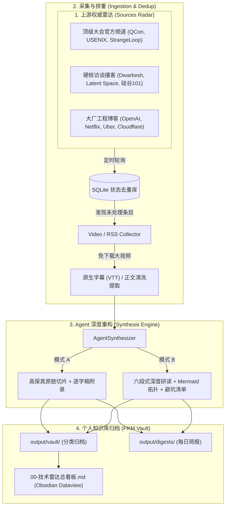

# TechRadar-to-Knowledge: 行业权威技术讲座与工程博客自动化研读中枢

> **开源自动化工作流**：专为 Agent 批量研读打造的端到端技术雷达系统。  
> 融合全球顶级技术峰会 (USENIX, QCon)、硬核 AI 播客 (Dwarkesh, Latent Space) 与知名科技大厂工程博客 (OpenAI, Netflix, Uber, Cloudflare)，自动执行**发现、增量去重、字幕秒级抓取、Agent 深度提炼与 Obsidian PKM 看板归档**。  
> 
> 🚨 **工作区纪律**：本项目工作区中 Agent 只负责按工作流执行任务，所有研读产物自动强一致同步至桌面 Agent 经验库：[`C:\Users\jiang\Desktop\开发经验\开发者经验分析-Agent`](file:///C:/Users/jiang/Desktop/开发经验/开发者经验分析-Agent)。

---

## 📋 工作区核心规范与协议

- **Agent 工作流执行协议**：[AGENTS.md](./AGENTS.md)
- **开发者经验分析与执行规范**：[开发者经验分析与Agent自动化执行规范.md](./开发者经验分析与Agent自动化执行规范.md)
- **桌面强一致同步引擎**：[sync_to_desktop.py](./sync_to_desktop.py) / [sync_to_desktop.ps1](./sync_to_desktop.ps1)

---

## 🌟 核心特性

1. **解决“缺乏视频/权威来源”的冷启动问题**：
   - 内置精心筛选的高权重内容池（涵盖 16+ 个世界级权威来源，自带全球 500+ 大厂工程博客标准 `engineering_blogs.opml`）。
2. **轻量极速摄取（Zero Heavy Video Download）**：
   - 针对 YouTube / B站 权威讲座，**优先秒级提取原生或自动生成的 VTT/SRT 字幕**，杜绝下载几个 GB 视频的带宽浪费与磁盘爆仓。
3. **严格遵守 `video-to-knowledge` 工业级研读规范**：
   - **模式 A【高保真原貌切片复刻档】**：零脑补，忠实提取时间戳章节切片与完整逐字稿附录。
   - **模式 B【六段式深度学习研读案】**：提炼全景时间轴 (Mermaid timeline)、系统拓扑时序 (Mermaid sequenceDiagram)、3大工业高危盲区、工程配置代码与准出自检清单 (Checklist)。
4. **Obsidian / Notion 原生知识库支持 (PKM-Native)**：
   - 所有产物均自带规范的 YAML Frontmatter，根目录自带开箱即用的 `00-技术雷达总看板.md`，支持 Obsidian Dataview 插件一键表格聚合。
5. **增量持久化与断点防重 (SQLite Deduplication)**：
   - 内置轻量级本地 SQLite 数据库，基于 URL SHA-256 指纹跟踪状态，保证不漏抓、不重复分析。
6. **无人值守自动化**：
   - 提供 Windows 计划任务一键安装脚本与 GitHub Actions 每日自动执行工作流。

---

## 🏗️ 架构拓扑图



---

## 🚀 快速上手

### 1. 环境准备与依赖安装
确保安装了 Python 3.8+，推荐安装基础依赖：
```bash
pip install -r requirements.txt
```
*(可选)* 若需要抓取 YouTube 自动字幕，确保系统已安装 `yt-dlp`（通过 `pip install yt-dlp` 或包管理器安装）。

### 2. 查看当前内置的权威来源列表
```bash
python cli.py list-sources
```
系统会格式化输出当前监控中的会议、播客与大厂博客（含权威度评分与分类）。

### 3. 一键运行自动化流水线
```bash
# 轮询所有源，每个源抓取最新 1 篇进行深度研读
python cli.py run --max-items 1
```

### 4. 查看知识库归档统计
```bash
python cli.py stats
```

### 5. 动态添加自定义内容源
如果你发现了一个优质的 YouTube 频道或技术播客：
```bash
python cli.py add-source --id "pod-acquired" --name "Acquired Podcast" --category podcast --feed-url "https://feeds.transistor.fm/acquired"
```

### 6. 导出所有源为标准 OPML
你可以将当前雷达的所有高质量源一键导出，并导入到任意 RSS 阅读器（如 NetNewsWire, Feedly, Inoreader, FreshRSS）：
```bash
python cli.py export-opml --output "output/my_tech_radar.opml"
```

---

## 📂 目录结构

```
tech-radar-pipeline/
├── config/
│   ├── sources.yaml            # 核心权威源配置表 (分类、权威分、URL)
│   └── pipeline_config.yaml    # 流水线运行配置 (模式、过滤阈值、路径)
├── sources/
│   └── engineering_blogs.opml  # 全球 500+ 大厂工程博客标准 OPML
├── pipeline/
│   ├── db.py                   # SQLite 状态去重与统计引擎
│   ├── collectors/             # 多源数据采集器
│   │   ├── rss_collector.py    # RSS / 播客音频 Enclosure 提取
│   │   ├── video_collector.py  # YouTube 视频字幕秒级抓取
│   │   └── web_cleaner.py      # 网页正文去噪清洗器
│   ├── synthesizer.py          # Agent 深度研读与重构引擎
│   └── pkm_exporter.py         # PKM 知识库归档与 Dataview 看板维护
├── scripts/
│   ├── setup_cron_task.ps1     # Windows 计划任务一键配置
│   └── ...
├── .github/workflows/
│   └── daily_radar.yml         # GitHub Actions 每日无人值守定时流水线
├── output/
│   ├── vault/                  # 产出的 Obsidian 笔记目录
│   │   └── 00-技术雷达总看板.md
│   └── digests/                # 每日汇编简报
├── cli.py                      # 统一命令行中枢
└── requirements.txt
```

---

## ⚙️ 接入外部 LLM (可选)

如果你希望由更强大的大模型进行深度逻辑推理，可以直接设置环境变量：
```bash
# Windows PowerShell
$env:GEMINI_API_KEY="your-gemini-api-key"
# 或
$env:OPENAI_API_KEY="your-openai-api-key"
```
若未设置任何 API Key，系统将自动无缝降级为**高保真启发式结构提炼引擎**，同样能输出标准的前置 YAML、Mermaid 时序拓扑与工业踩坑点，保障流水线稳定运行。
