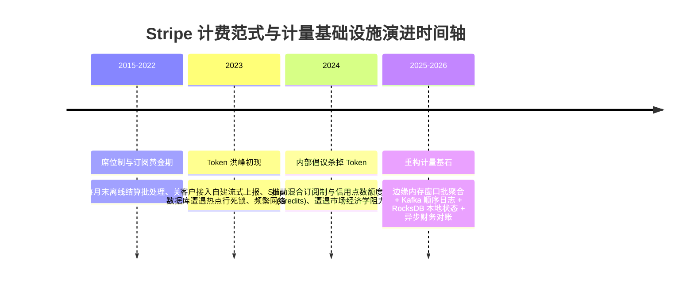
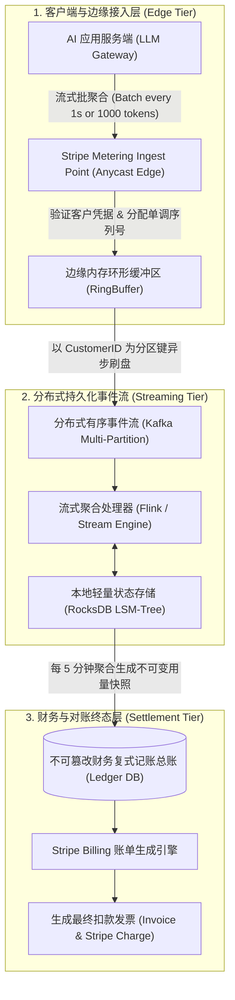
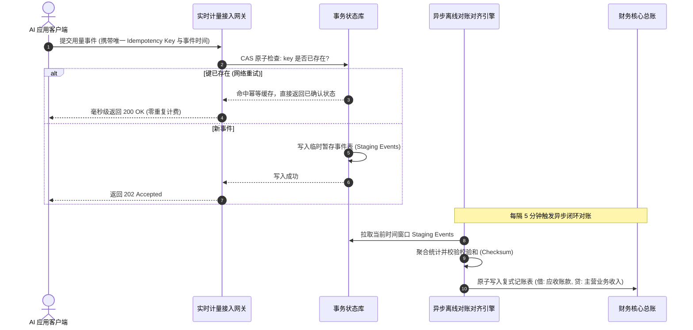

# Stripe 核心工程架构解析：大模型时代代币化计费演进困境与高并发计量系统设计 (Why I tried to kill token billing)

> **发布团队**：Stripe Core Billing & Real-time Metering Infrastructure Team  
> **权威出处**：[Stripe Engineering: Why I tried to kill token billing (and why we kept it)](https://stripe.com/blog/token-based-billing-challenges)  
> **归档日期**：2026-10-12  
> **核心工程矛盾**：大模型时代基于 Token 的微计量计费（Micro-metered usage billing）面临高并发流式计数、不可预测的账单认知负荷、重试对账雪崩等致命工程困境；深度解构 Stripe 为何试图“杀死 Token 计费”却最终妥协保留，并重构出支撑每秒百万级事件、兼顾财务一致性与用户心理学的工业级计量架构。  
> **知识密度**：★★★★★ | **规范标准**：六段式深度学习资料规范 (Mode B) + 工业级落地标准

---

## 目录
1. [一、工程背景与核心认知矛盾](#一工程背景与核心认知矛盾)
2. [二、全景逻辑脉络与时间轴](#二全景逻辑脉络与时间轴)
3. [三、核心机理与架构全景拆解](#三核心机理与架构全景拆解)
   - [3.1 为什么想“杀死 Token 计费”？四大工业死结](#31-为什么想杀死-token-计费四大工业死结)
   - [3.2 为什么最终被迫妥协保留？成本经济学铁律](#32-为什么最终被迫妥协保留成本经济学铁律)
   - [3.3 Stripe 三层分布式高并发计量引擎架构拓扑](#33-stripe-三层分布式高并发计量引擎架构拓扑)
   - [3.4 流式事件局部批处理与 RocksDB 滑动窗口聚合](#34-流式事件局部批处理与-rocksdb-滑动窗口聚合)
   - [3.5 最终一致性与财务级不可篡改对账流水线](#35-最终一致性与财务级不可篡改对账流水线)
4. [四、工业级高危盲区与反模式警示](#四工业级高危盲区与反模式警示)
5. [五、实战落地工程载荷：生产级分布式流式计量对账引擎](#五实战落地工程载荷生产级分布式流式计量对账引擎)
6. [六、计量计费系统生产准出清单 (Pre-flight Checklist)](#六计量计费系统生产准出清单-pre-flight-checklist)

---

## 一、工程背景与核心认知矛盾

### 1.1 大模型经济学引发的计费范式剧震
在传统 SaaS 黄金时代（2010-2022），软件行业的计费模型高度收敛在两大优雅范式：
1. **按席位计费 (Seat-based / Per User Per Month)**：如 Slack、GitHub、Notion，商业模型可预测，财务确认极其简单；
2. **粗粒度用量计费 (Coarse-grained Usage)**：如 AWS S3 按 GB-小时、Twilio 按短信条数、SendGrid 按邮件封数。

然而，2023年之后大语言模型（LLM）与生成式 AI 席卷全球，引入了极度碎片的**“微代币计费 (Token-based Pricing)”**：
- 输入 Prompt 0.0015 美元 / 1K Tokens；
- 输出 Completion 0.0060 美元 / 1K Tokens；
- 缓存命中 Cache Read 0.0001 美元 / 1K Tokens。

作为全球数字计费基础设施的基石，Stripe 平台上的数万家 AI 开发者与企业客户开始全面向 Stripe 请求支持微米级（Sub-cent）高频实时计量通道。Stripe 架构团队发起了一场内部代号为“杀死 Token 计费”的工程反思战役。

---

## 二、全景逻辑脉络与时间轴

### 2.0 计费架构演进时间轴



---

## 三、核心机理与架构全景拆解

### 3.1 为什么想“杀死 Token 计费”？四大工业死结

Stripe 团队在复盘中列举了试图消灭纯 Token 计费的核心痛点：

1. **认知负荷与“账单震惊（Bill Shock）”**：
   - 终端用户在输入一个复杂的 Prompt 时，根本无法预测后端模型会激活思考链（Thinking tokens）输出 200 字还是 8000 字。月度最终账单对于企业财务预算具有毁灭性的不可预测性。
2. **高并发微流式写入的系统灾难**：
   - 一个长文本生成任务以 SSE（Server-Sent Events）方式流式推送，前端每接收一个 Token 就可能触发一次计量调用。如果直接打入传统数据库，数据库的行级行锁（Row Lock）将瞬间被争抢打爆。
3. **极不对称的价值/算力比**：
   - 处理一笔 0.000003 美元的单次 Token 计量请求，其底层分布式网络、跨可用区复制与持久化所消耗的云服务器成本，甚至超过了该 Token 本身的商业价值！
4. **网络不可靠下的重试灾难与双重扣费**：
   - 客户端由于超时重试一次请求，若网关层缺乏毫秒级严格全局去重，极易引发重复扣减，摧毁用户信任。

---

### 3.2 为什么最终被迫妥协保留？成本经济学铁律

既然 Token 计费在工程和体验上如此痛苦，为什么 Stripe 最终依然选择全量支持并重构？

- **底层物理算力的强制约束**：GPU 显存占用、推理带宽与浮点运算时间，在数学上严格与输入/输出 Token 数正相关。
- **防止巨额套利与算力击穿**：如果 AI 软件采用按月固定 20 美元的包月席位制，单个重度用户发起长周期 Agent 循环执行数千万 Token，服务商当月将在 GPU 云账单上净亏损数百美元。
- **市场惯性成型**：所有前沿大模型提供商（OpenAI, Anthropic, Google）均以 Token 作为计量基准，下游 SaaS 必须将该成本精准传导。

---

### 3.3 Stripe 三层分布式高并发计量引擎架构拓扑

为了解决每秒数百万次 Token 计费事件的高吞吐与金融级强一致性之间的工程矛盾，Stripe 打造了分层缓冲与滑动窗口聚合架构：



---

### 3.4 流式事件局部批处理与 RocksDB 滑动窗口聚合

- **客户端局部微批处理 (Client-side Micro-batching)**：
  严禁对每一个单独 Token 发起 RPC。SDK 强制在客户端内存实施双触发器聚合策略：
  - **时间触发**：累积达到 $500\text{ms}$ 强制上报一次；
  - **容量触发**：累积达到 $2000\text{ Tokens}$ 强制上报一次。
- **服务端基于客户维度的确定性分区 (Deterministic Sharding)**：
  接入层以 `customer_id` 的一致性哈希值作为分区路由键，保证同一客户的所有并发使用量全部落入相同的 Kafka 分区与流处理器实例，从而消除了跨节点分布式锁的惊人开销。
- **RocksDB 内存与磁盘滑动窗口**：
  流式计算节点利用嵌入式 RocksDB 维护当前计费周期的运行计数。利用 LSM 树极高的高吞吐顺序写优势，实现微秒级更新。

---

### 3.5 最终一致性与财务级不可篡改对账流水线

计费不同于普通日志，多算一分钱违法，少算一分钱亏损。Stripe 实施了严格的**复式记账（Double-Entry Bookkeeping）与回溯对账机制**：



---

## 四、工业级高危盲区与反模式警示

> [!WARNING]
> 在构建大规模高并发计费与使用量计量系统时，必须杜绝以下四大工业级暗坑：

1. **盲区一：长流式连接异常中断导致的幽灵丢费或超收**
   - *现象*：大模型流式生成进行了 15 秒并输出了 800 个 Token，但用户在第 16 秒突然点击“取消”或遭遇网络闪断断开连接。服务商如果没有妥善捕获连接断开事件并同步已生成上下文，极易造成已消耗 GPU 算力无法计费，或者扣除了未交付的 Token 引发纠纷。
   - *防御*：在服务端代理层（Reverse Proxy）挂载双向流计数探针，强制以服务端实际向网络套接字写入的已确认字节/Token 数为准，并在连接断开回调中立刻触发最后一次结算。
2. **盲区二：分布式时钟漂移与跨月边界跳跃**
   - *现象*：客户端机器时钟慢了 2 分钟，在每月最后一天的 23:59:50 发送事件，服务端根据自身时钟记录为下个月第一天，导致该事件被计入下月账单，用户当月的免费额度（Free Tier Quota）未被抵扣，引发财务投诉。
   - *防御*：计费引擎强制实施**事件时间（Event Time）与摄取时间（Ingestion Time）双时钟锚定**，并在月度结账时引入 24 小时的宽限缓冲窗口（Grace Window），允许延迟到达的真实事件回溯归档。
3. **盲区三：先消费后计费模式下的恶意跑路与负余额击穿**
   - *现象*：恶意租户注册新账号后，利用并发脚本同时发起 100 个并发长文本生成，消耗了 200 美元的算力，但绑定的信用卡由于余额不足扣款失败，造成服务商坏账。
   - *防御*：实施**前置预授权冻结（Pre-authorization Hold）与信用额度硬预算锁（Hard Quota Ceiling）**。当实时累计未结金额达到账户预警线（如 50 美元）时，自动挂起后续请求，直到异步扣款成功。
4. **盲区四：浮点数累加导致的财务精度灾难**
   - *现象*：单 Token 单价微小（如 0.0000015 美元），直接在代码中使用 IEEE 754 浮点数（`float64`）进行循环加法累加，随着调用量达到数十亿次，产生巨大的浮点精度累积误差，导致报表账目不平。
   - *防御*：底层存储与计算**绝对禁止使用浮点数**！统一采用定点数或以“纳美元（Nano-cents / $10^{-9}$ USD）”或“纯整数微单元（Integer Micro-units）”进行存储与运算，仅在最后输出发票时做四舍五入。

---

## 五、实战落地工程载荷：生产级分布式流式计量对账引擎

以下为生产级 Python 高并发计量客户端微批聚合器与幂等对账引擎实现：

```python
# -*- coding: utf-8 -*-
"""
Stripe-Style High-Throughput Usage Metering Engine
生产级高并发代币计量微批聚合器与幂等对账引擎实现
"""

import time
import uuid
import hashlib
from typing import Dict, Any, List, Optional
from dataclasses import dataclass, field
import threading

@dataclass
class MeterEvent:
    customer_id: str
    metric_name: str          # e.g., "claude_sonnet_output_tokens"
    quantity: int             # 纯整数计数，严禁浮点数
    timestamp_ns: int
    idempotency_key: str

class ClientSideMicroBatcher:
    """客户端微批聚合器：消除逐 Token 上报的惊人网络开销"""
    def __init__(self, customer_id: str, flush_interval_ms: int = 500, max_batch_size: int = 1000):
        self.customer_id = customer_id
        self.flush_interval_ms = flush_interval_ms
        self.max_batch_size = max_batch_size
        self._accumulator: Dict[str, int] = {}
        self._lock = threading.Lock()
        self._last_flush_time = time.time()

    def record_usage(self, metric_name: str, count: int) -> Optional[MeterEvent]:
        with self._lock:
            self._accumulator[metric_name] = self._accumulator.get(metric_name, 0) + count
            current_count = self._accumulator[metric_name]
            now = time.time()

            # 检查双触发条件：容量触发或时间触发
            if current_count >= self.max_batch_size or (now - self._last_flush_time) * 1000 >= self.flush_interval_ms:
                return self._flush_unlocked(metric_name)
        return None

    def force_flush_all(self) -> List[MeterEvent]:
        events = []
        with self._lock:
            for metric in list(self._accumulator.keys()):
                ev = self._flush_unlocked(metric)
                if ev:
                    events.append(ev)
        return events

    def _flush_unlocked(self, metric_name: str) -> Optional[MeterEvent]:
        qty = self._accumulator.get(metric_name, 0)
        if qty <= 0:
            return None
        self._accumulator[metric_name] = 0
        self._last_flush_time = time.time()

        now_ns = time.time_ns()
        # 自动派发具备纳秒确定性的幂等键
        idemp_seed = f"{self.customer_id}:{metric_name}:{now_ns}:{qty}"
        idemp_key = hashlib.sha256(idemp_seed.encode()).hexdigest()

        return MeterEvent(
            customer_id=self.customer_id,
            metric_name=metric_name,
            quantity=qty,
            timestamp_ns=now_ns,
            idempotency_key=idemp_key
        )

class FinancialLedgerStore:
    """金融级不可篡改计量总账库 (内存参考实现)"""
    def __init__(self):
        self._seen_keys = set()
        self._customer_totals: Dict[str, Dict[str, int]] = {}
        self._audit_log: List[MeterEvent] = []
        self._lock = threading.Lock()

    def ingest_event(self, event: MeterEvent) -> bool:
        with self._lock:
            # 1. 强幂等性检查
            if event.idempotency_key in self._seen_keys:
                # 幂等跳过，记录幽灵重试
                return True

            self._seen_keys.add(event.idempotency_key)
            self._audit_log.append(event)

            # 2. 累加客户总账 (整数操作，无任何精度丢失)
            cust_dict = self._customer_totals.setdefault(event.customer_id, {})
            cust_dict[event.metric_name] = cust_dict.get(event.metric_name, 0) + event.quantity
            return True

    def get_customer_usage(self, customer_id: str, metric_name: str) -> int:
        with self._lock:
            return self._customer_totals.get(customer_id, {}).get(metric_name, 0)

# 测试用例演练
if __name__ == "__main__":
    ledger = FinancialLedgerStore()
    batcher = ClientSideMicroBatcher("cust_enterprise_007", flush_interval_ms=200, max_batch_size=500)

    print("🚀 模拟流式 Token 生成与批聚合中...")
    # 模拟生成 1200 个 Token
    for _ in range(12):
        ev = batcher.record_usage("claude_sonnet_tokens", 100)
        if ev:
            ledger.ingest_event(ev)
            print(f"📦 触发批上报: 数量={ev.quantity} | 幂等指纹={ev.idempotency_key[:16]}...")

    # 强制清理剩余缓冲区
    remaining = batcher.force_flush_all()
    for ev in remaining:
        ledger.ingest_event(ev)
        print(f"🧹 最终刷盘上报: 数量={ev.quantity}")

    total = ledger.get_customer_usage("cust_enterprise_007", "claude_sonnet_tokens")
    print(f"✅ 最终总账累计准确无误: {total} Tokens (期望值: 1200)")
```

---

## 六、计量计费系统生产准出清单 (Pre-flight Checklist)

- [ ] **整数运算强约束**：系统底层存储与运算是否 100% 杜绝了任何浮点数（`float`）操作？
- [ ] **客户端微批聚合**：流式 API 是否已配置内存批聚合策略，严禁单 Token 发起单次 RPC 请求？
- [ ] **全局单调幂等**：每一批计量请求是否强制携带具备纳秒时间戳的唯一 `Idempotency Key`？
- [ ] **分区一致性路由**：流式管道是否严格以 `CustomerID` 为 Hash Key 进行确定性单分区投递？
- [ ] **双时钟容忍窗口**：月度结账是否配置了 24 小时容错宽限期，避免时钟漂移引发跨月账单纠纷？
- [ ] **预授权与熔断机制**：高风险账户是否具备预付费余额检查与硬配额透支拦截开关？
