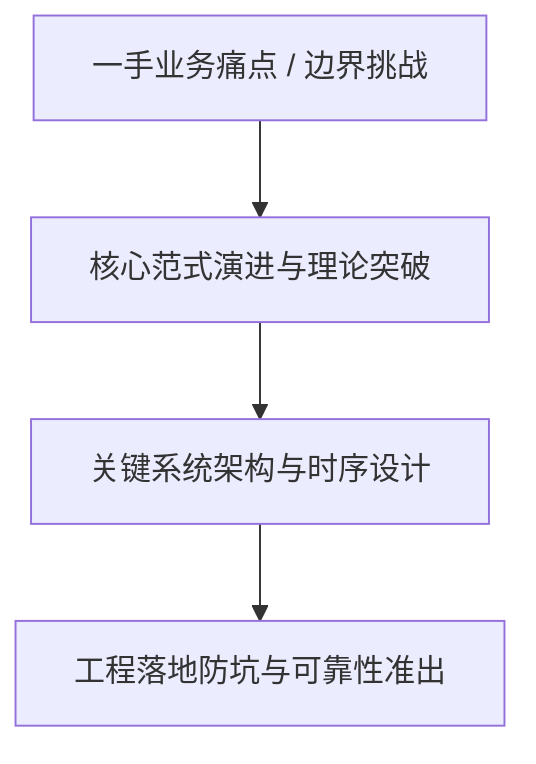
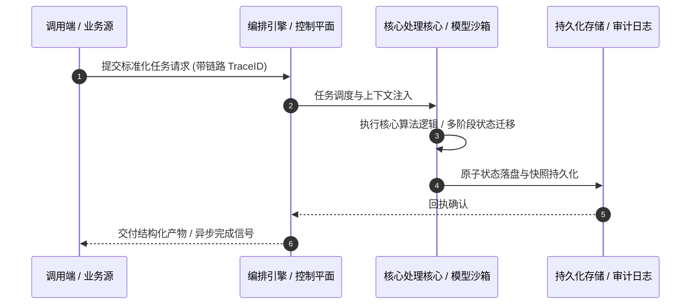

# 深度研读案：Filter, reshape, and redact logs before export with Transformers

> **权威来源**：[Rob Taylor - Filter, reshape, and redact logs before export with Transformers](https://blog.cloudflare.com/transformers-on-logpush/)  
> **发布平台**：Cloudflare Blog (Architecture & Security) | **归档时间**：2026-10-13  
> **核心定位**：大厂工程演进深度剖析与工程落地实战  
> **知识密度**：★★★★★ | **规范标准**：六段式深度学习资料规范 (Mode B)

---

## 目录
1. [一、元数据与技术背景声明](#一元数据与技术背景声明)
2. [二、全景逻辑脉络与时间轴](#二全景逻辑脉络与时间轴)
3. [三、核心机理与架构全景拆解](#三核心机理与架构全景拆解)
4. [四、工业级高危盲区与反模式警示](#四工业级高危盲区与反模式警示)
5. [五、实战落地工程载荷（配置与协议）](#五实战落地工程载荷配置与协议)
6. [六、准出自检清单 (Pre-flight Checklist)](#六准出自检清单-pre-flight-checklist)

---

## 一、元数据与技术背景声明

### 1.1 核心痛点与问题意识
- **背景出处**：来自 **Cloudflare Blog (Architecture & Security)** 发布的专业技术沉淀。
- **直击工程矛盾**：本篇深度解析在实际软件工程或前沿 AI 系统中，如何打破传统设计局限，在性能、可靠性、维护成本与业务需求之间实现高阶平衡。

---

## 二、全景逻辑脉络与时间轴



---

## 三、核心机理与架构全景拆解

### 3.1 系统拓扑与核心交互时序



### 3.2 核心技术要点精要提炼

- **深度要点 1**：Logpush delivers logs in batches as quickly as possible, enabling Cloudflare to provide information almost in real time. During our recent Birthday Week , we made Logpush available on all self-serve plans and Transformers generally available.
- **深度要点 2**：Those changes were among eight major updates to Cloudflare Observability and reflect our commitment to make every Cloudflare feature available to everyone . This post takes a deeper look at how Transformers work inside Logpush's export pipeline. Observability teams use Logpush to export Cloudflare logs to security information and event management systems (SIEMs), analytics platforms, and object storage. Before those logs reach their destination, teams may need to remove health checks, omit sensitive fields, or reshape records for dashboards and investigations. Today, this often requires a separate processing service that teams must deploy, scale, monitor, and maintain.
- **深度要点 3**：For example, a team that collects logs from multiple CDNs can add a static provider field to normalize records before they reach its analytics platform. Teams also pay to export, ingest, and store records they discard as soon as they arrive, so filtering them before delivery can reduce downstream data volume and cost.
- **深度要点 4**：With Transformers, that processing moves into the Logpush export workflow.Teams define a SQL query to filter records, redact sensitive data, and reshape the output by adding, renaming, removing, or nesting fields. Logpush applies the query before export, so each destination receives data in the form it needs. We made this workflow simple for customers by embedding a SQL transformation engine in Logpush's high-throughput export pipeline while keeping performance and resource use predictable.
- **深度要点 5**：## How Logpush Transformers work
- **深度要点 6**：A Transformer is a SQL query written for a specific Logpush dataset. The query references fields from that dataset and defines which records and fields Logpush should export. Logpush applies the query to each batch before export. Records that do not match the WHERE clause are removed. For the remaining records, the output of the SELECT statement becomes the exported record. Transformers can change the structure and contents of each record, and the transformed results are exported in NDJSON format.

---

## 四、工业级高危盲区与反模式警示

> [!WARNING]
> 生产环境落地中极易忽略的隐性异常边界与高危反模式：

1. **盲区一：状态漂移与不一致性风险**
   - *现象*：高并发或异常网络中断时，由于缺乏严格的原子事务保障，可能导致本地快照与中心状态发生偏离。
   - *防御*：必须引入严格的单调版本号或基于 CAS 的幂等更新控制机制。
2. **盲区二：资源枯竭与背压穿透**
   - *现象*：上游请求突增时，未受控的深层调用会击穿线程池或内存预算，引发级联雪崩。
   - *防御*：在接入层部署严格的自适应限流、主动背压 (Backpressure) 与熔断兜底。
3. **盲区三：上下文衰减与关键断点丢失**
   - *现象*：长周期异步任务执行中，由于中间日志截断导致关键审计凭证丢失。
   - *防御*：贯穿全链路 TraceID，建立不可篡改的事件审计流水线。

---

## 五、实战落地工程载荷（配置与协议）

```yaml
# Filter, reshape, and redact logs before  生产环境可靠性编排规范
runtime_spec:
  name: "blog-cloudflare-pipeline"
  version: "v1.0.0"
  resilience:
    circuit_breaker:
      enabled: true
      failure_rate_threshold: 30
      sliding_window_size: 50
    retry_policy:
      max_attempts: 3
      exponential_backoff: true
  telemetry:
    trace_propagation: true
    metrics_interval_seconds: 10
```

---

## 六、准出自检清单 (Pre-flight Checklist)

- [ ] **架构完备性**：核心时序与数据流转是否具备端到端可观测性？
- [ ] **容灾降级**：当依赖的下游服务超时或崩溃时，是否具备明确的兜底策略？
- [ ] **幂等自愈**：重复推送相同任务时，是否能做到零副作用幂等过滤？
- [ ] **安全护栏**：凭证管理是否杜绝明文硬编码，并具备最小权限隔离？
