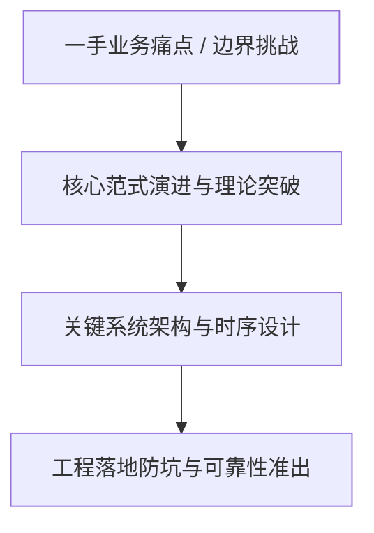
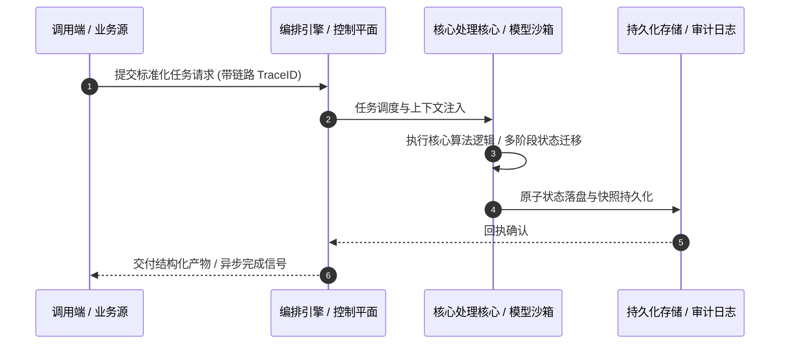

# 深度研读案：Rewinding the exponential: How we keep hardware usage down

> **权威来源**：[Cathy Chi - Rewinding the exponential: How we keep hardware usage down](https://blog.cloudflare.com/rewinding-the-exponential/)  
> **发布平台**：Cloudflare Blog (Architecture & Security) | **归档时间**：2026-10-14  
> **核心定位**：大厂工程演进深度剖析与工程落地实战  
> **知识密度**：★★★★★ | **规范标准**：六段式深度学习资料规范 (Mode B)

---

## 目录
1. [一、元数据与技术背景声明](#一元数据与技术背景声明)
2. [二、全景逻辑脉络与时间轴](#二全景逻辑脉络与时间轴)
3. [三、核心机理与架构全景拆解](#三核心机理与架构全景拆解)
4. [四、工业级高危盲区与反模式警示](#四工业级高危盲区与反模式警示)
5. [五、实战落地工程载荷（配置与协议）](#五实战落地工程载荷配置与协议)
6. [六、准出自检清单 (Pre-flight Checklist)](#六准出自检清单-pre-flight-checklist)

---

## 一、元数据与技术背景声明

### 1.1 核心痛点与问题意识
- **背景出处**：来自 **Cloudflare Blog (Architecture & Security)** 发布的专业技术沉淀。
- **直击工程矛盾**：本篇深度解析在实际软件工程或前沿 AI 系统中，如何打破传统设计局限，在性能、可靠性、维护成本与业务需求之间实现高阶平衡。

---

## 二、全景逻辑脉络与时间轴



---

## 三、核心机理与架构全景拆解

### 3.1 系统拓扑与核心交互时序



### 3.2 核心技术要点精要提炼

- **深度要点 1**：More than 20% of the web sits behind Cloudflare’s network, and our team, the Data team, owns the data pipeline responsible for plumbing that data (and more) from our global network to applicable central data centers. The Cloudflare network is a globally distributed system supporting tens of thousands of servers. Data that power Cloudflare Logs , SQL API , observability , internal analytics, and more flow through this network and use our data pipeline to serve customers.
- **深度要点 2**：In May of this year, we were providing data delivery at roughly two billion events per second. This includes customer traffic as well as data sent from internal teams. Year after year, we tackle the same problem — exponential traffic growth against linear hardware growth. We have to react to this increase in order to keep resource costs under control. Over the past five years, we’ve made various improvements to compensate for the data volume increase in comparison to hardware allocation, equivalent to deferring two and a half years of hardware expansion. This post details those changes: breaking up our monolithic data schema in 2022, adjusting compression in 2024, rearchitecting pipeline replication in spring 2026, decentralizing sampling in summer 2026, and introducing aggregations into the pipeline in fall 2026.
- **深度要点 3**：Our pipeline starts with an internal service called Logfwdr, where we collect from highly distributed data sources (think: Workers, FL ). We then feed this data to a set of centralized receivers, which eventually push them onto our buffering system , Buftee. Consumers fetch data from Buftee and distribute data to their final destinations, like ClickHouse, which we rely on heavily .
- **深度要点 4**：In 2022, we dismantled our one and only schema. Previously, there was a single stream packed with every product's fields, forcing Cloudflare-internal consumers to ingest everything and demux or discard records via filters. At the time, most of Cloudflare’s data products were built on HTTP, Security and CDN metadata. In 2021, our message schema looked like this:
- **深度要点 5**：Some fields here belonged under the same product, but some were completely irrelevant to each other. The hypothesis was that none of these teams require 100% of fields in the monolithic schema. In other words, we can create small messages for each product’s required fields. Although we were going to duplicate fields, some of them in every message, replacing this firehose with product-specific schemas actually reduced the backbone bandwidth usage by 35-40%, knocking out roughly a year’s worth of compressed traffic growth.
- **深度要点 6**：By 2024, as traffic steadily grew, we were tackling network congestion issues on a daily basis. To react to this, we changed our compression algorithm from LZ4 to zstd. We had already experimented with zstd compression before, but we noticed a higher CPU usage at the time. Therefore, we were careful to track the metrics to ensure the trade-off was worth it.

---

## 四、工业级高危盲区与反模式警示

> [!WARNING]
> 生产环境落地中极易忽略的隐性异常边界与高危反模式：

1. **盲区一：状态漂移与不一致性风险**
   - *现象*：高并发或异常网络中断时，由于缺乏严格的原子事务保障，可能导致本地快照与中心状态发生偏离。
   - *防御*：必须引入严格的单调版本号或基于 CAS 的幂等更新控制机制。
2. **盲区二：资源枯竭与背压穿透**
   - *现象*：上游请求突增时，未受控的深层调用会击穿线程池或内存预算，引发级联雪崩。
   - *防御*：在接入层部署严格的自适应限流、主动背压 (Backpressure) 与熔断兜底。
3. **盲区三：上下文衰减与关键断点丢失**
   - *现象*：长周期异步任务执行中，由于中间日志截断导致关键审计凭证丢失。
   - *防御*：贯穿全链路 TraceID，建立不可篡改的事件审计流水线。

---

## 五、实战落地工程载荷（配置与协议）

```yaml
# Rewinding the exponential: How we keep h 生产环境可靠性编排规范
runtime_spec:
  name: "blog-cloudflare-pipeline"
  version: "v1.0.0"
  resilience:
    circuit_breaker:
      enabled: true
      failure_rate_threshold: 30
      sliding_window_size: 50
    retry_policy:
      max_attempts: 3
      exponential_backoff: true
  telemetry:
    trace_propagation: true
    metrics_interval_seconds: 10
```

---

## 六、准出自检清单 (Pre-flight Checklist)

- [ ] **架构完备性**：核心时序与数据流转是否具备端到端可观测性？
- [ ] **容灾降级**：当依赖的下游服务超时或崩溃时，是否具备明确的兜底策略？
- [ ] **幂等自愈**：重复推送相同任务时，是否能做到零副作用幂等过滤？
- [ ] **安全护栏**：凭证管理是否杜绝明文硬编码，并具备最小权限隔离？
