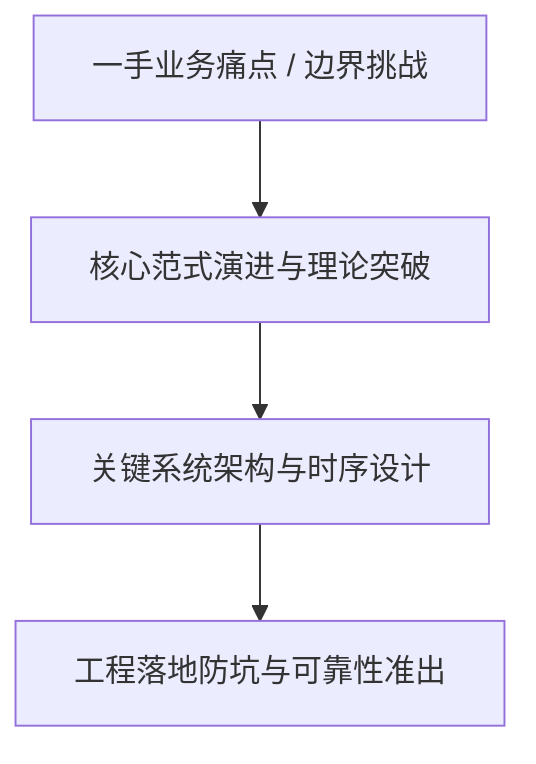
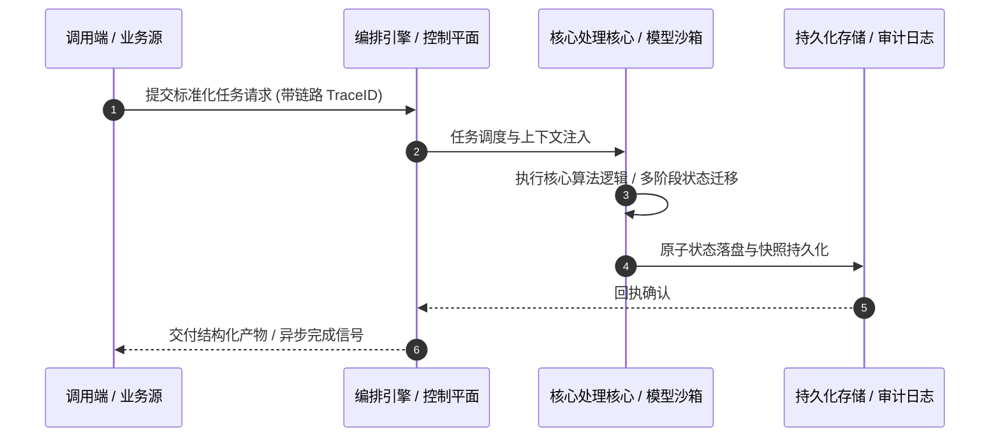

# 深度研读案：DataJunction as Netflix’s answer to the missing piece of the modern data stack

> **权威来源**：[Netflix Technology Blog - DataJunction as Netflix’s answer to the missing piece of the modern data stack](https://netflixtechblog.com/datajunction-as-netflixs-answer-to-the-missing-piece-of-the-modern-data-stack-92af926b40a5?source=rss----2615bd06b42e---4)  
> **发布平台**：Netflix TechBlog | **归档时间**：2026-10-15  
> **核心定位**：大厂工程演进深度剖析与工程落地实战  
> **知识密度**：★★★★★ | **规范标准**：六段式深度学习资料规范 (Mode B)

---

## 目录
1. [一、元数据与技术背景声明](#一元数据与技术背景声明)
2. [二、全景逻辑脉络与时间轴](#二全景逻辑脉络与时间轴)
3. [三、核心机理与架构全景拆解](#三核心机理与架构全景拆解)
4. [四、工业级高危盲区与反模式警示](#四工业级高危盲区与反模式警示)
5. [五、实战落地工程载荷（配置与协议）](#五实战落地工程载荷配置与协议)
6. [六、准出自检清单 (Pre-flight Checklist)](#六准出自检清单-pre-flight-checklist)

---

## 一、元数据与技术背景声明

### 1.1 核心痛点与问题意识
- **背景出处**：来自 **Netflix TechBlog** 发布的专业技术沉淀。
- **直击工程矛盾**：本篇深度解析在实际软件工程或前沿 AI 系统中，如何打破传统设计局限，在性能、可靠性、维护成本与业务需求之间实现高阶平衡。

---

## 二、全景逻辑脉络与时间轴



---

## 三、核心机理与架构全景拆解

### 3.1 系统拓扑与核心交互时序



### 3.2 核心技术要点精要提炼

- **深度要点 1**：by Olek Gorajek , Samuel Redai , Yian Shang
- **深度要点 2**：Our Netflix journey from data to dashboards, particularly within the space of the experimentation platform, always presented a unique set of challenges. This blog post aims to illuminate these hurdles and explain how an innovative open-source metric platform became instrumental in overcoming some of them. We’ll showcase the critical role that DataJunction played in streamlining our data workflows and enhancing our ability to derive meaningful insights from our vast datasets.
- **深度要点 3**：Metrics are the foundation of data-driven decision-making, but at many organizations, they are scattered, inconsistently defined, and difficult to discover or trust. At Netflix, this challenge first became apparent in our experimentation platform, where reliable metrics are essential for interpreting test results. But the complexity of the original tooling made it very difficult to understand and introspect these metrics both in terms of their definitions as well as their values.
- **深度要点 4**：Scattered metric definitions, redundant datasets, and pipelines are often a natural effect of a fast-moving company with a large and powerful analytical workforce. This is a common problem in big data-driven firms, and it is not easy to solve across multiple departments, which are often governed by somewhat different rules and regulations. An easy-to-use, well-governed, and centralized semantic layer can help with these issues. Our initial problem was most evident in our Experimentation Platform team, where the previous system required: -  extensive business knowledge -  familiarity with experimentation conventions -  and complex engineering practices
- **深度要点 5**：This led to metric authoring processes that would take weeks, which was a prohibitive requirement for Data Scientists and Analytics Engineers who wanted to onboard new metrics to the Experimentation Platform.
- **深度要点 6**：To address this problem and to set ourselves on the path to a successful semantic layer solution in the future, we looked at several candidates. Among other solutions we evaluated Mando (an internal framework), Minerva (an open source semantic layer from AirBnB), and DataJunction (another open source solution, “DJ” for short). All of them had some strength, but DJ offered one thing that the others did not at the time: a solid SQL parsing and SQL generation engine. At the time of the POC, DJ was also the only open-source solution that stored all its definitions in a connected graph, similar to how relational databases store metadata on their views and queries. Easy “SQL wrangling” with rich metadata was the main feature that convinced us to try it for our immediate use case.

---

## 四、工业级高危盲区与反模式警示

> [!WARNING]
> 生产环境落地中极易忽略的隐性异常边界与高危反模式：

1. **盲区一：状态漂移与不一致性风险**
   - *现象*：高并发或异常网络中断时，由于缺乏严格的原子事务保障，可能导致本地快照与中心状态发生偏离。
   - *防御*：必须引入严格的单调版本号或基于 CAS 的幂等更新控制机制。
2. **盲区二：资源枯竭与背压穿透**
   - *现象*：上游请求突增时，未受控的深层调用会击穿线程池或内存预算，引发级联雪崩。
   - *防御*：在接入层部署严格的自适应限流、主动背压 (Backpressure) 与熔断兜底。
3. **盲区三：上下文衰减与关键断点丢失**
   - *现象*：长周期异步任务执行中，由于中间日志截断导致关键审计凭证丢失。
   - *防御*：贯穿全链路 TraceID，建立不可篡改的事件审计流水线。

---

## 五、实战落地工程载荷（配置与协议）

```yaml
# DataJunction as Netflix’s answer to the  生产环境可靠性编排规范
runtime_spec:
  name: "blog-netflix-pipeline"
  version: "v1.0.0"
  resilience:
    circuit_breaker:
      enabled: true
      failure_rate_threshold: 30
      sliding_window_size: 50
    retry_policy:
      max_attempts: 3
      exponential_backoff: true
  telemetry:
    trace_propagation: true
    metrics_interval_seconds: 10
```

---

## 六、准出自检清单 (Pre-flight Checklist)

- [ ] **架构完备性**：核心时序与数据流转是否具备端到端可观测性？
- [ ] **容灾降级**：当依赖的下游服务超时或崩溃时，是否具备明确的兜底策略？
- [ ] **幂等自愈**：重复推送相同任务时，是否能做到零副作用幂等过滤？
- [ ] **安全护栏**：凭证管理是否杜绝明文硬编码，并具备最小权限隔离？
