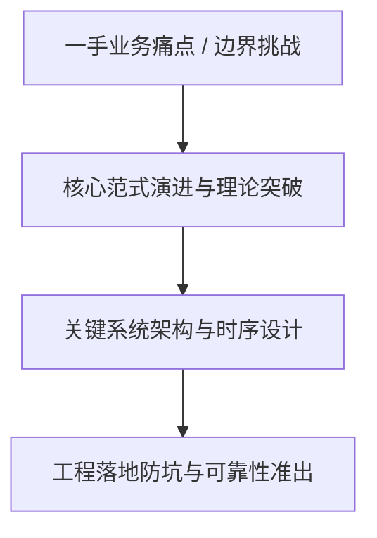
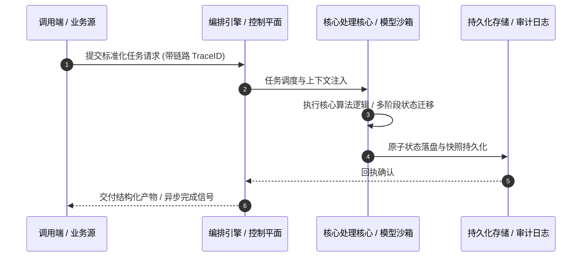

# 深度研读案：A fully programmable secure web gateway

> **权威来源**：[AJ Gerstenhaber - A fully programmable secure web gateway](https://blog.cloudflare.com/programmable-gateway-dlp/)  
> **发布平台**：Cloudflare Blog (Architecture & Security) | **归档时间**：2026-10-16  
> **核心定位**：大厂工程演进深度剖析与工程落地实战  
> **知识密度**：★★★★★ | **规范标准**：六段式深度学习资料规范 (Mode B)

---

## 目录
1. [一、元数据与技术背景声明](#一元数据与技术背景声明)
2. [二、全景逻辑脉络与时间轴](#二全景逻辑脉络与时间轴)
3. [三、核心机理与架构全景拆解](#三核心机理与架构全景拆解)
4. [四、工业级高危盲区与反模式警示](#四工业级高危盲区与反模式警示)
5. [五、实战落地工程载荷（配置与协议）](#五实战落地工程载荷配置与协议)
6. [六、准出自检清单 (Pre-flight Checklist)](#六准出自检清单-pre-flight-checklist)

---

## 一、元数据与技术背景声明

### 1.1 核心痛点与问题意识
- **背景出处**：来自 **Cloudflare Blog (Architecture & Security)** 发布的专业技术沉淀。
- **直击工程矛盾**：本篇深度解析在实际软件工程或前沿 AI 系统中，如何打破传统设计局限，在性能、可靠性、维护成本与业务需求之间实现高阶平衡。

---

## 二、全景逻辑脉络与时间轴



---

## 三、核心机理与架构全景拆解

### 3.1 系统拓扑与核心交互时序



### 3.2 核心技术要点精要提炼

- **深度要点 1**：Every secure web gateway on the market works the same way: traffic matches a condition. A terminal action fires. Allow, Block, Isolate, Log. This model has been the foundation of network security for nearly 30 years, and it handles the common case well. But it has a ceiling, and customers with complex environments hit that ceiling regularly.
- **深度要点 2**：Earlier this year, we shared our vision to build a truly programmable SASE platform . We also outlined how the term programmability has become diluted by the security industry. Most vendors claim programmability because they have public APIs, Terraform providers, webhooks, and alerting. Cloudflare offers all of those things too, but that’s not enough. True programmability means running your own code — arbitrary logic that you wrote for your specific environment — inline in the policy evaluation path, at the moment a security decision is made.
- **深度要点 3**：Today, we’re excited to announce Cloudflare is bringing true programmability to Cloudflare Gateway and DLP (Data Loss Prevention) by integrating it with the entirety of our edge computing platform. We are releasing a new type of Gateway action, Forward , and custom validation functions, available to all Zero Trust plans. These capabilities allow you to use a Cloudflare Worker to transform and manipulate traffic, or to bring your own data to policy evaluation.
- **深度要点 4**：## The trade-off that every security team faces
- **深度要点 5**：For as long as firewalls have existed, businesses have faced a binary choice. You can maintain your own security detection engine — your own firewall, your own proxy infrastructure — with high maintenance overhead and low portability, in exchange for maximum customization. Or, you can accept the constraints of a vendor, offloading the considerable maintenance cost, at the expense of flexibility to solve problems specific to your environment.
- **深度要点 6**：In six years of building Cloudflare Gateway, we have heard from thousands of customers struggling with this trade-off. A security team migrating access controls for a critical internal application needs to inject HTTP headers based on JSON Web Token (JWT) claims from their identity provider. The data exists in the request context, but Gateway cannot read the JWT and write the header. So the team stands up a pool of NGINX proxies solely to perform this transformation. That infrastructure now must be patched, monitored, and secured... indefinitely.

---

## 四、工业级高危盲区与反模式警示

> [!WARNING]
> 生产环境落地中极易忽略的隐性异常边界与高危反模式：

1. **盲区一：状态漂移与不一致性风险**
   - *现象*：高并发或异常网络中断时，由于缺乏严格的原子事务保障，可能导致本地快照与中心状态发生偏离。
   - *防御*：必须引入严格的单调版本号或基于 CAS 的幂等更新控制机制。
2. **盲区二：资源枯竭与背压穿透**
   - *现象*：上游请求突增时，未受控的深层调用会击穿线程池或内存预算，引发级联雪崩。
   - *防御*：在接入层部署严格的自适应限流、主动背压 (Backpressure) 与熔断兜底。
3. **盲区三：上下文衰减与关键断点丢失**
   - *现象*：长周期异步任务执行中，由于中间日志截断导致关键审计凭证丢失。
   - *防御*：贯穿全链路 TraceID，建立不可篡改的事件审计流水线。

---

## 五、实战落地工程载荷（配置与协议）

```yaml
# A fully programmable secure web gateway 生产环境可靠性编排规范
runtime_spec:
  name: "blog-cloudflare-pipeline"
  version: "v1.0.0"
  resilience:
    circuit_breaker:
      enabled: true
      failure_rate_threshold: 30
      sliding_window_size: 50
    retry_policy:
      max_attempts: 3
      exponential_backoff: true
  telemetry:
    trace_propagation: true
    metrics_interval_seconds: 10
```

---

## 六、准出自检清单 (Pre-flight Checklist)

- [ ] **架构完备性**：核心时序与数据流转是否具备端到端可观测性？
- [ ] **容灾降级**：当依赖的下游服务超时或崩溃时，是否具备明确的兜底策略？
- [ ] **幂等自愈**：重复推送相同任务时，是否能做到零副作用幂等过滤？
- [ ] **安全护栏**：凭证管理是否杜绝明文硬编码，并具备最小权限隔离？
