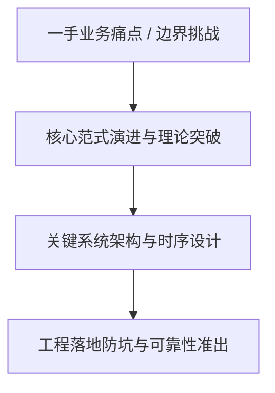
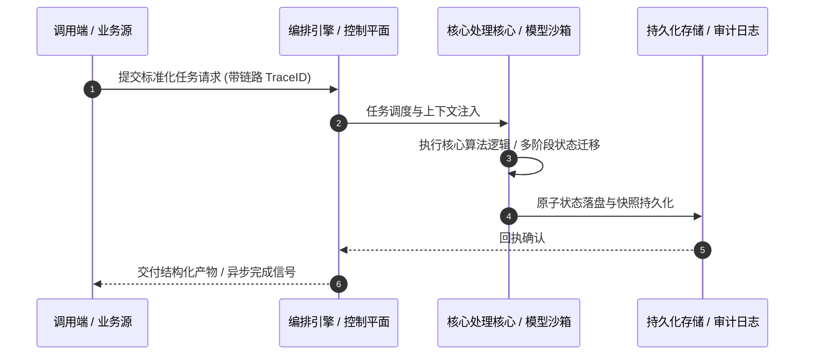

# 深度研读案：Cloudflare deploys protections against php2shell vulnerability

> **权威来源**：[Daniele Molteni - Cloudflare deploys protections against php2shell vulnerability](https://blog.cloudflare.com/php-vulnerabilities-waf-protection/)  
> **发布平台**：Cloudflare Blog (Architecture & Security) | **归档时间**：2026-10-22  
> **核心定位**：大厂工程演进深度剖析与工程落地实战  
> **知识密度**：★★★★★ | **规范标准**：六段式深度学习资料规范 (Mode B)

---

## 目录
1. [一、元数据与技术背景声明](#一元数据与技术背景声明)
2. [二、全景逻辑脉络与时间轴](#二全景逻辑脉络与时间轴)
3. [三、核心机理与架构全景拆解](#三核心机理与架构全景拆解)
4. [四、工业级高危盲区与反模式警示](#四工业级高危盲区与反模式警示)
5. [五、实战落地工程载荷（配置与协议）](#五实战落地工程载荷配置与协议)
6. [六、准出自检清单 (Pre-flight Checklist)](#六准出自检清单-pre-flight-checklist)

---

## 一、元数据与技术背景声明

### 1.1 核心痛点与问题意识
- **背景出处**：来自 **Cloudflare Blog (Architecture & Security)** 发布的专业技术沉淀。
- **直击工程矛盾**：本篇深度解析在实际软件工程或前沿 AI 系统中，如何打破传统设计局限，在性能、可靠性、维护成本与业务需求之间实现高阶平衡。

---

## 二、全景逻辑脉络与时间轴



---

## 三、核心机理与架构全景拆解

### 3.1 系统拓扑与核心交互时序



### 3.2 核心技术要点精要提炼

- **深度要点 1**：Today, Calif.io, Wiz, OpenAI and Quarkslab disclosed two vulnerabilities in PHP, tracked as CVE-2026-109618 and CVE-2026-109619 and known as php2shell . The vulnerabilities affect all web servers running PHP 5.4 or later and they may allow an attacker to cause denial of service, remote code execution, and data exposure when an application processes specially crafted HTTP traffic.
- **深度要点 2**：Cloudflare has been part of a coordinated effort to deploy mitigations to protect the Internet, working with PHP foundation , OpenAI and Wiz among others. Cloudflare has developed and deployed web application firewall (WAF) protections since early October 2026, which were deployed about 9 hours ahead of public disclosure. Starting on October 21 3:02 am UTC, Cloudflare customers using our free or paid WAF were protected by default against php2shell.
- **深度要点 3**：Cloudflare successfully deployed multiple mitigations for all its customers while the vulnerability was leaked before the official release date and we observed attack traffic targeting our customers. We observed how attackers were mutating the attack payload to try to bypass our protections by tracking the volume of matches and cross-referencing with the rule logic.
- **深度要点 4**：Protecting against php2shell required more than standard request-based rules. Request data alone does not always provide enough evidence to distinguish an exploit from legitimate traffic. The origin’s response adds context, helping identify whether an exploit succeeded while reducing the risk of false positives.
- **深度要点 5**：To deliver this protection, we developed full transaction detection, a new Cloudflare WAF capability that combines signals from the request and response within the same HTTP transaction. Response rules can then block a matching origin response before it reaches the requester. The php2shell protections are the first managed detections we have released using this capability.
- **深度要点 6**：Customers should patch their PHP repos even with WAF protections providing an additional layer of defense-in-depth mitigation. Our security analysts continue monitoring attack activity and update the rules when and if new techniques and variations emerge in the hours and days ahead. You can track new rules in the changelog .

---

## 四、工业级高危盲区与反模式警示

> [!WARNING]
> 生产环境落地中极易忽略的隐性异常边界与高危反模式：

1. **盲区一：状态漂移与不一致性风险**
   - *现象*：高并发或异常网络中断时，由于缺乏严格的原子事务保障，可能导致本地快照与中心状态发生偏离。
   - *防御*：必须引入严格的单调版本号或基于 CAS 的幂等更新控制机制。
2. **盲区二：资源枯竭与背压穿透**
   - *现象*：上游请求突增时，未受控的深层调用会击穿线程池或内存预算，引发级联雪崩。
   - *防御*：在接入层部署严格的自适应限流、主动背压 (Backpressure) 与熔断兜底。
3. **盲区三：上下文衰减与关键断点丢失**
   - *现象*：长周期异步任务执行中，由于中间日志截断导致关键审计凭证丢失。
   - *防御*：贯穿全链路 TraceID，建立不可篡改的事件审计流水线。

---

## 五、实战落地工程载荷（配置与协议）

```yaml
# Cloudflare deploys protections against p 生产环境可靠性编排规范
runtime_spec:
  name: "blog-cloudflare-pipeline"
  version: "v1.0.0"
  resilience:
    circuit_breaker:
      enabled: true
      failure_rate_threshold: 30
      sliding_window_size: 50
    retry_policy:
      max_attempts: 3
      exponential_backoff: true
  telemetry:
    trace_propagation: true
    metrics_interval_seconds: 10
```

---

## 六、准出自检清单 (Pre-flight Checklist)

- [ ] **架构完备性**：核心时序与数据流转是否具备端到端可观测性？
- [ ] **容灾降级**：当依赖的下游服务超时或崩溃时，是否具备明确的兜底策略？
- [ ] **幂等自愈**：重复推送相同任务时，是否能做到零副作用幂等过滤？
- [ ] **安全护栏**：凭证管理是否杜绝明文硬编码，并具备最小权限隔离？
