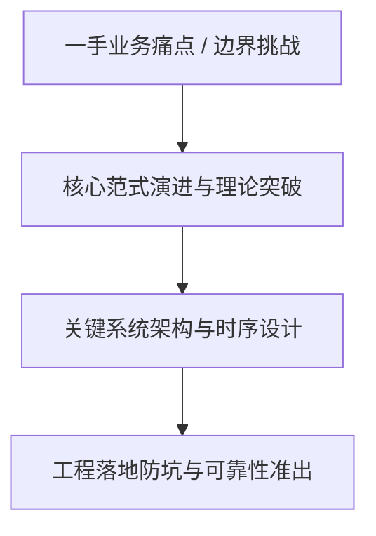
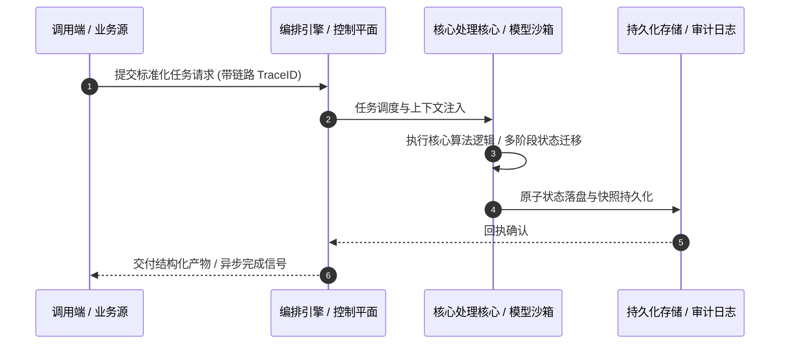

# 深度研读案：Bringing post-quantum cryptography to geographically fenced key management

> **权威来源**：[Chetan Agrawal - Bringing post-quantum cryptography to geographically fenced key management](https://blog.cloudflare.com/post-quantum-geo-key-manager/)  
> **发布平台**：Cloudflare Blog (Architecture & Security) | **归档时间**：2026-10-24  
> **核心定位**：大厂工程演进深度剖析与工程落地实战  
> **知识密度**：★★★★★ | **规范标准**：六段式深度学习资料规范 (Mode B)

---

## 目录
1. [一、元数据与技术背景声明](#一元数据与技术背景声明)
2. [二、全景逻辑脉络与时间轴](#二全景逻辑脉络与时间轴)
3. [三、核心机理与架构全景拆解](#三核心机理与架构全景拆解)
4. [四、工业级高危盲区与反模式警示](#四工业级高危盲区与反模式警示)
5. [五、实战落地工程载荷（配置与协议）](#五实战落地工程载荷配置与协议)
6. [六、准出自检清单 (Pre-flight Checklist)](#六准出自检清单-pre-flight-checklist)

---

## 一、元数据与技术背景声明

### 1.1 核心痛点与问题意识
- **背景出处**：来自 **Cloudflare Blog (Architecture & Security)** 发布的专业技术沉淀。
- **直击工程矛盾**：本篇深度解析在实际软件工程或前沿 AI 系统中，如何打破传统设计局限，在性能、可靠性、维护成本与业务需求之间实现高阶平衡。

---

## 二、全景逻辑脉络与时间轴



---

## 三、核心机理与架构全景拆解

### 3.1 系统拓扑与核心交互时序



### 3.2 核心技术要点精要提炼

- **深度要点 1**：Today, Cloudflare is launching a post-quantum geographically restricted key manager in support of our Data Localization Suite (DLS) in closed beta. This new PQ GeoKey Manager is a cornerstone of Cloudflare’s data sovereignty solutions, making sure that a customer's decryption keys are only accessible in their chosen geography. GeoKey Manager implements this by wrapping each decryption key such that it can only be decrypted by Cloudflare servers that are located in the allowed geography.
- **深度要点 2**：While general availability (GA) is planned for Q1 2027, today’s launch is an important milestone on our journey to support our customers’ data sovereignty goals while also migrating all Cloudflare products to post-quantum (PQ) cryptography .
- **深度要点 3**：Governments, financial institutions, healthcare providers, and defense organizations process highly sensitive data that can remain sensitive for years or decades after it is produced. Encryption is often required to protect this data. When classical, public-key encryption is used, adversaries do not immediately need a quantum computer today to put that data at risk: they can store the ciphertext and retain them until quantum computers can break the public key cryptography protecting it — an attack strategy known as harvest now, decrypt later.
- **深度要点 4**：For organizations with geographic requirements, resisting that threat is only half the challenge. At Cloudflare's scale, high availability requires replicating customer data across many servers across our global network. However, many data sovereignty regulations require that certain types of data be processed only within a given geographical region. We must therefore ensure the data is end-to-end encrypted such that only servers within the region have access to the plaintext. In this post, we describe the system that makes this work.
- **深度要点 5**：## The evolution of GeoKey Manager
- **深度要点 6**：Cloudflare pioneered the concept of geo-restricted transport layer security ( TLS ) keys back in 2017 with GeoKey Manager . This gave customers control over the locations where their private TLS keys could be unwrapped on Cloudflare’s anycast network to provide stronger technical guarantees of which region their requests are decrypted into. For instance, a customer could choose to only unwrap their private keys in India. So instead of allowing decryption across Cloudflare’s entire global network, GeoKey Manager makes sure TLS signing for each customer request happens in our India network.

---

## 四、工业级高危盲区与反模式警示

> [!WARNING]
> 生产环境落地中极易忽略的隐性异常边界与高危反模式：

1. **盲区一：状态漂移与不一致性风险**
   - *现象*：高并发或异常网络中断时，由于缺乏严格的原子事务保障，可能导致本地快照与中心状态发生偏离。
   - *防御*：必须引入严格的单调版本号或基于 CAS 的幂等更新控制机制。
2. **盲区二：资源枯竭与背压穿透**
   - *现象*：上游请求突增时，未受控的深层调用会击穿线程池或内存预算，引发级联雪崩。
   - *防御*：在接入层部署严格的自适应限流、主动背压 (Backpressure) 与熔断兜底。
3. **盲区三：上下文衰减与关键断点丢失**
   - *现象*：长周期异步任务执行中，由于中间日志截断导致关键审计凭证丢失。
   - *防御*：贯穿全链路 TraceID，建立不可篡改的事件审计流水线。

---

## 五、实战落地工程载荷（配置与协议）

```yaml
# Bringing post-quantum cryptography to ge 生产环境可靠性编排规范
runtime_spec:
  name: "blog-cloudflare-pipeline"
  version: "v1.0.0"
  resilience:
    circuit_breaker:
      enabled: true
      failure_rate_threshold: 30
      sliding_window_size: 50
    retry_policy:
      max_attempts: 3
      exponential_backoff: true
  telemetry:
    trace_propagation: true
    metrics_interval_seconds: 10
```

---

## 六、准出自检清单 (Pre-flight Checklist)

- [ ] **架构完备性**：核心时序与数据流转是否具备端到端可观测性？
- [ ] **容灾降级**：当依赖的下游服务超时或崩溃时，是否具备明确的兜底策略？
- [ ] **幂等自愈**：重复推送相同任务时，是否能做到零副作用幂等过滤？
- [ ] **安全护栏**：凭证管理是否杜绝明文硬编码，并具备最小权限隔离？
