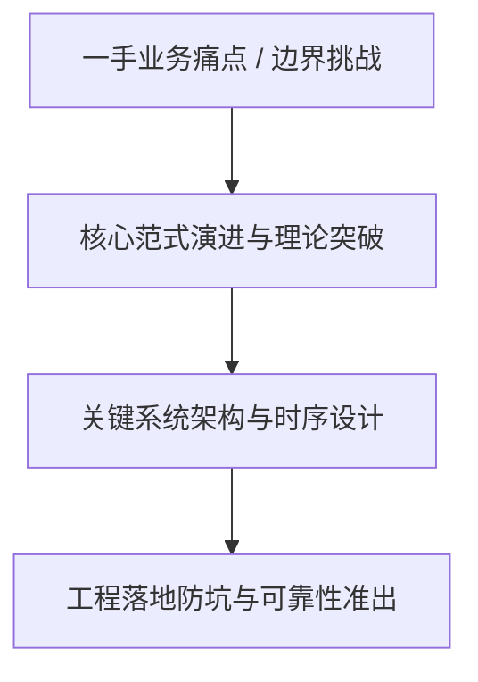
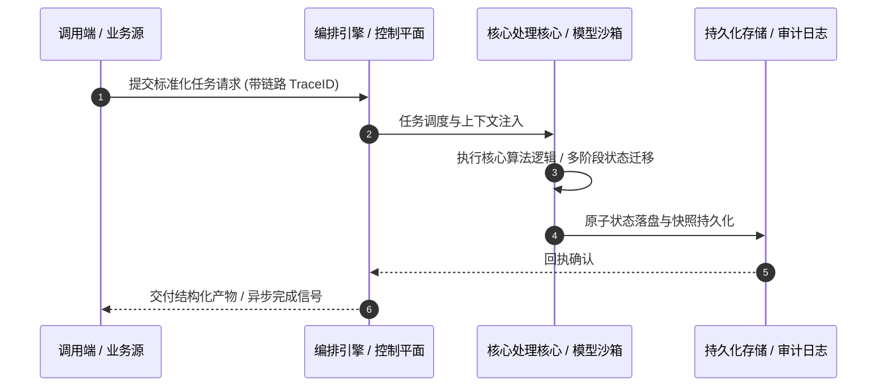

# 深度研读案：What took the Internet offline in Q3 2026

> **权威来源**：[Lai Yi Ohlsen - What took the Internet offline in Q3 2026](https://blog.cloudflare.com/q3-2026-internet-disruption-summary/)  
> **发布平台**：Cloudflare Blog (Architecture & Security) | **归档时间**：2026-10-28  
> **核心定位**：大厂工程演进深度剖析与工程落地实战  
> **知识密度**：★★★★★ | **规范标准**：六段式深度学习资料规范 (Mode B)

---

## 目录
1. [一、元数据与技术背景声明](#一元数据与技术背景声明)
2. [二、全景逻辑脉络与时间轴](#二全景逻辑脉络与时间轴)
3. [三、核心机理与架构全景拆解](#三核心机理与架构全景拆解)
4. [四、工业级高危盲区与反模式警示](#四工业级高危盲区与反模式警示)
5. [五、实战落地工程载荷（配置与协议）](#五实战落地工程载荷配置与协议)
6. [六、准出自检清单 (Pre-flight Checklist)](#六准出自检清单-pre-flight-checklist)

---

## 一、元数据与技术背景声明

### 1.1 核心痛点与问题意识
- **背景出处**：来自 **Cloudflare Blog (Architecture & Security)** 发布的专业技术沉淀。
- **直击工程矛盾**：本篇深度解析在实际软件工程或前沿 AI 系统中，如何打破传统设计局限，在性能、可靠性、维护成本与业务需求之间实现高阶平衡。

---

## 二、全景逻辑脉络与时间轴



---

## 三、核心机理与架构全景拆解

### 3.1 系统拓扑与核心交互时序



### 3.2 核心技术要点精要提炼

- **深度要点 1**：The Internet can feel invisible when everything is working normally. But when connectivity breaks, the many systems it depends upon become evident in an instant. Because Cloudflare’s global network handles more than 20% of the web’s traffic, it offers a unique perspective of how Internet traffic is behaving. When failures in infrastructure, power, policy, or security disrupt access to the Internet, Cloudflare Radar can observe the impact by monitoring traffic to our customers. Each quarter, we review the disruptions detected and annotated on Radar, highlighting what happened, where it happened, and the broader conditions that shaped each event.
- **深度要点 2**：In this post, we examine the major categories of Internet disruptions observed during the third quarter of 2026, including government-directed shutdowns, power outages and natural disasters.
- **深度要点 3**：Between July and September, Internet disruptions were largely driven by failures in the systems the Internet depends on. Power grids failed in Cuba, Honduras, Guam, Ukraine, and several other countries. Natural disasters damaged electricity and telecommunications infrastructure from Nepal to Colombia. Government-directed shutdowns remained the most frequent source of disruption, driven largely by exam-related shutdowns in Iraq, while renewed conflict in Ethiopia’s Tigray region showed how quickly connectivity can become part of a broader political and humanitarian crisis. Outages within the United States, Japan, and Portugal — countries with a relatively strong history of Internet resilience — remind us that no country is immune to disruption.
- **深度要点 4**：In total, Cloudflare Radar recorded 49 disruptions during the quarter. Government-directed shutdowns accounted for 19 incidents, including 18 exam shutdowns in Iraq. Power outages followed with 14 incidents, while natural disasters accounted for five.
- **深度要点 5**：## Power failure was a leading cause of disruptions
- **深度要点 6**：The Internet is designed to be distributed and resilient, but that resilience still depends on electricity. When power fails, routers, mobile base stations, data centers, interconnection facilities, and the networks that connect them can fail with it. Over the past three months, that dependency was one of the clearest patterns in Radar’s disruption data. Power outages were the second-most common cause of disruptions by incident count this quarter, behind government-directed exam shutdowns.

---

## 四、工业级高危盲区与反模式警示

> [!WARNING]
> 生产环境落地中极易忽略的隐性异常边界与高危反模式：

1. **盲区一：状态漂移与不一致性风险**
   - *现象*：高并发或异常网络中断时，由于缺乏严格的原子事务保障，可能导致本地快照与中心状态发生偏离。
   - *防御*：必须引入严格的单调版本号或基于 CAS 的幂等更新控制机制。
2. **盲区二：资源枯竭与背压穿透**
   - *现象*：上游请求突增时，未受控的深层调用会击穿线程池或内存预算，引发级联雪崩。
   - *防御*：在接入层部署严格的自适应限流、主动背压 (Backpressure) 与熔断兜底。
3. **盲区三：上下文衰减与关键断点丢失**
   - *现象*：长周期异步任务执行中，由于中间日志截断导致关键审计凭证丢失。
   - *防御*：贯穿全链路 TraceID，建立不可篡改的事件审计流水线。

---

## 五、实战落地工程载荷（配置与协议）

```yaml
# What took the Internet offline in Q3 202 生产环境可靠性编排规范
runtime_spec:
  name: "blog-cloudflare-pipeline"
  version: "v1.0.0"
  resilience:
    circuit_breaker:
      enabled: true
      failure_rate_threshold: 30
      sliding_window_size: 50
    retry_policy:
      max_attempts: 3
      exponential_backoff: true
  telemetry:
    trace_propagation: true
    metrics_interval_seconds: 10
```

---

## 六、准出自检清单 (Pre-flight Checklist)

- [ ] **架构完备性**：核心时序与数据流转是否具备端到端可观测性？
- [ ] **容灾降级**：当依赖的下游服务超时或崩溃时，是否具备明确的兜底策略？
- [ ] **幂等自愈**：重复推送相同任务时，是否能做到零副作用幂等过滤？
- [ ] **安全护栏**：凭证管理是否杜绝明文硬编码，并具备最小权限隔离？
