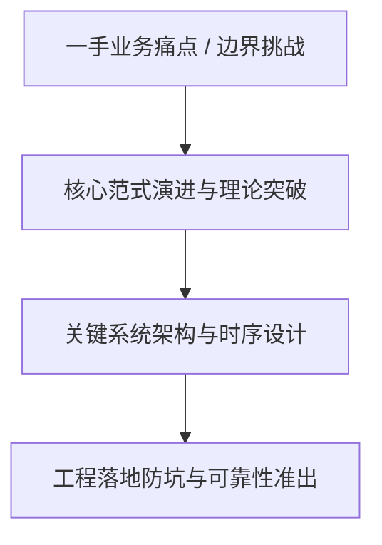
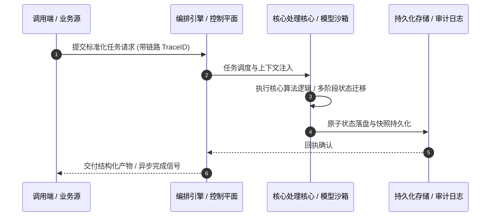

# 深度研读案：4 real? Tracking exploitation and patching of eMudhra’s weak keys

> **权威来源**：[Maxime Guerreiro - 4 real? Tracking exploitation and patching of eMudhra’s weak keys](https://blog.cloudflare.com/emudhra-patching/)  
> **发布平台**：Cloudflare Blog (Architecture & Security) | **归档时间**：2026-10-31  
> **核心定位**：大厂工程演进深度剖析与工程落地实战  
> **知识密度**：★★★★★ | **规范标准**：六段式深度学习资料规范 (Mode B)

---

## 目录
1. [一、元数据与技术背景声明](#一元数据与技术背景声明)
2. [二、全景逻辑脉络与时间轴](#二全景逻辑脉络与时间轴)
3. [三、核心机理与架构全景拆解](#三核心机理与架构全景拆解)
4. [四、工业级高危盲区与反模式警示](#四工业级高危盲区与反模式警示)
5. [五、实战落地工程载荷（配置与协议）](#五实战落地工程载荷配置与协议)
6. [六、准出自检清单 (Pre-flight Checklist)](#六准出自检清单-pre-flight-checklist)

---

## 一、元数据与技术背景声明

### 1.1 核心痛点与问题意识
- **背景出处**：来自 **Cloudflare Blog (Architecture & Security)** 发布的专业技术沉淀。
- **直击工程矛盾**：本篇深度解析在实际软件工程或前沿 AI 系统中，如何打破传统设计局限，在性能、可靠性、维护成本与业务需求之间实现高阶平衡。

---

## 二、全景逻辑脉络与时间轴



---

## 三、核心机理与架构全景拆解

### 3.1 系统拓扑与核心交互时序



### 3.2 核心技术要点精要提炼

- **深度要点 1**：On October 19, 2026, we learned about eMudhra’s eight shockingly weak keys: where eMudhra was trusted to pick a 115-digit number for their virtual combination lock protecting the Internet, they picked the number 4. Not even four digits, just the number 4. The other seven keys were similarly weak: 56, 66, 115, 155, 156, 230 and 237.
- **深度要点 2**：The next day, we wrote a blog post on the immediate action we took to mitigate this leak, and what customers needed to do on their end to stay secure. Now, we are sharing a more in-depth follow up on the evidence we’ve seen of exploitation, and the progress seen on visitors patching their systems.
- **深度要点 3**：Let's start with the scale of the problem. A certificate authority (CA) with weak keys this serious is unprecedented, and the potential consequences are significant. While there have been plenty of compromised certification authorities in the past (such as DigiNotar , TÜRKTRUST , and TrustWave ), access to their keys has always been contained to a degree; these incidents gave a limited set of attackers or organizations the ability to issue fraudulent certificates. The eMudhra incident is fundamentally different; the affected intermediate private keys could be recovered almost instantly by anyone from the public certificates themselves. Anyone can independently recover these same signing keys and create certificates for any domain that an unpatched client not enforcing Certificate Transparency would accept.
- **深度要点 4**：eMudhra announced they’re exiting the public CA business and have claimed a mistake in a key generation script, but have not yet shared the script. They signed a certificate revocation list (CRL) with what might’ve been a correctly generated key, and subsequently corrected it to be signed with the weak key.
- **深度要点 5**：How did that come to be and why didn’t that set off alarms? Much has to be cleared up, including the role of the auditors and cross signers. This blog proposes the fixes and next steps for organizations to ensure they are secure.
- **深度要点 6**：Our primary concern remains the security impact on Cloudflare, our customers, and the Internet as a whole. At the time of writing, all high priority Cloudflare systems have been patched. A small number of confirmed low impact tickets is being worked on.

---

## 四、工业级高危盲区与反模式警示

> [!WARNING]
> 生产环境落地中极易忽略的隐性异常边界与高危反模式：

1. **盲区一：状态漂移与不一致性风险**
   - *现象*：高并发或异常网络中断时，由于缺乏严格的原子事务保障，可能导致本地快照与中心状态发生偏离。
   - *防御*：必须引入严格的单调版本号或基于 CAS 的幂等更新控制机制。
2. **盲区二：资源枯竭与背压穿透**
   - *现象*：上游请求突增时，未受控的深层调用会击穿线程池或内存预算，引发级联雪崩。
   - *防御*：在接入层部署严格的自适应限流、主动背压 (Backpressure) 与熔断兜底。
3. **盲区三：上下文衰减与关键断点丢失**
   - *现象*：长周期异步任务执行中，由于中间日志截断导致关键审计凭证丢失。
   - *防御*：贯穿全链路 TraceID，建立不可篡改的事件审计流水线。

---

## 五、实战落地工程载荷（配置与协议）

```yaml
# 4 real? Tracking exploitation and patchi 生产环境可靠性编排规范
runtime_spec:
  name: "blog-cloudflare-pipeline"
  version: "v1.0.0"
  resilience:
    circuit_breaker:
      enabled: true
      failure_rate_threshold: 30
      sliding_window_size: 50
    retry_policy:
      max_attempts: 3
      exponential_backoff: true
  telemetry:
    trace_propagation: true
    metrics_interval_seconds: 10
```

---

## 六、准出自检清单 (Pre-flight Checklist)

- [ ] **架构完备性**：核心时序与数据流转是否具备端到端可观测性？
- [ ] **容灾降级**：当依赖的下游服务超时或崩溃时，是否具备明确的兜底策略？
- [ ] **幂等自愈**：重复推送相同任务时，是否能做到零副作用幂等过滤？
- [ ] **安全护栏**：凭证管理是否杜绝明文硬编码，并具备最小权限隔离？
