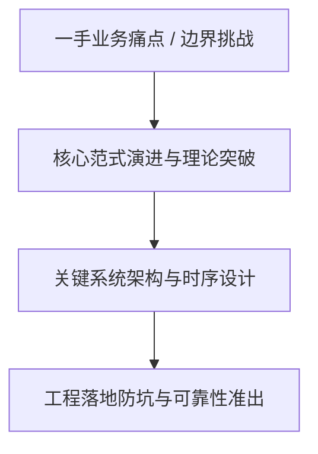
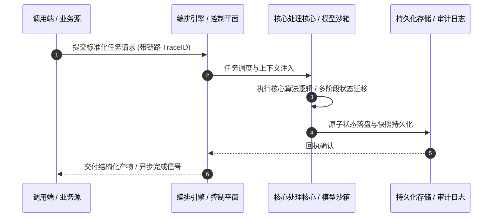

# 深度研读案：Agents aren’t humans (but they kinda are)

> **权威来源**：[Bryan Becker - Agents aren’t humans (but they kinda are)](https://blog.cloudflare.com/trusted-agent-delegation/)  
> **发布平台**：Cloudflare Blog (Architecture & Security) | **归档时间**：2026-11-06  
> **核心定位**：大厂工程演进深度剖析与工程落地实战  
> **知识密度**：★★★★★ | **规范标准**：六段式深度学习资料规范 (Mode B)

---

## 目录
1. [一、元数据与技术背景声明](#一元数据与技术背景声明)
2. [二、全景逻辑脉络与时间轴](#二全景逻辑脉络与时间轴)
3. [三、核心机理与架构全景拆解](#三核心机理与架构全景拆解)
4. [四、工业级高危盲区与反模式警示](#四工业级高危盲区与反模式警示)
5. [五、实战落地工程载荷（配置与协议）](#五实战落地工程载荷配置与协议)
6. [六、准出自检清单 (Pre-flight Checklist)](#六准出自检清单-pre-flight-checklist)

---

## 一、元数据与技术背景声明

### 1.1 核心痛点与问题意识
- **背景出处**：来自 **Cloudflare Blog (Architecture & Security)** 发布的专业技术沉淀。
- **直击工程矛盾**：本篇深度解析在实际软件工程或前沿 AI 系统中，如何打破传统设计局限，在性能、可靠性、维护成本与业务需求之间实现高阶平衡。

---

## 二、全景逻辑脉络与时间轴



---

## 三、核心机理与架构全景拆解

### 3.1 系统拓扑与核心交互时序



### 3.2 核心技术要点精要提炼

- **深度要点 1**：AI Agents now act on the web for millions of people. To a Site, an Agent can take many forms. It may be indistinguishable from a human user carrying out a task, or it might look like one visitor carrying many Users. This removes the ability for the Site to recognize, serve, and hold accountable the user or users behind the Agent, and causes the Site to face the costs when something goes wrong. This post argues that in order for Sites to maximize the access they provide to Agents, the ecosystem must develop new mechanisms to preserve the relationship between Sites and Users. Traditionally, in Security and Fraud Prevention, that requires three things: Identity, Reputation, and Accountability, allowing Sites to answer: Is the person acting being truthful about who they are? Is that person trustworthy? And who answers for the action?
- **深度要点 2**：“Personal AI Agents” (“Agents” for short) are automations that take instructions from a human (“User”) and pursue a goal by controlling a cloud computer or browser. They are usually hosted and maintained by an “Operator” as part of a managed service or consumer offering. Examples include Muse from Meta and dots from OpenAI, and more are launching all the time. Agents can potentially take any action online that their User could, without the limits that hold humans back. They don't tire, they run around the clock, they act in parallel, and they put up with friction no person would. Much of the web, from how Sites plan capacity to how they make money, assumes those limits.
- **深度要点 3**：Fundamentally, remotely hosted Agents are intermediaries . An intermediary is anything that sits between a User and a Site, so the Site sees it instead of the User. Agents are the newest kind of intermediary, but intermediaries have existed for a long time. Cloud browsers (hosted browsers that software controls on a User's behalf) and Proxies (services that relay a User's traffic, including VPNs) are intermediaries too. What has changed is the trajectory. Agentic traffic is growing rapidly and may eclipse traditional human browsing on the Internet in the near future. This forces a reckoning for anyone operating a Site today. Historically, a Site could simply block intermediary traffic and require Users to disable the intermediary service. That stops working when the majority of traffic is agentic. Once blocking is no longer viable, Site Operators are left with the problem that intermediaries have always created. The Site loses direct information about the User and must decide whether to trust the intermediary without it.
- **深度要点 4**：This post covers Agents hosted somewhere other than the User's device. Local agents (e.g. OpenClaw) or Agents running in the User's own browser, on their own device, are out of scope of the primary topic addressed by this post (see below, "On open source and local Agents").
- **深度要点 5**：This post rests on one principle:
- **深度要点 6**：The Intermediation Principle : The business relationship between Users and Sites, and each participant’s security responsibilities, must be upheld regardless of intermediation.

---

## 四、工业级高危盲区与反模式警示

> [!WARNING]
> 生产环境落地中极易忽略的隐性异常边界与高危反模式：

1. **盲区一：状态漂移与不一致性风险**
   - *现象*：高并发或异常网络中断时，由于缺乏严格的原子事务保障，可能导致本地快照与中心状态发生偏离。
   - *防御*：必须引入严格的单调版本号或基于 CAS 的幂等更新控制机制。
2. **盲区二：资源枯竭与背压穿透**
   - *现象*：上游请求突增时，未受控的深层调用会击穿线程池或内存预算，引发级联雪崩。
   - *防御*：在接入层部署严格的自适应限流、主动背压 (Backpressure) 与熔断兜底。
3. **盲区三：上下文衰减与关键断点丢失**
   - *现象*：长周期异步任务执行中，由于中间日志截断导致关键审计凭证丢失。
   - *防御*：贯穿全链路 TraceID，建立不可篡改的事件审计流水线。

---

## 五、实战落地工程载荷（配置与协议）

```yaml
# Agents aren’t humans (but they kinda are 生产环境可靠性编排规范
runtime_spec:
  name: "blog-cloudflare-pipeline"
  version: "v1.0.0"
  resilience:
    circuit_breaker:
      enabled: true
      failure_rate_threshold: 30
      sliding_window_size: 50
    retry_policy:
      max_attempts: 3
      exponential_backoff: true
  telemetry:
    trace_propagation: true
    metrics_interval_seconds: 10
```

---

## 六、准出自检清单 (Pre-flight Checklist)

- [ ] **架构完备性**：核心时序与数据流转是否具备端到端可观测性？
- [ ] **容灾降级**：当依赖的下游服务超时或崩溃时，是否具备明确的兜底策略？
- [ ] **幂等自愈**：重复推送相同任务时，是否能做到零副作用幂等过滤？
- [ ] **安全护栏**：凭证管理是否杜绝明文硬编码，并具备最小权限隔离？
