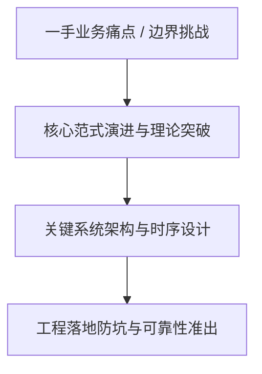
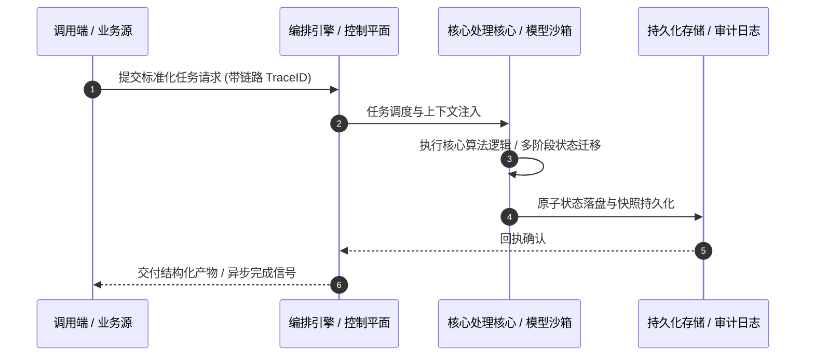

# 深度研读案：The post-quantum future of web privacy

> **权威来源**：[Christopher Patton - The post-quantum future of web privacy](https://blog.cloudflare.com/vole-mole/)  
> **发布平台**：Cloudflare Blog (Architecture & Security) | **归档时间**：2026-11-07  
> **核心定位**：大厂工程演进深度剖析与工程落地实战  
> **知识密度**：★★★★★ | **规范标准**：六段式深度学习资料规范 (Mode B)

---

## 目录
1. [一、元数据与技术背景声明](#一元数据与技术背景声明)
2. [二、全景逻辑脉络与时间轴](#二全景逻辑脉络与时间轴)
3. [三、核心机理与架构全景拆解](#三核心机理与架构全景拆解)
4. [四、工业级高危盲区与反模式警示](#四工业级高危盲区与反模式警示)
5. [五、实战落地工程载荷（配置与协议）](#五实战落地工程载荷配置与协议)
6. [六、准出自检清单 (Pre-flight Checklist)](#六准出自检清单-pre-flight-checklist)

---

## 一、元数据与技术背景声明

### 1.1 核心痛点与问题意识
- **背景出处**：来自 **Cloudflare Blog (Architecture & Security)** 发布的专业技术沉淀。
- **直击工程矛盾**：本篇深度解析在实际软件工程或前沿 AI 系统中，如何打破传统设计局限，在性能、可靠性、维护成本与业务需求之间实现高阶平衡。

---

## 二、全景逻辑脉络与时间轴



---

## 三、核心机理与架构全景拆解

### 3.1 系统拓扑与核心交互时序



### 3.2 核心技术要点精要提炼

- **深度要点 1**：The highest priorities for the transition to post-quantum cryptography are the basic building blocks of authenticated key-agreement protocols such as TLS. Without these building blocks in place, secure communication on the Internet will not be possible once cryptographically relevant quantum computers come online. However, today we rely on quantum-vulnerable cryptography for much more than TLS.
- **深度要点 2**：Privacy Pass is a protocol used by site operators like Cloudflare to help protect applications from abuse. One way we do this is by rate limiting individual clients so that no one client consumes too many of the site's resources. Normally this involves some combination of friction or loss of privacy for users: CAPTCHAs or other challenges to moderate traffic, along with accounts and fingerprinting to identify traffic.Privacy Pass was designed to avoid this tradeoff between friction and privacy. The basic idea is that a client gets issued a number of tokens , which they can redeem in exchange for access to the site. Crucially, each token is unlinkable to the client it was issued to, ensuring the client can use the site as they always had without sacrificing privacy.
- **深度要点 3**：With 10 years of deployment experience under our belts — using Privacy Pass for applications such as privacy proxies (like iCloud Private Relay) and relays (like Privacy Gateway) — we, along with others , are collaborating to bring the next generation of this technology to the web. One of our goals is to develop more sophisticated tools for managing agentic traffic that would otherwise consume too many resources and degrade performance for human visitors. Another goal is to foster a more open ecosystem by making it easier for more types of clients to participate. Achieving these goals requires developing new capabilities beyond what Privacy Pass offers today.
- **深度要点 4**：Given the trajectory, in this post we look at the prospects for post-quantum. In fact, we're in better shape than one might think. Privacy Pass still relies on classical cryptography, like RSA and elliptic curves. This means that a quantum attacker will be able to forge tokens at will and use them to bypass whatever security mechanism the site operator wants to implement (such as rate limiting). On the other hand, Privacy Pass is unconditionally private, meaning no attacker, quantum or not, can link the redemption of a token to its issuance. What's more, the new capabilities we're developing for this new generation of private authentication technology  can and will be instantiated in a way that upholds the same guarantee: your interaction remains private even after Q-day.
- **深度要点 5**：This gives us a little breathing room, but we will need an alternative soon. This is an active area of research that has made significant strides in recent years. Still, just as is the case with other aspects of the transition, the primary challenge is the sheer size of post-quantum alternatives: ML-DSA-44 signatures are a whopping 2,420 bytes, while ECDSA-P256 signatures are just 64 bytes. And there's not much hope for drop-in replacements any time soon. Just as for TLS, we'll have to settle for primitives with higher cost and re-engineer our systems to bear this cost .
- **深度要点 6**：But what will those primitives be? In this post, we'll explore one potential future for post-quantum privacy on the web, made possible by a recent breakthrough in the design of blind signatures.

---

## 四、工业级高危盲区与反模式警示

> [!WARNING]
> 生产环境落地中极易忽略的隐性异常边界与高危反模式：

1. **盲区一：状态漂移与不一致性风险**
   - *现象*：高并发或异常网络中断时，由于缺乏严格的原子事务保障，可能导致本地快照与中心状态发生偏离。
   - *防御*：必须引入严格的单调版本号或基于 CAS 的幂等更新控制机制。
2. **盲区二：资源枯竭与背压穿透**
   - *现象*：上游请求突增时，未受控的深层调用会击穿线程池或内存预算，引发级联雪崩。
   - *防御*：在接入层部署严格的自适应限流、主动背压 (Backpressure) 与熔断兜底。
3. **盲区三：上下文衰减与关键断点丢失**
   - *现象*：长周期异步任务执行中，由于中间日志截断导致关键审计凭证丢失。
   - *防御*：贯穿全链路 TraceID，建立不可篡改的事件审计流水线。

---

## 五、实战落地工程载荷（配置与协议）

```yaml
# The post-quantum future of web privacy 生产环境可靠性编排规范
runtime_spec:
  name: "blog-cloudflare-pipeline"
  version: "v1.0.0"
  resilience:
    circuit_breaker:
      enabled: true
      failure_rate_threshold: 30
      sliding_window_size: 50
    retry_policy:
      max_attempts: 3
      exponential_backoff: true
  telemetry:
    trace_propagation: true
    metrics_interval_seconds: 10
```

---

## 六、准出自检清单 (Pre-flight Checklist)

- [ ] **架构完备性**：核心时序与数据流转是否具备端到端可观测性？
- [ ] **容灾降级**：当依赖的下游服务超时或崩溃时，是否具备明确的兜底策略？
- [ ] **幂等自愈**：重复推送相同任务时，是否能做到零副作用幂等过滤？
- [ ] **安全护栏**：凭证管理是否杜绝明文硬编码，并具备最小权限隔离？
