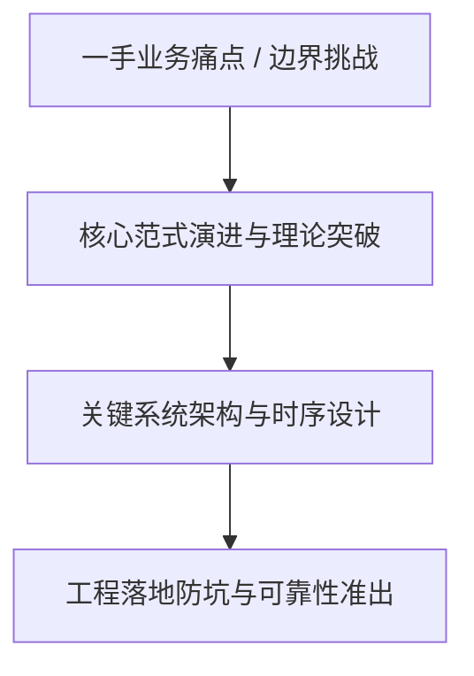
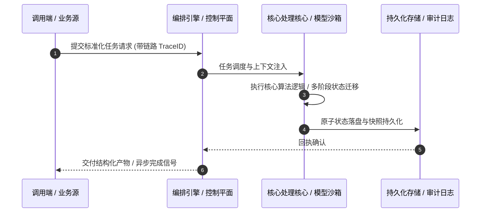

# 深度研读案：Adapting to AI penetration testing orchestrators: The Modern Security Model

> **权威来源**：[Blake Darché - Adapting to AI penetration testing orchestrators: The Modern Security Model](https://blog.cloudflare.com/adapting-to-ai-penetration-testing-orchestrators/)  
> **发布平台**：Cloudflare Blog (Architecture & Security) | **归档时间**：2026-11-14  
> **核心定位**：大厂工程演进深度剖析与工程落地实战  
> **知识密度**：★★★★★ | **规范标准**：六段式深度学习资料规范 (Mode B)

---

## 目录
1. [一、元数据与技术背景声明](#一元数据与技术背景声明)
2. [二、全景逻辑脉络与时间轴](#二全景逻辑脉络与时间轴)
3. [三、核心机理与架构全景拆解](#三核心机理与架构全景拆解)
4. [四、工业级高危盲区与反模式警示](#四工业级高危盲区与反模式警示)
5. [五、实战落地工程载荷（配置与协议）](#五实战落地工程载荷配置与协议)
6. [六、准出自检清单 (Pre-flight Checklist)](#六准出自检清单-pre-flight-checklist)

---

## 一、元数据与技术背景声明

### 1.1 核心痛点与问题意识
- **背景出处**：来自 **Cloudflare Blog (Architecture & Security)** 发布的专业技术沉淀。
- **直击工程矛盾**：本篇深度解析在实际软件工程或前沿 AI 系统中，如何打破传统设计局限，在性能、可靠性、维护成本与业务需求之间实现高阶平衡。

---

## 二、全景逻辑脉络与时间轴



---

## 三、核心机理与架构全景拆解

### 3.1 系统拓扑与核心交互时序



### 3.2 核心技术要点精要提炼

- **深度要点 1**：Over the last month, the number of Large Language Model (LLM) penetration testing and orchestration frameworks has exploded. Just a few weeks ago, ARTEX — an open source agentic penetration testing system that automates offensive security workflows — was the only framework available. In just the last three days, we have seen over 50 framework families attempt to scan Cloudflare customers globally. The number of Internet Protocol (IP) addresses seen running these frameworks has grown into the thousands and continues to increase daily. The proliferation of these frameworks has significantly changed the status quo in cyber defense: defenders are struggling to keep up with the volumetric nature of these autonomously guided attacks.
- **深度要点 2**：ARTEX was taken down by its creator Autumn-27 on October 8. (“The malicious exploitation of this tool runs entirely counter to its original intent,” they wrote in Chinese. ) But in the month since, the ecosystem has exploded with new fragmented versions of it. There are now over 12,000 repositories, with several hundred unique forks containing lineage from the original repository. Additionally, hundreds of other similar agentic orchestration frameworks have been created since October 8. Daily requests of AI penetration testing (pentesting) and exploitation tools has grown by 30x since October 1. These tools have also begun chaining stolen customer credentials in some of the more complex attacks, such as lateral movement chaining throughout an environment.
- **深度要点 3**：We expect these frameworks to continue to proliferate, and every organization should be prepared to address this threat. To counter LLM-based pentest frameworks, we recommend that all organizations adopt what we call the Modern Security Model, which has six key pillars: -  Fortify the front gate : Implement a Web Application Firewall (WAF) with advanced rules such as rate limits. -  Security station in the foyer : Anomaly detection on all web applications your customers access. -  Identify phony visitors : Implement Bot Defense. -  Remove the back door : Implement Identity-Gated Access for all high-risk external and internal web applications. -  Inspect deliveries: Enforce validated schemas and explicit security controls. -  Neighborhood watch : Implement Threat Intelligence to gain visibility into attacks.
- **深度要点 4**：## What is an LLM penetration and exploitation orchestrator?
- **深度要点 5**：Open-source pentesting frameworks are able to orchestrate AI agents to carry out stages of the traditional Cyber Kill Chain at scale. Tools like ARTEX have the ability to quickly plug in existing Model Context Protocol (MCP) and connect traditional standalone pentesting tools in novel ways. Some even allow operator direction on what type of task to accomplish. These tools can map and enumerate environments, both from the inside and outside. ARTEX and its forks map assets and environments onto a graph, allowing multiple independent parallel agents to enumerate, verify, prototype, and attack at the speed of inference. These tools turn compromises into a hill-climbable problem, which agents are specifically good at.
- **深度要点 6**：### The AI LLM pentesting tools that currently exist

---

## 四、工业级高危盲区与反模式警示

> [!WARNING]
> 生产环境落地中极易忽略的隐性异常边界与高危反模式：

1. **盲区一：状态漂移与不一致性风险**
   - *现象*：高并发或异常网络中断时，由于缺乏严格的原子事务保障，可能导致本地快照与中心状态发生偏离。
   - *防御*：必须引入严格的单调版本号或基于 CAS 的幂等更新控制机制。
2. **盲区二：资源枯竭与背压穿透**
   - *现象*：上游请求突增时，未受控的深层调用会击穿线程池或内存预算，引发级联雪崩。
   - *防御*：在接入层部署严格的自适应限流、主动背压 (Backpressure) 与熔断兜底。
3. **盲区三：上下文衰减与关键断点丢失**
   - *现象*：长周期异步任务执行中，由于中间日志截断导致关键审计凭证丢失。
   - *防御*：贯穿全链路 TraceID，建立不可篡改的事件审计流水线。

---

## 五、实战落地工程载荷（配置与协议）

```yaml
# Adapting to AI penetration testing orche 生产环境可靠性编排规范
runtime_spec:
  name: "blog-cloudflare-pipeline"
  version: "v1.0.0"
  resilience:
    circuit_breaker:
      enabled: true
      failure_rate_threshold: 30
      sliding_window_size: 50
    retry_policy:
      max_attempts: 3
      exponential_backoff: true
  telemetry:
    trace_propagation: true
    metrics_interval_seconds: 10
```

---

## 六、准出自检清单 (Pre-flight Checklist)

- [ ] **架构完备性**：核心时序与数据流转是否具备端到端可观测性？
- [ ] **容灾降级**：当依赖的下游服务超时或崩溃时，是否具备明确的兜底策略？
- [ ] **幂等自愈**：重复推送相同任务时，是否能做到零副作用幂等过滤？
- [ ] **安全护栏**：凭证管理是否杜绝明文硬编码，并具备最小权限隔离？
