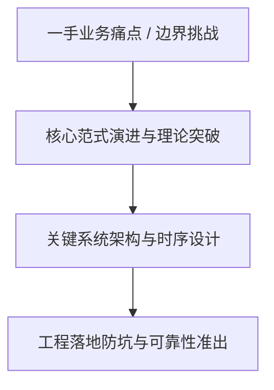
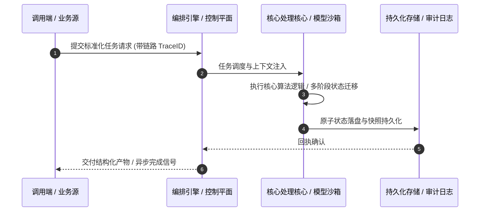

# 深度研读案：Engineering AI Discover

> **权威来源**：[Netflix Technology Blog - Engineering AI Discover](https://netflixtechblog.com/engineering-ai-discover-e244944cdc38?source=rss----2615bd06b42e---4)  
> **发布平台**：Netflix TechBlog | **归档时间**：2026-11-18  
> **核心定位**：大厂工程演进深度剖析与工程落地实战  
> **知识密度**：★★★★★ | **规范标准**：六段式深度学习资料规范 (Mode B)

---

## 目录
1. [一、元数据与技术背景声明](#一元数据与技术背景声明)
2. [二、全景逻辑脉络与时间轴](#二全景逻辑脉络与时间轴)
3. [三、核心机理与架构全景拆解](#三核心机理与架构全景拆解)
4. [四、工业级高危盲区与反模式警示](#四工业级高危盲区与反模式警示)
5. [五、实战落地工程载荷（配置与协议）](#五实战落地工程载荷配置与协议)
6. [六、准出自检清单 (Pre-flight Checklist)](#六准出自检清单-pre-flight-checklist)

---

## 一、元数据与技术背景声明

### 1.1 核心痛点与问题意识
- **背景出处**：来自 **Netflix TechBlog** 发布的专业技术沉淀。
- **直击工程矛盾**：本篇深度解析在实际软件工程或前沿 AI 系统中，如何打破传统设计局限，在性能、可靠性、维护成本与业务需求之间实现高阶平衡。

---

## 二、全景逻辑脉络与时间轴



---

## 三、核心机理与架构全景拆解

### 3.1 系统拓扑与核心交互时序



### 3.2 核心技术要点精要提炼

- **深度要点 1**：The challenges and decisions behind AI Discover’s intelligence layer
- **深度要点 2**：By Varun Khaitan , Peng Ren , Gary Tang , Itay Teller , Atif Faheem , Nipun Kumar , Donnie DeBoer , Eduardo Lundgren , Matteo Rinaldi , Raghav Bakshi
- **深度要点 3**：We recently introduced AI Discover , a new tab in our TV app where a small group of members can try new ways to find something to watch. For years, our recommendations have worked in the background, inferring what a member might enjoy from their viewing history. AI Discover moves from that silent ranking toward steerable discovery. A member picks a theme, say “Quick Watches,” and gets a row of matching titles, a short note on why they fit and a few narrower themes to try next. From there, they can keep narrowing, head somewhere new or tune what they see.
- **深度要点 4**：Building AI Discover raised a question many teams will recognize: how do you deliver a better member experience with generative AI on TV without sacrificing speed, reliability or safety? Our answer is a new intelligence layer, the agent harness behind AI Discover. For each request, it decides how to combine LLMs with our recommendation systems. It builds on years of work understanding what members enjoy, and on our recent work applying LLMs to recommendations and generative experiences. The layer itself plans each request, runs it across those systems, serves the result and evaluates it offline.
- **深度要点 5**：This post covers the challenges we designed for and the key decisions we made along the way.
- **深度要点 6**：Every Netflix page combines recommendations with rules. We pick titles a member may enjoy, and eligibility, maturity and safety rules decide what can appear. An experience built on LLMs needs the same rules, plus code that decides when to call an LLM and how to handle its output. That code is called an agent harness, and it’s the core of our intelligence layer.

---

## 四、工业级高危盲区与反模式警示

> [!WARNING]
> 生产环境落地中极易忽略的隐性异常边界与高危反模式：

1. **盲区一：状态漂移与不一致性风险**
   - *现象*：高并发或异常网络中断时，由于缺乏严格的原子事务保障，可能导致本地快照与中心状态发生偏离。
   - *防御*：必须引入严格的单调版本号或基于 CAS 的幂等更新控制机制。
2. **盲区二：资源枯竭与背压穿透**
   - *现象*：上游请求突增时，未受控的深层调用会击穿线程池或内存预算，引发级联雪崩。
   - *防御*：在接入层部署严格的自适应限流、主动背压 (Backpressure) 与熔断兜底。
3. **盲区三：上下文衰减与关键断点丢失**
   - *现象*：长周期异步任务执行中，由于中间日志截断导致关键审计凭证丢失。
   - *防御*：贯穿全链路 TraceID，建立不可篡改的事件审计流水线。

---

## 五、实战落地工程载荷（配置与协议）

```yaml
# Engineering AI Discover 生产环境可靠性编排规范
runtime_spec:
  name: "blog-netflix-pipeline"
  version: "v1.0.0"
  resilience:
    circuit_breaker:
      enabled: true
      failure_rate_threshold: 30
      sliding_window_size: 50
    retry_policy:
      max_attempts: 3
      exponential_backoff: true
  telemetry:
    trace_propagation: true
    metrics_interval_seconds: 10
```

---

## 六、准出自检清单 (Pre-flight Checklist)

- [ ] **架构完备性**：核心时序与数据流转是否具备端到端可观测性？
- [ ] **容灾降级**：当依赖的下游服务超时或崩溃时，是否具备明确的兜底策略？
- [ ] **幂等自愈**：重复推送相同任务时，是否能做到零副作用幂等过滤？
- [ ] **安全护栏**：凭证管理是否杜绝明文硬编码，并具备最小权限隔离？
