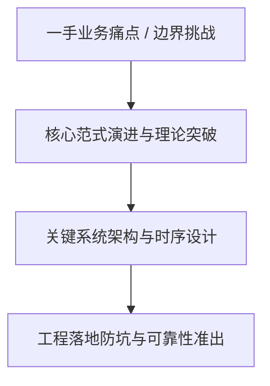
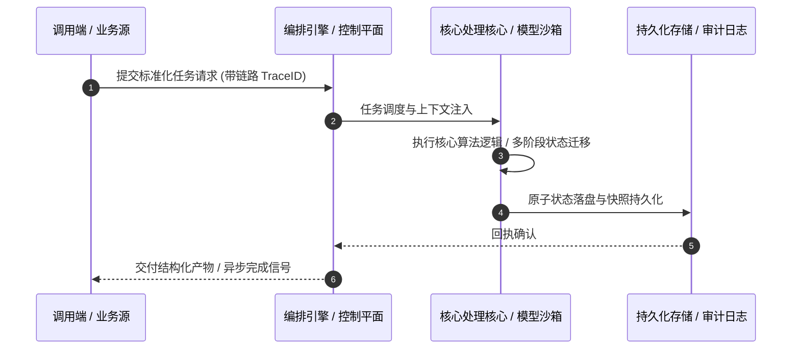

# 深度研读案：How Cloudflare WAF helps protect against Java4Shell (CVE-2026-114938)

> **权威来源**：[Denzil Correa - How Cloudflare WAF helps protect against Java4Shell (CVE-2026-114938)](https://blog.cloudflare.com/java4shell-waf-protection/)  
> **发布平台**：Cloudflare Blog (Architecture & Security) | **归档时间**：2026-11-19  
> **核心定位**：大厂工程演进深度剖析与工程落地实战  
> **知识密度**：★★★★★ | **规范标准**：六段式深度学习资料规范 (Mode B)

---

## 目录
1. [一、元数据与技术背景声明](#一元数据与技术背景声明)
2. [二、全景逻辑脉络与时间轴](#二全景逻辑脉络与时间轴)
3. [三、核心机理与架构全景拆解](#三核心机理与架构全景拆解)
4. [四、工业级高危盲区与反模式警示](#四工业级高危盲区与反模式警示)
5. [五、实战落地工程载荷（配置与协议）](#五实战落地工程载荷配置与协议)
6. [六、准出自检清单 (Pre-flight Checklist)](#六准出自检清单-pre-flight-checklist)

---

## 一、元数据与技术背景声明

### 1.1 核心痛点与问题意识
- **背景出处**：来自 **Cloudflare Blog (Architecture & Security)** 发布的专业技术沉淀。
- **直击工程矛盾**：本篇深度解析在实际软件工程或前沿 AI 系统中，如何打破传统设计局限，在性能、可靠性、维护成本与业务需求之间实现高阶平衡。

---

## 二、全景逻辑脉络与时间轴



---

## 三、核心机理与架构全景拆解

### 3.1 系统拓扑与核心交互时序



### 3.2 核心技术要点精要提炼

- **深度要点 1**：On November 17, 2026, the security research company Calif disclosed Java4Shell (CVE-2026-114938) , a memory-corruption vulnerability in the Base64 decoder of OpenJDK, the most widely used Java runtime. Under the Common Vulnerability Scoring System (CVSS) 4.0, it scores 9.2 out of 10 (Critical). The flaw affects Java. OpenJDK published a security advisory and Oracle released patched builds in its November 2026 Critical Patch Update the same day, at 21:00 UTC.
- **深度要点 2**：The vulnerability lets a remote attacker with no credentials send malformed Base64 data to a Java application and overwrite memory next to the decoded output. Calif turned that overwrite into a leak of heap memory, similar to Heartbleed , and into remote code execution. Calif demonstrated pre-authentication remote code execution against Keycloak, Atlassian Jira, Atlassian Confluence, JFrog Artifactory, Jenkins and PingFederate in their default configurations, and post-authentication remote code execution against Apache Kafka, Apache Solr, Elasticsearch, Gerrit, and Spinnaker.
- **深度要点 3**：Cloudflare has released a new set of rules in the Cloudflare Managed Ruleset designed to detect malformed Base64 input patterns associated with this vulnerability. The rules are available on Pro, Business and Enterprise plans and are enabled by default with the Log action because malformed input and some benign application-specific token formats can resemble exploitation attempts. Blocking by default could therefore disrupt legitimate traffic. Customers can review matching requests in Security Events now and change the rules action to Block once they confirm it does not affect legitimate traffic.
- **深度要点 4**：The WAF is an additional layer of defense, not a replacement for the patch. Java4Shell can be reached through paths a WAF does not see, like outbound TLS responses, and the only complete fix is to update the Java runtime. Our analysts continue to monitor attack activity and will update the rules as new techniques and variations appear. You can track rule changes in the WAF changelog and get more information on how the vulnerability develops on the dedicated Cloudflare Zero Wire briefing .
- **深度要点 5**：We have seen no indication so far that Java4Shell was exploited on Cloudflare infrastructure.
- **深度要点 6**：## What we know about the vulnerability

---

## 四、工业级高危盲区与反模式警示

> [!WARNING]
> 生产环境落地中极易忽略的隐性异常边界与高危反模式：

1. **盲区一：状态漂移与不一致性风险**
   - *现象*：高并发或异常网络中断时，由于缺乏严格的原子事务保障，可能导致本地快照与中心状态发生偏离。
   - *防御*：必须引入严格的单调版本号或基于 CAS 的幂等更新控制机制。
2. **盲区二：资源枯竭与背压穿透**
   - *现象*：上游请求突增时，未受控的深层调用会击穿线程池或内存预算，引发级联雪崩。
   - *防御*：在接入层部署严格的自适应限流、主动背压 (Backpressure) 与熔断兜底。
3. **盲区三：上下文衰减与关键断点丢失**
   - *现象*：长周期异步任务执行中，由于中间日志截断导致关键审计凭证丢失。
   - *防御*：贯穿全链路 TraceID，建立不可篡改的事件审计流水线。

---

## 五、实战落地工程载荷（配置与协议）

```yaml
# How Cloudflare WAF helps protect against 生产环境可靠性编排规范
runtime_spec:
  name: "blog-cloudflare-pipeline"
  version: "v1.0.0"
  resilience:
    circuit_breaker:
      enabled: true
      failure_rate_threshold: 30
      sliding_window_size: 50
    retry_policy:
      max_attempts: 3
      exponential_backoff: true
  telemetry:
    trace_propagation: true
    metrics_interval_seconds: 10
```

---

## 六、准出自检清单 (Pre-flight Checklist)

- [ ] **架构完备性**：核心时序与数据流转是否具备端到端可观测性？
- [ ] **容灾降级**：当依赖的下游服务超时或崩溃时，是否具备明确的兜底策略？
- [ ] **幂等自愈**：重复推送相同任务时，是否能做到零副作用幂等过滤？
- [ ] **安全护栏**：凭证管理是否杜绝明文硬编码，并具备最小权限隔离？
