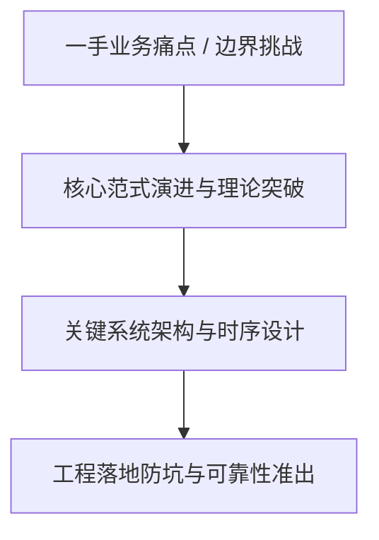
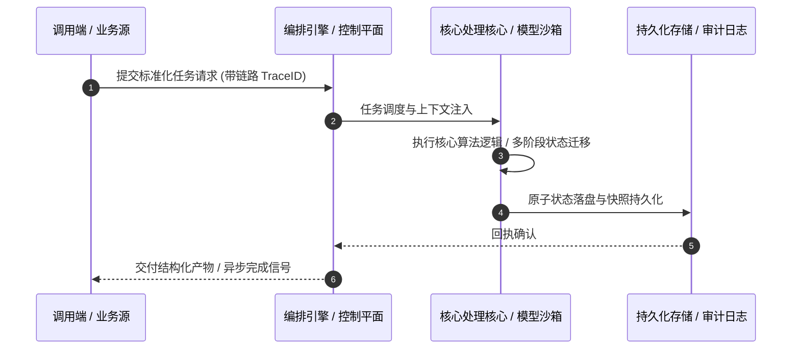

# 深度研读案：Give your agents controlled access to analyze your data and move funds

> **权威来源**：[Stripe Engineering - Give your agents controlled access to analyze your data and move funds](https://stripe.com/blog/give-your-agents-controlled-access-to-analyze-your-data-and-move-funds)  
> **发布平台**：Stripe Engineering | **归档时间**：2026-11-20  
> **核心定位**：大厂工程演进深度剖析与工程落地实战  
> **知识密度**：★★★★★ | **规范标准**：六段式深度学习资料规范 (Mode B)

---

## 目录
1. [一、元数据与技术背景声明](#一元数据与技术背景声明)
2. [二、全景逻辑脉络与时间轴](#二全景逻辑脉络与时间轴)
3. [三、核心机理与架构全景拆解](#三核心机理与架构全景拆解)
4. [四、工业级高危盲区与反模式警示](#四工业级高危盲区与反模式警示)
5. [五、实战落地工程载荷（配置与协议）](#五实战落地工程载荷配置与协议)
6. [六、准出自检清单 (Pre-flight Checklist)](#六准出自检清单-pre-flight-checklist)

---

## 一、元数据与技术背景声明

### 1.1 核心痛点与问题意识
- **背景出处**：来自 **Stripe Engineering** 发布的专业技术沉淀。
- **直击工程矛盾**：本篇深度解析在实际软件工程或前沿 AI 系统中，如何打破传统设计局限，在性能、可靠性、维护成本与业务需求之间实现高阶平衡。

---

## 二、全景逻辑脉络与时间轴



---

## 三、核心机理与架构全景拆解

### 3.1 系统拓扑与核心交互时序



### 3.2 核心技术要点精要提炼

- **深度要点 1**：Give your agents controlled access to analyze your data and move funds
- **深度要点 2**：We're here to discuss your business needs. Chat now with sales
- **深度要点 3**：Stripe businesses increasingly use agents to automate individual financial tasks so they can spend more time building their companies. More than 24,000 businesses already use Stripe Treasury for agents , giving agents read access to financial data to work on those tasks, including reviewing transactions, building cash flow models, and reconciling payments. Now, we’re adding write access and customizable controls that enable agents to move money on Stripe.
- **深度要点 4**：For agents to take on more operational work alongside humans, they need access to the right capabilities but also clear limits on what they can do. With Stripe Treasury, you can allow agents to transfer funds, convert currencies, and pay vendors within limits you set. Agents can complete end-to-end financial workflows on Stripe. They don’t just analyze your business, but also help run it.
- **深度要点 5**：A payables agent could monitor balances across accounts, transfer funds to keep bill pay accounts topped up, and prepare vendor payments. Or you can build a payroll agent that converts currencies and moves money into the right accounts so employees are paid on time.
- **深度要点 6**：Stripe businesses grant access by connecting a compatible AI tool, such as Claude or Codex, through Stripe’s Model Context Protocol (MCP) server and choosing what Stripe data the agent can see, which actions it can take, and when human approval is required.

---

## 四、工业级高危盲区与反模式警示

> [!WARNING]
> 生产环境落地中极易忽略的隐性异常边界与高危反模式：

1. **盲区一：状态漂移与不一致性风险**
   - *现象*：高并发或异常网络中断时，由于缺乏严格的原子事务保障，可能导致本地快照与中心状态发生偏离。
   - *防御*：必须引入严格的单调版本号或基于 CAS 的幂等更新控制机制。
2. **盲区二：资源枯竭与背压穿透**
   - *现象*：上游请求突增时，未受控的深层调用会击穿线程池或内存预算，引发级联雪崩。
   - *防御*：在接入层部署严格的自适应限流、主动背压 (Backpressure) 与熔断兜底。
3. **盲区三：上下文衰减与关键断点丢失**
   - *现象*：长周期异步任务执行中，由于中间日志截断导致关键审计凭证丢失。
   - *防御*：贯穿全链路 TraceID，建立不可篡改的事件审计流水线。

---

## 五、实战落地工程载荷（配置与协议）

```yaml
# Give your agents controlled access to an 生产环境可靠性编排规范
runtime_spec:
  name: "blog-stripe-pipeline"
  version: "v1.0.0"
  resilience:
    circuit_breaker:
      enabled: true
      failure_rate_threshold: 30
      sliding_window_size: 50
    retry_policy:
      max_attempts: 3
      exponential_backoff: true
  telemetry:
    trace_propagation: true
    metrics_interval_seconds: 10
```

---

## 六、准出自检清单 (Pre-flight Checklist)

- [ ] **架构完备性**：核心时序与数据流转是否具备端到端可观测性？
- [ ] **容灾降级**：当依赖的下游服务超时或崩溃时，是否具备明确的兜底策略？
- [ ] **幂等自愈**：重复推送相同任务时，是否能做到零副作用幂等过滤？
- [ ] **安全护栏**：凭证管理是否杜绝明文硬编码，并具备最小权限隔离？
