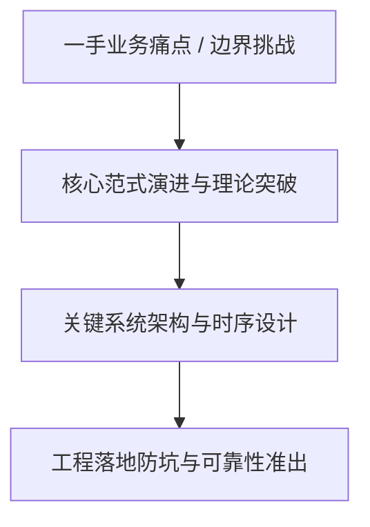
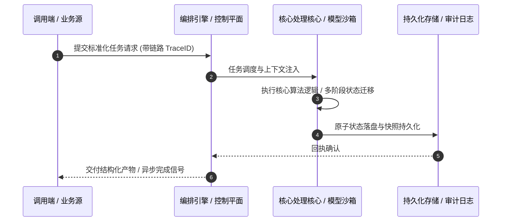

# 深度研读案：nginx2root: Five new nginx vulnerabilities, and how Cloudflare protects origins from the worst of them

> **权威来源**：[Dan Jones - nginx2root: Five new nginx vulnerabilities, and how Cloudflare protects origins from the worst of them](https://blog.cloudflare.com/nginx2root/)  
> **发布平台**：Cloudflare Blog (Architecture & Security) | **归档时间**：2026-11-20  
> **核心定位**：大厂工程演进深度剖析与工程落地实战  
> **知识密度**：★★★★★ | **规范标准**：六段式深度学习资料规范 (Mode B)

---

## 目录
1. [一、元数据与技术背景声明](#一元数据与技术背景声明)
2. [二、全景逻辑脉络与时间轴](#二全景逻辑脉络与时间轴)
3. [三、核心机理与架构全景拆解](#三核心机理与架构全景拆解)
4. [四、工业级高危盲区与反模式警示](#四工业级高危盲区与反模式警示)
5. [五、实战落地工程载荷（配置与协议）](#五实战落地工程载荷配置与协议)
6. [六、准出自检清单 (Pre-flight Checklist)](#六准出自检清单-pre-flight-checklist)

---

## 一、元数据与技术背景声明

### 1.1 核心痛点与问题意识
- **背景出处**：来自 **Cloudflare Blog (Architecture & Security)** 发布的专业技术沉淀。
- **直击工程矛盾**：本篇深度解析在实际软件工程或前沿 AI 系统中，如何打破传统设计局限，在性能、可靠性、维护成本与业务需求之间实现高阶平衡。

---

## 二、全景逻辑脉络与时间轴



---

## 三、核心机理与架构全景拆解

### 3.1 系统拓扑与核心交互时序



### 3.2 核心技术要点精要提炼

- **深度要点 1**：On November 18, 2026, F5 and nginx.org disclosed ten vulnerabilities in nginx. Five of them, detailed by the Xint research team and published under the name nginx2root , are memory corruption flaws that an unauthenticated attacker can use to crash an nginx worker or, per Xint's research, run commands on the server. Xint also found a Linux kernel bug that turns that foothold into root on the host, including from inside a Docker container. Other teams found the two HTTP/2 bugs independently: F5 also credits Rapid7, Wiz Research and Ikotas Labs for CVE-2026-123007, and Metnir, Wiz Research, and Palo Alto Networks Unit 42 for CVE-2026-123633.
- **深度要点 2**：nginx is an HTTP web server that also serves as reverse proxy, content cache, load balancer, TCP/UDP proxy server, and mail proxy server. nginx runs a large share of the world's web servers, so this is a patch-now event. But if your nginx server is reachable only through Cloudflare's proxy, attackers cannot reach the vulnerable code paths for the most serious of these bugs, giving you protection while you update your servers.
- **深度要点 3**：Here is where Cloudflare stands, what that protection covers, where it stops, and how the bugs work.
- **深度要点 4**：-  Cloudflare's edge is not affected. Much of the proxy that handles customer traffic at our edge now runs on FL2, written in Rust. We reviewed the parts still built on our heavily modified nginx fork against all five bugs before disclosure, and an update closing the related code paths finished rolling out globally before the vulnerabilities were published. The same releases fix five other nginx CVEs, including CVE-2026-118899, an infinite loop while reading a request body over TLS 1.3. -  Origins behind Cloudflare's HTTP proxy are shielded from the HTTP/2 and HTTP/3 attacks. For proxied hostnames, Cloudflare terminates every client HTTP/2 and HTTP/3 connection at our edge and opens a separate connection to your origin. The attacker's frames never reach your nginx. -  The resolver and mail proxy vulnerabilities depend on specific configuration. Many configurations of nginx will not be vulnerable, but the safest way to be sure is to update your install or disable features. -  You should still patch. Update to nginx 1.30.7 or 1.31.9 (or your vendor's fixed build) and restart. Some configurations, covered below, are not protected by the proxy.
- **深度要点 5**：nginx2root is five independent bugs. Each one works on its own and each one needs a different configuration.
- **深度要点 6**：Integer overflow leading to out-of-bounds heap read/write

---

## 四、工业级高危盲区与反模式警示

> [!WARNING]
> 生产环境落地中极易忽略的隐性异常边界与高危反模式：

1. **盲区一：状态漂移与不一致性风险**
   - *现象*：高并发或异常网络中断时，由于缺乏严格的原子事务保障，可能导致本地快照与中心状态发生偏离。
   - *防御*：必须引入严格的单调版本号或基于 CAS 的幂等更新控制机制。
2. **盲区二：资源枯竭与背压穿透**
   - *现象*：上游请求突增时，未受控的深层调用会击穿线程池或内存预算，引发级联雪崩。
   - *防御*：在接入层部署严格的自适应限流、主动背压 (Backpressure) 与熔断兜底。
3. **盲区三：上下文衰减与关键断点丢失**
   - *现象*：长周期异步任务执行中，由于中间日志截断导致关键审计凭证丢失。
   - *防御*：贯穿全链路 TraceID，建立不可篡改的事件审计流水线。

---

## 五、实战落地工程载荷（配置与协议）

```yaml
# nginx2root: Five new nginx vulnerabiliti 生产环境可靠性编排规范
runtime_spec:
  name: "blog-cloudflare-pipeline"
  version: "v1.0.0"
  resilience:
    circuit_breaker:
      enabled: true
      failure_rate_threshold: 30
      sliding_window_size: 50
    retry_policy:
      max_attempts: 3
      exponential_backoff: true
  telemetry:
    trace_propagation: true
    metrics_interval_seconds: 10
```

---

## 六、准出自检清单 (Pre-flight Checklist)

- [ ] **架构完备性**：核心时序与数据流转是否具备端到端可观测性？
- [ ] **容灾降级**：当依赖的下游服务超时或崩溃时，是否具备明确的兜底策略？
- [ ] **幂等自愈**：重复推送相同任务时，是否能做到零副作用幂等过滤？
- [ ] **安全护栏**：凭证管理是否杜绝明文硬编码，并具备最小权限隔离？
