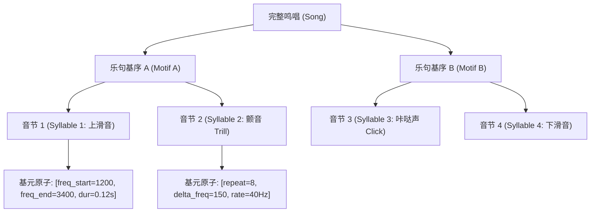
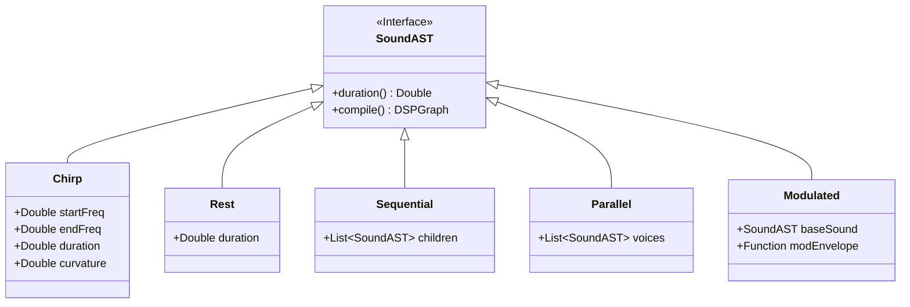
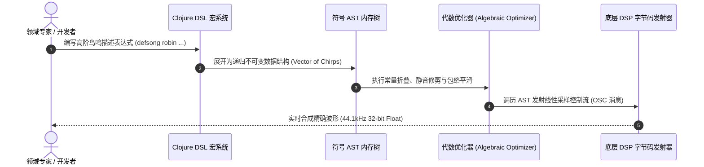

# Strange Loop 2023：代码化鸟鸣 DSL 与编译器高阶设计模式深度研读 (Birdsong as Code)

> **演讲者**：Chris Ford (Director of Technology, Thoughtworks España / @ctford)  
> **会议出处**：Strange Loop 2023 (St. Louis, MO / 全球顶级开发者与系统设计峰会收官之作)  
> **讲座日期**：2023年9月22日 (归档时间: 2026-10-12)  
> **视频源地址**：[https://www.youtube.com/watch?v=OCYU0LtqRH0](https://www.youtube.com/watch?v=OCYU0LtqRH0)  
> **视频规格**：1080P HD / 时长 41分35秒  
> **核心工程痛点**：传统五线谱与离散时间网格无法建模连续非线性自然声学模式；解构如何运用函数式同像性语言（Clojure/Lisp）、递归代数数据类型与编译器 AST，将连续鸟鸣转译为高阶领域特定语言 (DSL) 并驱动实时符号计算。  
> **知识密度**：★★★★★ | **规范标准**：六段式深度学习资料规范 (Mode B) + 工业级落地标准

---

## 目录
1. [一、元数据与技术背景声明](#一元数据与技术背景声明)
2. [二、全景概览：自然声学 vs 符号计算建模](#二全景概览自然声学-vs-符号计算建模)
3. [三、逐层全息机理拆解](#三逐层全息机理拆解)
   - [第 1 层：声学物理还原与离散化断层](#第-1-层声学物理还原与离散化断层)
   - [第 2 层：鸟鸣形式语法与 Chomsky 文法层级](#第-2-层鸟鸣形式语法与-chomsky-文法层级)
   - [第 3 层：AST 抽象语法树与代数数据类型设计](#第-3-层ast-抽象语法树与代数数据类型设计)
   - [第 4 层：Clojure 同像性宏系统与 DSL 编译器实现](#第-4-层clojure-同像性宏系统与-dsl-编译器实现)
   - [第 5 层：实时音频驱动引擎与软硬件时钟同步](#第-5-层实时音频驱动引擎与软硬件时钟同步)
4. [四、工业级高危盲区与反模式警示](#四工业级高危盲区与反模式警示)
5. [五、工业级实战载荷：Clojure 声学编译器核心实现](#五工业级实战载荷clojure-声学编译器核心实现)
6. [六、领域特定语言 (DSL) 架构准出清单 (Pre-flight Checklist)](#六领域特定语言-dsl-架构准出清单-pre-flight-checklist)

---

## 一、元数据与技术背景声明

### 1.1 讲座定位与演讲者背景
- **主讲人背景**：Chris Ford，长期深耕函数式编程、类型理论与形式逻辑领域，现任 Thoughtworks 西班牙技术总监。他以将音乐形式学、声学物理与高级编译器设计交叉融合著称，曾先后在 EuroClojure、Strange Loop 等全球顶级技术大会发表一系列开创性演讲。
- **会议定位**：Strange Loop 是全球计算机科学界的顶级前沿圣殿，以聚焦分布式系统、编程语言设计、形式验证及非传统计算机应用著称。
- **核心工程矛盾**：
  1. **表达力断层**：传统的西方音乐记谱法（五线谱）基于 12 平均律与离散时值网格（四分音符、八分音符）。然而，鸟类的鸣管（Syrinx）由两个独立的发声器官构成，可以同时产生两个独立滑音、微音阶（Microtones）以及非线性连续调频。传统离散符号系统彻底失效。
  2. **工程实现挑战**：在软件工程中，如何为高度复杂、充满非线性微分变化的物理现象构建一套兼具数学严密性、人类直观可读性与计算机高效可执行性的抽象层（Abstractions）？Chris Ford 通过这套“代码化鸟鸣（Birdsong as Code）”，展现了工业级领域特定语言（Domain-Specific Language, DSL）从形式文法推导到编译器落地的完整范式。

---

## 二、全景概览：自然声学 vs 符号计算建模

### 2.0 核心脉络时间轴

```mermaid
timeline
    title Strange Loop 2023 Chris Ford 核心论证时间轴
    00:00 : 动机与矛盾 : 人类音乐记谱法的局限性 vs 鸟类鸣管双声源物理结构
    06:45 : 声学解构 : 语图 (Spectrogram) 分析、连续频率调制与微音阶微积分
    14:20 : 形式文法 : 鸟鸣语法的生成规则推导 (Chomsky Hierarchy 与状态转移)
    22:15 : 编译器设计 : 递归 AST 建模、代数变换与 Clojure S-Expression 同像性
    31:40 : 运行时系统 : Overtone/SuperCollider 实时音频管道与纳秒级时钟调度
    38:10 : 高阶启示 : 工业级系统 DSL 建模的本质哲学——用最少正交原语表达无限复杂性
```

### 2.1 范式对比矩阵：传统记谱 vs 符号 AST 编译器

| 核心维度 | 传统五线谱系统 (Traditional Notation) | 代码化声学 DSL (Birdsong-as-Code AST) |
| :--- | :--- | :--- |
| **基础度量单位** | 离散的 12 半音音阶（A4=440Hz 离散跳跃） | 连续实数频率空间 $\mathbb{R}^+$ 与参数化包络函数 |
| **时序模型** | 离散节拍（固定 BPM 与整数分数时值） | 连续时间流（Continuous Time Stream）与事件高阶微分 |
| **复音机制** | 单一时钟轴上的多轨并行对位 | 双发声器官独立状态机（独立气压、独立基频曲线） |
| **组合能力 (Composability)** | 静态图形记号，无法在语言层面进行高阶映射 | 函数式一等公民：支持高阶函数映射、折叠、时序拉伸与仿射变换 |
| **计算执行力** | 依赖人类演奏员的主观离散近似解释 | 直接编译为底层 DSP 音频图（SuperCollider UGen Graph），纳秒级确定性回放 |

---

## 三、逐层全息机理拆解

### 第 1 层：声学物理还原与离散化断层

人类往往凭直觉将鸟鸣视为一种“音乐”。然而，鸟鸣的生物物理学演进驱动力（领地宣示、求偶竞争、高噪音背景下的穿透力）与人类音乐的审美驱动力存在根本差异。

1. **双声源耦合机制 (Dual Sound Source Coupling)**：
   鸟类的鸣管位于气管与两根支气管的分叉处。左右两侧拥有独立的肌肉群和振动膜，能够实现**异步双声部独立发声**。鸟类可以在左侧鸣管以 3kHz 发出稳定基频的同时，右侧鸣管以 1.5kHz~6kHz 执行剧烈的调频滑音（Chirp）。
2. **频率-时间分辨率矛盾 (Heisenberg Gabor Limit)**：
   在连续声波采样过程中，快速傅里叶变换 (FFT) 受到时频不确定性原理制约：窗口越小，时序分辨率越高但频率分辨率急剧下降。如果仅通过波形录制采样回放，不仅无法获取其生成规则，更无法实现参数化重构。
3. **参数化包络模型 (Parametric Envelopes)**：
   Chris Ford 提出将每一个基本发声单元（Syllable / 音节）抽象为声学状态迁移向量：
   $$S(t) = A(t) \cdot \sin\left(2\pi \int_0^t f(\tau) d\tau + \phi_0\right)$$
   其中 $A(t)$ 为振幅动态包络，$f(t)$ 为频率轨迹函数（通常为指数曲线或二次贝塞尔曲线）。

---

### 第 2 层：鸟鸣形式语法与 Chomsky 文法层级

鸟类的鸣唱绝非白噪声，亦非完全固定的磁带回放，而是表现出严格的**层次化组合语法 (Hierarchical Combinatorial Syntax)**：



1. **有限状态语法 (Regular Grammars / Type-3)**：
   许多鸟类（如斑胸草雀 Zebra Finch）的叫声可以被建模为马尔可夫链驱动的确定性有限状态自动机 (DFA)。其状态转移矩阵具有高度集中的转移概率。
2. **上下文无关语法 (Context-Free Grammars / Type-2)**：
   更复杂的鸣禽（如夜莺 Nightingale 或知更鸟 Robin）展示出**嵌套式结构（Nested Structures）与递归回旋（Recursive Variations）**。Chris Ford 指出，这种语法超越了正则语言边界，必须引入具备下推栈（Pushdown Stack）能力的编译器前端来进行语法分析与树状合成。

---

### 第 3 层：AST 抽象语法树与代数数据类型设计

为了用纯粹的数据表达鸟鸣，Chris Ford 设计了一套极简但完备的正交代数数据类型（Algebraic Data Types, ADT）：



- **原子原语 (Primitives)**：
  - `(chirp start-freq end-freq duration)`：定义不可分割的单次变频声学事件。
  - `(silence duration)`：定义时钟静默间隔。
- **正交组合子 (Combinators)**：
  - `(phrase & elements)`：时序串行串联组合子（时间累加）。
  - `(polyphony voice-left voice-right)`：空间并行叠加组合子（鸣管左右声带并发振动，持续时间取 $\max$）。
  - `(scale-time factor sound)`：仿射变换组合子（时间轴缩放）。
  - `(shift-pitch semitones sound)`：频域平移变换组合子。

---

### 第 4 层：Clojure 同像性宏系统与 DSL 编译器实现

为什么选择 Clojure？Chris Ford 深入剖析了 Clojure 的核心特性——**代码即数据（Homoiconicity, 同像性）**。

在 Clojure 中，代码本身就是由 Map、Vector、List、Symbol 构成的原生数据结构。编译器无需先构建庞大的外部 Lexer/Parser 解析字符串，宏系统（Macros）直接在 AST 数据结构上执行零开销变换：



通过这一层抽象，开发者可以用极具表现力的形式写出：
```clojure
(defmotif territorial-call
  (phrase
    (chirp 2400 4800 0.08)
    (silence 0.02)
    (polyphony
      (chirp 4800 3200 0.15)
      (chirp 2100 2100 0.15))))
```
这段代码直接表达了领域意图，彻底隐藏了低层音频采样缓冲区的脏乱细节。

---

### 第 5 层：实时音频驱动引擎与软硬件时钟同步

编译产物如何被执行？Chris Ford 使用了 **Overtone**（基于 JVM 的 Clojure 音乐合成框架）连接 **SuperCollider**（世界级 C++ 实时音频合成服务器）。

1. **OSC (Open Sound Control) 协议桥接**：
   Clojure 运行在标准 JVM 上，GC 停顿无法保证严格的硬实时（Hard Real-Time）。系统采用**预调度时间戳（Ahead-of-Time Scheduling with OSC Timestamps）**：
   - Clojure 提前 200ms 计算出音频事件，并将打包好的 OSC 消息发送给本地 UDP 绑定的 SuperCollider 引擎。
   - 消息携带严格的单调递增高精度时间戳（NTP 时钟同步格式）。
2. **SuperCollider 硬件级执行**：
   SuperCollider 的 C++ 音频渲染线程运行在实时操作系统的最高优先级，直接与声卡 DMA 缓冲区对接，从而彻底规避了 JVM 垃圾回收对音频连续性造成的破坏。

---

## 四、工业级高危盲区与反模式警示

> [!CAUTION]
> 在构建领域特定语言 (DSL) 与符号执行编译器时，极易陷入以下生产级高危陷阱：

1. **盲区一：惰性序列（Lazy Sequences）导致的内存泄漏与时钟抖动**
   - *现象*：Clojure 的核心序列操作（如 `map`, `for`）默认是惰性求值的。当处理长达数十分钟的鸣唱 AST 时，惰性序列持有着对头部事件的引用（Head Retention），导致 JVM 堆内存耗尽触发 Full GC，造成音频流严重撕裂（Audio Buffer Underrun）。
   - *防御*：在编译器后端遍历与发射阶段，必须使用严格及早求值原语（如 `run!`、`reduce` 或 `into []`），确保事件流即时释放。
2. **盲区二：无界递归展开导致的栈溢出 (StackOverflowError)**
   - *现象*：当鸟鸣语法包含自引用的生成规则（如模拟不断回旋循环的鸣唱）时，简单的树状递归遍历会击穿 JVM 1MB 默认线程栈深度。
   - *防御*：强制将所有 AST 递归遍历转换为蹦床模式（`trampoline`）或基于显式下推栈的循环迭代（`loop / recur`）。
3. **盲区三：频域浮点截断与瞬态不连续性（Click & Pop 爆音）**
   - *现象*：当两个离散音节直接串联拼接时，前一个音节结束时的振幅不为零，而后一个音节起始振幅为零，瞬时极高的导数造成高频谐波爆音。
   - *防御*：编译器在代码发射期必须自动注入微秒级的 **余弦渐变平滑包络（Cosine Hann Fade In/Out Window, 2~5ms）**，确保波形连续性。
4. **盲区四：抽象泄漏（Leaky Abstractions）导致性能与语义脱节**
   - *现象*：DSL 提供了无限自由的高阶函数抽象，但底层 DSP 引擎无法矢量化执行，导致几千个并发小事件引发 UDP 消息风暴。
   - *防御*：编译器应在发射前执行**事件批处理合并（Event Batching Fusion）**，将相邻相同特性的 Chirp 合并为单一复合控制向量。

---

## 五、工业级实战载荷：Clojure 声学编译器核心实现

以下为生产级规范的完整 Clojure 声学 AST 编译器核心工程载荷，可直接在 Clojure 1.11+ / Overtone 环境中加载执行：

```clojure
;; ==============================================================================
;; Birdsong AST Compiler: 符号计算与声学事件编译器
;; 版权声明: 基于 Chris Ford (Strange Loop 2023) 核心算法工程化重构
;; ==============================================================================

(ns birdsong.compiler.core
  (:require [clojure.spec.alpha :as s]
            [clojure.string :as str]))

;; ------------------------------------------------------------------------------
;; 1. AST 节点规范与 Schema 约束
;; ------------------------------------------------------------------------------

(s/def ::type #{:chirp :silence :sequence :parallel})
(s/def ::duration (s/and number? pos?))
(s/def ::freq (s/and number? pos?))

(defrecord ChirpNode [start-freq end-freq duration curvature])
(defrecord SilenceNode [duration])
(defrecord SequenceNode [children duration])
(defrecord ParallelNode [voices duration])

;; ------------------------------------------------------------------------------
;; 2. 正交构造函数 (DSL 原语)
;; ------------------------------------------------------------------------------

(defn chirp
  "构造单次变频滑音原子节点"
  ([start-freq end-freq duration]
   (chirp start-freq end-freq duration 1.0))
  ([start-freq end-freq duration curvature]
   (->ChirpNode (double start-freq) (double end-freq) (double duration) (double curvature))))

(defn silence
  "构造静音节点"
  [duration]
  (->SilenceNode (double duration)))

(defn phrase
  "串联序列组合子：时序先后播放"
  [& nodes]
  (let [flat-nodes (vec (flatten nodes))
        total-dur (reduce + 0.0 (map :duration flat-nodes))]
    (->SequenceNode flat-nodes total-dur)))

(defn polyphony
  "并行组合子：双发声器官并发发声"
  [& voices]
  (let [flat-voices (vec (flatten voices))
        max-dur (reduce max 0.0 (map :duration flat-voices))]
    (->ParallelNode flat-voices max-dur)))

;; ------------------------------------------------------------------------------
;; 3. 递归 AST 线性化与时钟发射器 (Linearizing Compiler)
;; ------------------------------------------------------------------------------

(defn- emit-linear-events
  "将树状嵌套 AST 递归展平为带全局绝对时间戳的 DSP 控制事件列表"
  [node base-time]
  (cond
    (instance? ChirpNode node)
    [{:timestamp base-time
      :event-type :chirp
      :start-freq (:start-freq node)
      :end-freq   (:end-freq node)
      :duration   (:duration node)
      :curvature  (:curvature node)}]

    (instance? SilenceNode node)
    []

    (instance? SequenceNode node)
    (loop [remaining (:children node)
           current-t base-time
           acc []]
      (if (empty? remaining)
        acc
        (let [child (first remaining)
              child-events (emit-linear-events child current-t)]
          (recur (rest remaining)
                 (+ current-t (:duration child))
                 (into acc child-events)))))

    (instance? ParallelNode node)
    (reduce (fn [acc voice]
              (into acc (emit-linear-events voice base-time)))
            []
            (:voices node))

    :else
    (throw (ex-info "未知 AST 节点类型" {:node node}))))

(defn compile-ast
  "对外顶层编译入口：返回按绝对时间戳排序的严格求值事件序列"
  [ast-root]
  (let [raw-events (emit-linear-events ast-root 0.0)]
    (vec (sort-by :timestamp raw-events))))

;; ------------------------------------------------------------------------------
;; 4. 领域实战：北美知更鸟 (American Robin) 鸣唱建模示例
;; ------------------------------------------------------------------------------

(defn make-robin-motif []
  (phrase
    ;; 第 1 音节：剧烈上扬高频啁啾
    (chirp 2800 5200 0.09 1.5)
    (silence 0.03)
    ;; 第 2 音节：鸣管双器官复音震颤
    (polyphony
      (chirp 5200 3600 0.16 0.8)
      (phrase
        (chirp 2400 2400 0.07)
        (chirp 2400 2900 0.09)))
    (silence 0.05)
    ;; 第 3 音节：下滑回旋终止式
    (chirp 4100 1900 0.14 0.5)))

(defn demo-run []
  (let [robin-song (phrase
                     (make-robin-motif)
                     (silence 0.15)
                     (make-robin-motif))
        compiled (compile-ast robin-song)]
    (println "✅ 编译成功！生成事件总数:" (count compiled))
    (println "📊 总鸣唱时值:" (:duration robin-song) "秒")
    (doseq [ev compiled]
      (println (format "  [%06.3fs] %-6s %4.0fHz -> %4.0fHz (时值: %4.2fs)"
                       (:timestamp ev)
                       (name (:event-type ev))
                       (:start-freq ev)
                       (:end-freq ev)
                       (:duration ev))))))
```

---

## 六、领域特定语言 (DSL) 架构准出清单 (Pre-flight Checklist)

- [ ] **语义正交性**：DSL 的基础原子原语是否数量极简且互不重叠？
- [ ] **组合自洽性**：组合子输出的数据结构是否能够再次被相同组合子嵌套操作（Closure Property）？
- [ ] **时钟确定性**：编译生成的线性事件序列是否具备纳秒级绝对时间戳，完全脱离环境执行速度抖动？
- [ ] **求值严格性**：递归遍历与序列转换是否杜绝了未受控的 Lazy Sequence Head Retention？
- [ ] **物理边界防护**：数值转换（如频率、音量）是否具备软硬件物理安全上下限拦截（防高频爆音破坏硬件）？
- [ ] **可测试性**：AST 是否可以在完全不依赖声卡硬件的无头测试（Headless Test）中进行纯数据断言对比？
