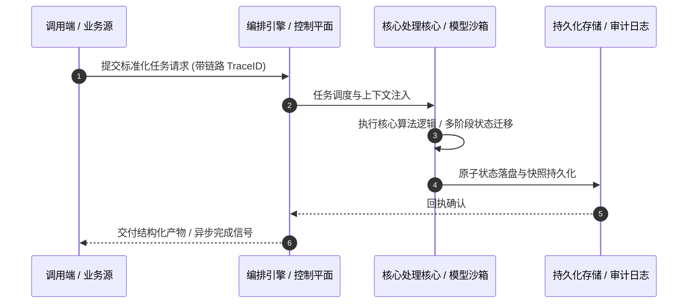

# 深度研读案：Open Source Is Under Attack & AI Made It Worse • Steve Poole & Olimpiu Pop • GOTO 2026

> **权威来源**：[GOTO Conferences - Open Source Is Under Attack & AI Made It Worse • Steve Poole & Olimpiu Pop • GOTO 2026](https://www.youtube.com/watch?v=aUIbUnWj8N0)  
> **发布平台**：GOTO Conferences | **归档时间**：2026-10-25  
> **核心定位**：顶级峰会与讲座深度剖析与工程落地实战  
> **知识密度**：★★★★★ | **规范标准**：六段式深度学习资料规范 (Mode B)

---

## 目录
1. [一、元数据与技术背景声明](#一元数据与技术背景声明)
2. [二、全景逻辑脉络与时间轴](#二全景逻辑脉络与时间轴)
3. [三、核心机理与架构全景拆解](#三核心机理与架构全景拆解)
4. [四、工业级高危盲区与反模式警示](#四工业级高危盲区与反模式警示)
5. [五、实战落地工程载荷（配置与协议）](#五实战落地工程载荷配置与协议)
6. [六、准出自检清单 (Pre-flight Checklist)](#六准出自检清单-pre-flight-checklist)

---

## 一、元数据与技术背景声明

### 1.1 核心痛点与问题意识
- **背景出处**：来自 **GOTO Conferences** 发布的专业技术沉淀。
- **直击工程矛盾**：本篇深度解析在实际软件工程或前沿 AI 系统中，如何打破传统设计局限，在性能、可靠性、维护成本与业务需求之间实现高阶平衡。

---

## 二、全景逻辑脉络与时间轴

```mermaid
timeline
    title Open Source Is Under Attack &  核心脉络推进时间轴
    00:00 : Intro : Intro
    01:30 : A watershed moment f : or software supply chains
    04:50 : How attackers actual : ly get in
    08:59 : The CRA regulators : & a surprise enforcer Insurers
    11:58 : Maintainers are walk : ing away
    19:41 : Vibe coding brings 3 : x more dependencies
```

---

## 三、核心机理与架构全景拆解

### 3.1 系统拓扑与核心交互时序



### 3.2 核心技术要点精要提炼

- **深度要点 1**：This interview was recorded for GOTO Unscripted. #GOTOcon #GOTOunscripted https://gotopia.tech
- **深度要点 2**：Steve Poole - Developer Advocate at HeroDevs & Community Director at London Java Community Olimpiu Pop - Technologist & Tech Journalist
- **深度要点 3**：Check out more here: https://gotopia.tech/articles/457
- **深度要点 4**：RESOURCES Steve https://x.com/spoole167 https://github.com/spoole167 https://www.linkedin.com/in/noregressions
- **深度要点 5**：Olimpiu https://x.com/olimpiupop https://github.com/zroll https://www.linkedin.com/in/olimpiupop
- **深度要点 6**：DESCRIPTION Steve Poole of HeroDevs, a longtime voice on software supply chain security, tells host Olimpiu Pop that the landscape has hit a "watershed moment" in the last few weeks. The long-standing attack methods are simple: typo'd or confusingly named packages, unchecked scripts, inflated version numbers that trick builds into pulling the wrong release, and maintainers who build trust and then turn bad. Developers are among the weakest links because their machines hold so many credentials. The new factor is AI-driven vulnerability discovery, which both attackers and security researchers are using. Steve's concern is that discovery is now industrialized while fixing is not: maintainers who once saw a CVE or two a year may now face batches of them, and he fears more will simply walk away. Unsupported packages are especially exposed, since CVEs against them often never get reported at all. His worst-case scenario is that open source security fixes end up arriving in small commercial enclaves first, as regulation and cyber insurers push companies to pay for maintenance.

---

## 四、工业级高危盲区与反模式警示

> [!WARNING]
> 生产环境落地中极易忽略的隐性异常边界与高危反模式：

1. **盲区一：状态漂移与不一致性风险**
   - *现象*：高并发或异常网络中断时，由于缺乏严格的原子事务保障，可能导致本地快照与中心状态发生偏离。
   - *防御*：必须引入严格的单调版本号或基于 CAS 的幂等更新控制机制。
2. **盲区二：资源枯竭与背压穿透**
   - *现象*：上游请求突增时，未受控的深层调用会击穿线程池或内存预算，引发级联雪崩。
   - *防御*：在接入层部署严格的自适应限流、主动背压 (Backpressure) 与熔断兜底。
3. **盲区三：上下文衰减与关键断点丢失**
   - *现象*：长周期异步任务执行中，由于中间日志截断导致关键审计凭证丢失。
   - *防御*：贯穿全链路 TraceID，建立不可篡改的事件审计流水线。

---

## 五、实战落地工程载荷（配置与协议）

```yaml
# Open Source Is Under Attack & AI Made It 生产环境可靠性编排规范
runtime_spec:
  name: "conf-goto-pipeline"
  version: "v1.0.0"
  resilience:
    circuit_breaker:
      enabled: true
      failure_rate_threshold: 30
      sliding_window_size: 50
    retry_policy:
      max_attempts: 3
      exponential_backoff: true
  telemetry:
    trace_propagation: true
    metrics_interval_seconds: 10
```

---

## 六、准出自检清单 (Pre-flight Checklist)

- [ ] **架构完备性**：核心时序与数据流转是否具备端到端可观测性？
- [ ] **容灾降级**：当依赖的下游服务超时或崩溃时，是否具备明确的兜底策略？
- [ ] **幂等自愈**：重复推送相同任务时，是否能做到零副作用幂等过滤？
- [ ] **安全护栏**：凭证管理是否杜绝明文硬编码，并具备最小权限隔离？
