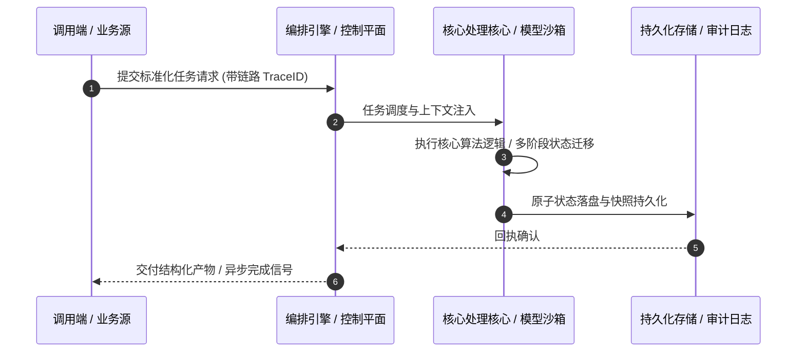

# 深度研读案：Engineer Confidence with Reliable Training Programs • Jennifer Petoff • GOTO Copenhagen 2026

> **权威来源**：[GOTO Conferences - Engineer Confidence with Reliable Training Programs • Jennifer Petoff • GOTO Copenhagen 2026](https://www.youtube.com/watch?v=V0rIn_vb1VU)  
> **发布平台**：GOTO Conferences | **归档时间**：2026-11-17  
> **核心定位**：顶级峰会与讲座深度剖析与工程落地实战  
> **知识密度**：★★★★★ | **规范标准**：六段式深度学习资料规范 (Mode B)

---

## 目录
1. [一、元数据与技术背景声明](#一元数据与技术背景声明)
2. [二、全景逻辑脉络与时间轴](#二全景逻辑脉络与时间轴)
3. [三、核心机理与架构全景拆解](#三核心机理与架构全景拆解)
4. [四、工业级高危盲区与反模式警示](#四工业级高危盲区与反模式警示)
5. [五、实战落地工程载荷（配置与协议）](#五实战落地工程载荷配置与协议)
6. [六、准出自检清单 (Pre-flight Checklist)](#六准出自检清单-pre-flight-checklist)

---

## 一、元数据与技术背景声明

### 1.1 核心痛点与问题意识
- **背景出处**：来自 **GOTO Conferences** 发布的专业技术沉淀。
- **直击工程矛盾**：本篇深度解析在实际软件工程或前沿 AI 系统中，如何打破传统设计局限，在性能、可靠性、维护成本与业务需求之间实现高阶平衡。

---

## 二、全景逻辑脉络与时间轴

```mermaid
timeline
    title Engineer Confidence with Relia 核心脉络推进时间轴
    00:00 : intro : intro
    06:15 : Why is training impo : rtant?
    14:29 : Those that start op : DevOps - Step 2 Tailor the message
    21:54 : Consider the How?2 : Consider the How?2
    28:52 : Lets get meta for a : minute
    34:57 : Better instrumented : for observability - SRE v2
```

---

## 三、核心机理与架构全景拆解

### 3.1 系统拓扑与核心交互时序



### 3.2 核心技术要点精要提炼

- **深度要点 1**：This presentation was recorded at GOTO Copenhagen 2026. #GOTOcon #GOTOcph Join us at GOTO Copenhagen 2027, October 4–8. https://gotocph.com/2027?utm_source=youtube&utm_medium=video&utm_campaign=cph26-talks
- **深度要点 2**：Jennifer Petoff - Co-Editor, Site Reliability Engineering @JenniferPetoff
- **深度要点 3**：RESOURCES https://x.com/jennski https://www.linkedin.com/in/jpetoff https://gotopia.tech/experts/2162/jennifer-petoff
- **深度要点 4**：ABSTRACT In 2026, "Engineering for Reality" means acknowledging that software ownership is a human challenge as much as a technical one. The mantra "you ship it, you own it" only works if engineers have the confidence to face production without fear. Confidence isn't a personality trait—it is an engineered outcome of focused training.
- **深度要点 5**：When engineers are left to "sink or swim", it breeds stress, imposter syndrome, and attrition. To enable them to build and operate software with confidence, we must build their confidence through targeted and reliable learning programs underpinned by Site Reliability Engineering (SRE) principles and best practices.
- **深度要点 6**：Drawing on proven methodologies from Google’s SRE EDU program, this session provides a blueprint for transforming training from a passive lecture into a reliability-critical asset, one where learning drives confidence, confidence drives behavior, and that behavior repeated over time enables a “you build it, you ship it, you own it” culture.)

---

## 四、工业级高危盲区与反模式警示

> [!WARNING]
> 生产环境落地中极易忽略的隐性异常边界与高危反模式：

1. **盲区一：状态漂移与不一致性风险**
   - *现象*：高并发或异常网络中断时，由于缺乏严格的原子事务保障，可能导致本地快照与中心状态发生偏离。
   - *防御*：必须引入严格的单调版本号或基于 CAS 的幂等更新控制机制。
2. **盲区二：资源枯竭与背压穿透**
   - *现象*：上游请求突增时，未受控的深层调用会击穿线程池或内存预算，引发级联雪崩。
   - *防御*：在接入层部署严格的自适应限流、主动背压 (Backpressure) 与熔断兜底。
3. **盲区三：上下文衰减与关键断点丢失**
   - *现象*：长周期异步任务执行中，由于中间日志截断导致关键审计凭证丢失。
   - *防御*：贯穿全链路 TraceID，建立不可篡改的事件审计流水线。

---

## 五、实战落地工程载荷（配置与协议）

```yaml
# Engineer Confidence with Reliable Traini 生产环境可靠性编排规范
runtime_spec:
  name: "conf-goto-pipeline"
  version: "v1.0.0"
  resilience:
    circuit_breaker:
      enabled: true
      failure_rate_threshold: 30
      sliding_window_size: 50
    retry_policy:
      max_attempts: 3
      exponential_backoff: true
  telemetry:
    trace_propagation: true
    metrics_interval_seconds: 10
```

---

## 六、准出自检清单 (Pre-flight Checklist)

- [ ] **架构完备性**：核心时序与数据流转是否具备端到端可观测性？
- [ ] **容灾降级**：当依赖的下游服务超时或崩溃时，是否具备明确的兜底策略？
- [ ] **幂等自愈**：重复推送相同任务时，是否能做到零副作用幂等过滤？
- [ ] **安全护栏**：凭证管理是否杜绝明文硬编码，并具备最小权限隔离？
