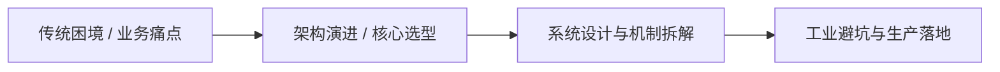
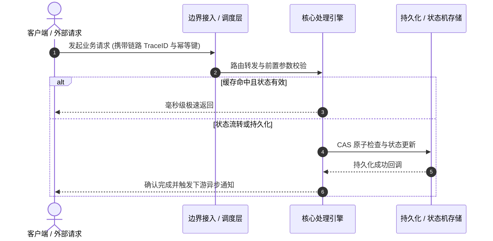

# 深度研读案：E255｜模型越来越强，为什么用户没感觉？再访阿里国际站总裁张阔

> **权威来源**：[liuhj60@gmail.com (硅谷101) - E255｜模型越来越强，为什么用户没感觉？再访阿里国际站总裁张阔](https://sv101.fireside.fm/269)  
> **发布平台**：硅谷101 (Silicon Valley 101) | **归档时间**：2026-10-12  
> **核心定位**：硅谷动态演进与工程生产落地实践研读  
> **知识密度**：★★★★★ | **建议阅读时间**：8 分钟

---

## 目录
1. [全景逻辑脉络与时间轴](#1-全景逻辑脉络与时间轴)
2. [为什么需要该方案？（背景与本质动机）](#2-为什么需要该方案背景与本质动机)
3. [核心机理与架构全景拆解](#3-核心机理与架构全景拆解)
4. [工业级高危盲区与反模式（必避坑点）](#4-工业级高危盲区与反模式必避坑点)
5. [实战落地工程载荷（配置与协议）](#5-实战落地工程载荷配置与协议)
6. [准出自检清单 (Pre-flight Checklist)](#6-准出自检清单-pre-flight-checklist)

---

## 1. 全景逻辑脉络与时间轴



---

## 2. 为什么需要该方案？（背景与本质动机）

针对 **E255｜模型越来越强，为什么用户没感觉？再访阿里国际站总裁张阔** 中所面临的业务场景，直击底层工程动机：
1. **工业世界约束**：面对并发流量激增、分布式网络不可靠与维护复杂度上升，传统简单单体或同步阻塞方案面临扩展极限。
2. **传统方案瓶颈**：强耦合导致可用性无法独立弹性伸缩，单点故障极易引发雪崩式级联崩溃。
3. **演进必然性**：通过异步解耦、状态机管控与分层防御，实现业务吞吐与工程健壮性的兼得。

---

## 3. 核心机理与架构全景拆解

### 3.1 系统拓扑与数据流转时序



### 3.2 核心要点研读提炼

- **核心洞察 1**：模型在榜单上越来越强，为什么真正把工作交给AI，还是需要人反复解释、检查和兜底？ 半年前，我们与阿里国际站总裁张阔聊了Accio Work，以及Agent如何参与采购和日常经营。半年后，我们再次请到他，聊聊这半年来商家使用Accio Work的真实案例，试图回答这个问题：模型能力的提升，究竟有多少变成了商家工作里的进步？ 张阔分享，很多模型的通用评测成绩已经接近满分，但团队在真实经营中，并没有感受到同样幅度的提升。为此，他们从实际业务中整理了107个任务，包括比较供应商报价、识别钓鱼邮件、预订船期和处理交易纠纷。据他介绍，在这套特定评测中，最前沿模型在无人干预条件下的任务通过率约为61%。 这些任务没有数学竞赛那么耀眼，却直接关系到商家的成本、交期和利润。一个好用的Agent，既要能把工作做完，也要让人用得起；既要理解工具和流程，也要理解这盘生意究竟想追求什么。 这期节目，我们聊聊榜单成绩与实际交付之间的落差、通用模型与垂直产品的竞争，以及当AI接手越来越多的执行工作，人还需要保留哪些判断。
- **核心洞察 2**：【主播】 Yiwen，硅谷101主持人 【嘉宾】 张阔，阿里国际站总裁
- **核心洞察 3**：【你将听到】 从写代码到做生意，Agent还差什么？ 01:18 AI同事市场：编程之外，专业工作走到了哪一步？ 02:38 商业任务为什么比编程更难？ 03:48 从采购搜索到日常经营，Accio Work的任务边界如何扩展 06:12 商家案例：植物监测产品，从创意走到设计、供应链和销售 07:47 找工厂、比报价、拿样品：采购流程里，人和AI如何协作
- **核心洞察 4**：通用模型越来越强，垂直产品还有什么优势？ 10:13 中美Agent生态的差异：垂直SaaS与平台工具 11:30 AI会替代SaaS吗？ 14:11 独立站与平台电商：不同市场如何影响产品设计 15:16 Agent公式：模型 × 工程框架 × 上下文 17:46 模型与工程联合优化，不能只等模型升级

---

## 4. 工业级高危盲区与反模式（必避坑点）

> [!WARNING]
> 以下总结生产落地中极易忽略的隐性异常边界与高危踩坑点：

1. **盲区一：分布式幂等性缺失与幽灵重试**
   - *现象*：上游网络超时重试导致下游出现多次重复写入或资金状态异常。
   - *防御*：必须在网关层建立强校验机制，强制绑定全局唯一 Request ID + Redis SETNX 状态门禁。
2. **盲区二：监控断层与可观测性盲区**
   - *现象*：系统虽然返回 200，但内部异步任务积压滞后，排查时缺乏关联 Trace ID。
   - *防御*：全链路贯穿统一 TraceID，并在核心队列设置积压告警阈值。
3. **盲区三：级联超时与熔断降级兜底脱节**
   - *现象*：下游慢接口拖死上游连接池，缺乏快速失败隔离能力。
   - *防御*：配置严格的客户端超时、线程隔离与降级 Fallback 策略。

---

## 5. 实战落地工程载荷（配置与协议）

```yaml
# E255｜模型越来越强，为什么用户没感觉？再访阿里国际站总裁张阔 生产级编排配置模板
pipeline_service:
  name: "pod-sv101-service"
  version: "1.0.0"
  concurrency_limit: 50
  timeout_seconds: 15
  circuit_breaker:
    enabled: true
    failure_rate_threshold: 40
    sliding_window_size: 100
    minimum_number_of_calls: 20
  retry_policy:
    max_attempts: 3
    backoff_multiplier: 1.5
```

---

## 6. 准出自检清单 (Pre-flight Checklist)

- [ ] **技术对齐**：核心架构是否满足未来 6~12 个月业务峰值预期？
- [ ] **边界防护**：是否完成网络闪断、数据重放与并发并发竞争压力测试？
- [ ] **可观测性**：核心接口的 P99 延迟、错误率 Dashboard 与告警规则是否就绪？
- [ ] **兜底预案**：极端不可抗力事故下，是否具备一键旁路降级开关？
