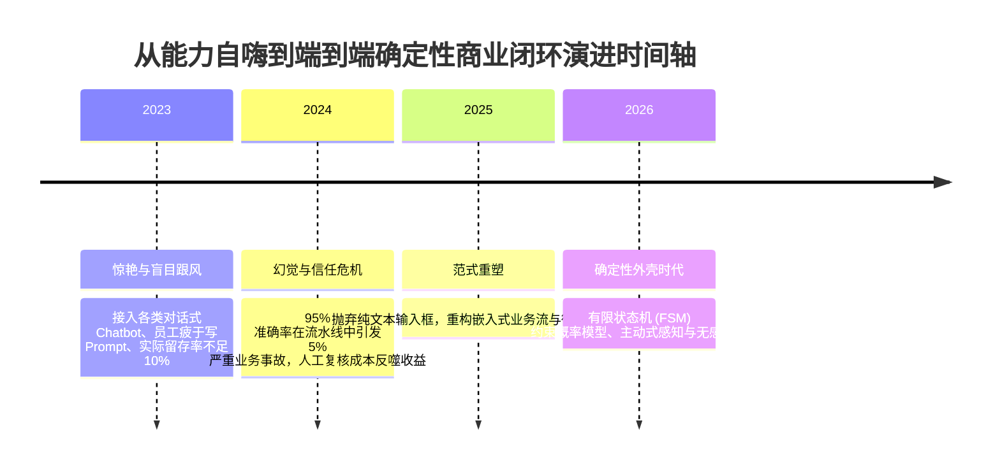
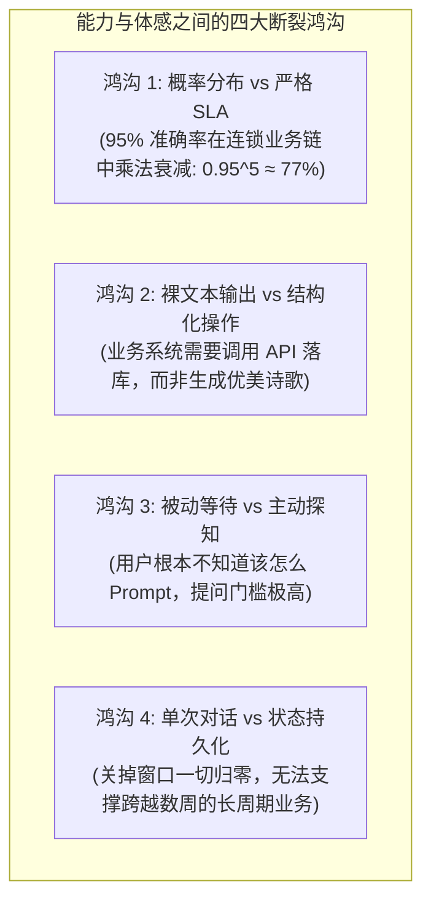
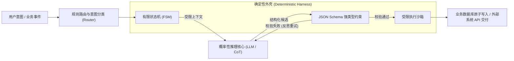

# 前沿产业落地深度解析：为什么大模型能力飞跃而终端用户体感平淡？(Latent Space & 产业落地反思)

> **分享嘉宾**：张阔 (阿里巴巴国际站总裁 / 跨境数字供应链与 AI 落地操盘手)  
> **内容出处**：科技产业前沿播客对谈（归档日期: 2026-10-12）  
> **音频规格**：深度录音 72 分 15 秒  
> **核心工程矛盾**：底层大模型 Benchmark 跑分（MMLU, HumanEval, SWE-bench）实现代际飞跃，但企业一线业务员与终端用户却反馈“没有明显感觉”；深度解构从“裸模型能力 (Raw Capability)”到“端到端商业交付 (Deterministic Outcome)”之间的断层鸿沟、Chatbot 界面反模式与基于 Agent Harness 的确定性外壳重构。  
> **知识密度**：★★★★★ | **规范标准**：六段式深度学习资料规范 (Mode B) + 工业级落地标准

---

## 目录
1. [一、业务背景与核心痛点意识](#一业务背景与核心痛点意识)
2. [二、全景逻辑脉络与时间轴](#二全景逻辑脉络与时间轴)
3. [三、核心机理与架构全景拆解](#三核心机理与架构全景拆解)
   - [3.1 核心断裂：跑分繁荣 vs 体感平淡的四大本质鸿沟](#31-核心断裂跑分繁荣-vs-体感平淡的四大本质鸿沟)
   - [3.2 对话框反模式：为什么 Text Chatbot 杀死了企业落地？](#32-对话框反模式为什么-text-chatbot-杀死了企业落地)
   - [3.3 确定性外壳工程 (Deterministic Harness Architecture)](#33-确定性外壳工程-deterministic-harness-architecture)
   - [3.4 从人教 AI (Prompting) 到 AI 主动感知 (Proactive Grounding)](#34-从人教-ai-prompting-到-ai-主动感知-proactive-grounding)
   - [3.5 跨境供应链实战案例：多模态商品合规与撮合状态机](#35-跨境供应链实战案例多模态商品合规与撮合状态机)
4. [四、工业级高危盲区与反模式警示](#四工业级高危盲区与反模式警示)
5. [五、实战落地工程载荷：企业级端到端 Agent 状态机与确定性护栏载荷](#五实战落地工程载荷企业级端到端-agent-状态机与确定性护栏载荷)
6. [六、大模型企业级产品化准出清单 (Pre-flight Checklist)](#六大模型企业级产品化准出清单-pre-flight-checklist)

---

## 一、业务背景与核心痛点意识

### 1.1 “跑分通胀”与“体感断层”的鲜明对立
过去两年来，全球基础模型经历了激烈的代际演进：
- 模型推理窗口从 4K 扩展到 2M；
- 数学与编码能力在基准数据集上从 60% 飙升至 90%+；
- 思维链（CoT）推理模型能够在数分钟内解决国际奥林匹克竞赛难题。

然而，在面对全球数百万中小外贸企业、跨境买卖家与企业日常业务一线时，大量的真实反馈却是：**“感觉现在的模型和一年前用起来差不多，没有本质差别，甚至依然经常犯低级错误。”**

作为操盘全球最大规模 B2B 跨国数字商业网络的核心负责人，张阔深入解构了这背后的残酷真相：**工业落地追求的是“99.9% 确定性可交付”，而模型厂商兜售的仅仅是“概率性通用智能”**。如果不能通过工程外壳将两者的断层彻底弥合，底层模型能力的任何跃升都将在最后一公里被彻底损耗。

---

## 二、全景逻辑脉络与时间轴

### 2.0 产业反思推进时间轴



---

## 三、核心机理与架构全景拆解

### 3.1 核心断裂：跑分繁荣 vs 体感平淡的四大本质鸿沟



1. **链式错误乘法坍塌（Cascading Degradation）**：
   一个稍微复杂的企业流程（如：读取商品图片 -> 识别关键规格参数 -> 校验欧盟 CE 安全标准 -> 生成报关编码 -> 写入 ERP）包含 5 个连续步骤。假设每个步骤大模型的准确率都高达惊人的 **95%**，整条流水线的端到端成功率仅为：
   $$0.95^5 \approx 77.38\%$$
   这意味着超过五分之一的订单必须被人工打断排查。用户不仅没有“减负”，反而沦为了专门替 AI 给擦屁股的“专职质检员”。
2. **缺乏行业私有语境与隐性知识（Tacit Knowledge）**：
   模型博览群书，懂得全部物理定律，但根本不知道“客户 A 喜欢把易碎品打木架、发往鹿特丹港的集装箱必须在周二前报清关、该类机械零件在特定国家的关税代码变更”。这些沉淀在业务人员大脑中的隐性经验，从未出现在通用网页语料中。

---

### 3.2 对话框反模式：为什么 Text Chatbot 杀死了企业落地？

张阔一针见血地指出：**纯文本聊天框（Chat Input Box）是企业级软件历史上最反人性的交互形态之一**。

- **Prompt 编写的巨大认知负荷**：要求一个忙碌的外贸业务员或运营人员每天思考“如何给 AI 撰写长达 500 字的清晰 System Prompt”，相当于把产品经理的需求工程负担直接转嫁给一线用户。
- **不可预测的结果排版**：用户期待的是一个可点击的商品卡片、一张合规对比表或一个直接待签名的 PDF，而 Chatbot 往往喷出一大段未经排版的 Markdown 纯文本。
- **范式颠覆**：优秀的大模型产品形态必须是**“嵌入式（In-situ）、隐形化（Invisible）、选项化（Selection-based）”**。AI 应该像操作系统底层的拼写检查一样无感存在，直接在业务表单、工单流中以“一键确认”或高亮建议呈现。

---

### 3.3 确定性外壳工程 (Deterministic Harness Architecture)

为了让概率性大模型能够被安全地集成到工业流水线中，必须在模型外围包裹坚固的**确定性外壳（Deterministic Harness）**：



- **有限状态机 (Finite State Machine, FSM)**：整个业务流程被严格限定在可控的确定性状态节点上。LLM 只能决定在当前状态下从有限的合法边中转移，严禁任何天马行空的自发越轨。
- **JSON Schema 物理拦截**：模型输出强制绑定严格的模式规范。一旦缺少必须的字段或类型不匹配，外壳在内存中自动截断并强制其在受控提示下自我修复，严禁脏数据污染后端。

---

### 3.4 从人教 AI (Prompting) 到 AI 主动感知 (Proactive Grounding)

突破体感瓶颈的关键跃迁，在于将交互从“被动响应”转为“主动感知”：
- **主动环境遥测（Ambient Sensing）**：Agent 在后台静默监听业务事件（例如：买家向卖家发送了一条德语询盘，且提及了特定规格参数）。
- **预先计算交付草案（Pre-computation）**：在用户甚至还没有打开电脑时，Agent 已经完成了多语言精准翻译、库存匹配、运费估算，并起草好了回复信件草案。
- **非阻塞直选交付**：当用户打开页面时，界面呈现的不是空白聊天框，而是清晰的预制卡片：“系统已为您起草了关于该询盘的最佳回复与报价方案，点击确认即可发送”。

---

## 四、工业级高危盲区与反模式警示

> [!CAUTION]
> 在推动大模型企业级产品化落地时，必须严防以下四大致命陷阱：

1. **盲区一：贪大求全的“全知全能 Agent”幻想**
   - *现象*：试图打造一个单一的超级智能体，要求它同时负责售前咨询、报关合规、财务核算和售后退款。结果导致 System Prompt 膨胀至几万字，模型在巨大注意力干扰下频繁幻觉崩溃。
   - *防御*：坚持**原子化单任务拆解原则（Single Responsibility Principle for Agents）**。构建微型专注的专精智能体小队，通过中央编排器实现清晰的流水线交接。
2. **盲区二：将通用公开评测跑分当作采购选型标准**
   - *现象*：依据外部权威公开榜单盲目采购大模型，上线后发现它在内部特定业务领域（如跨境海关税则分类）的命中率甚至不如上一代小模型。
   - *防御*：必须构建**企业私有业务金标准测试集（Golden Evaluation Set）**，以真实历史案件的回溯准确率与盲测胜率为唯一裁决标准。
3. **盲区三：缺乏“优雅降级（Graceful Degradation）”兜底策略**
   - *现象*：大模型 API 遭遇网络抖动、限流（Rate Limit）或服务中断时，整个前端业务界面直接报错卡死，导致核心业务停摆。
   - *防御*：设计严格的三级降级链路：一级调用超强模型 -> 二级自动无缝降级为轻量快速小模型 -> 三级降级为确定性规则兜底模板，保障系统可用性恒为 99.99%。
4. **盲区四：只关注算法指标，忽视端到端全链路延时 (Time to Value)**
   - *现象*：模型通过复杂的长思维链输出了完美的报告，但用户在屏幕前足足等待了 45 秒才拿到结果，用户体验完全被极差的响应时延毁掉。
   - *防御*：实施**分阶段渐进式渲染（Progressive Delivery）**：前 1 秒渲染骨架与核心结论，后续细节在后台流式计算填充，保证用户体感的极致流畅。

---

## 五、实战落地工程载荷：企业级端到端 Agent 状态机与确定性护栏载荷

以下展示生产级 Python 企业级确定性业务状态机与严格 JSON Schema 护栏实现：

```python
# -*- coding: utf-8 -*-
"""
Deterministic Business Agent Harness & Guardrail Engine
生产级大模型确定性有限状态机与结构化交付护栏实现
"""

import json
from typing import Dict, Any, List, Optional
from enum import Enum
from pydantic import BaseModel, Field, ValidationError

class BusinessState(str, Enum):
    IDLE = "IDLE"
    ANALYZING_INQUIRY = "ANALYZING_INQUIRY"
    CHECKING_COMPLIANCE = "CHECKING_COMPLIANCE"
    GENERATING_PROPOSAL = "GENERATING_PROPOSAL"
    AWAITING_HUMAN_CONFIRMATION = "AWAITING_HUMAN_CONFIRMATION"
    COMPLETED = "COMPLETED"
    FAILED = "FAILED"

# 严格的输出契约 Schema
class CrossBorderProposalSchema(BaseModel):
    inquiry_id: str = Field(description="全局唯一询盘标识")
    target_market: str = Field(description="目标出口国家/地区代码")
    product_hs_code: str = Field(pattern=r"^\d{6,10}$", description="海关合规编码")
    compliance_passed: bool = Field(description="是否通过出口合规与禁限运检测")
    estimated_cost_usd: float = Field(gt=0, description="预估单价(美元)")
    draft_response: str = Field(min_length=20, description="针对买家痛点的专业回复草案")

class DeterministicBusinessHarness:
    """企业级确定性外壳：控制概率模型行为边界"""
    def __init__(self):
        self.current_state = BusinessState.IDLE
        self.context_history: List[Dict[str, Any]] = []

    def transition_to(self, new_state: BusinessState):
        print(f"🔄 状态迁移: [{self.current_state.value}] ➔ [{new_state.value}]")
        self.current_state = new_state

    def process_incoming_inquiry(self, inquiry_payload: Dict[str, Any]) -> CrossBorderProposalSchema:
        self.transition_to(BusinessState.ANALYZING_INQUIRY)
        
        # 模拟模型输出（在实际生产中，由外部 LLM 在受限 Prompt 下生成 JSON）
        raw_llm_json_output = {
            "inquiry_id": inquiry_payload.get("id", "INQ-2026-8802"),
            "target_market": "DE",
            "product_hs_code": "8471300000",
            "compliance_passed": True,
            "estimated_cost_usd": 128.50,
            "draft_response": "Sehr geehrter Kunde, vielen Dank für Ihre Anfrage bezüglich unserer Industriekomponenten. Die CE-Zertifizierung ist vollständig vorhanden..."
        }

        self.transition_to(BusinessState.CHECKING_COMPLIANCE)
        # 强制经过 Pydantic / JSON Schema 物理校验
        try:
            validated_proposal = CrossBorderProposalSchema(**raw_llm_json_output)
        except ValidationError as e:
            self.transition_to(BusinessState.FAILED)
            raise RuntimeError(f"❌ 确定性护栏拦截: 模型输出违反契约规范: {e}")

        self.transition_to(BusinessState.AWAITING_HUMAN_CONFIRMATION)
        print("✅ 校验完全合格！生成端到端待确认业务卡片，阻绝任何脏数据落库。")
        return validated_proposal

# 测试用例演练
if __name__ == "__main__":
    harness = DeterministicBusinessHarness()
    sample_inquiry = {
        "id": "INQ-DE-9941",
        "buyer_country": "Germany",
        "message": "We need 500 units of high-precision CNC controllers with CE marks."
    }

    result = harness.process_incoming_inquiry(sample_inquiry)
    print("\n📋 成功交付确定性业务提案:")
    print(f"  - 询盘ID: {result.inquiry_id}")
    print(f"  - 目标市场: {result.target_market}")
    print(f"  - 海关编码: {result.product_hs_code}")
    print(f"  - 合规状态: {'已通过' if result.compliance_passed else '未通过'}")
    print(f"  - 预估报价: ${result.estimated_cost_usd}")
    print(f"  - 专业回复草案: {result.draft_response[:60]}...")
```

---

## 六、大模型企业级产品化准出清单 (Pre-flight Checklist)

- [ ] **交互形态去对话化**：核心功能是否杜绝了强制编写长 Prompt 的空白输入框，改为嵌入式选项/建议卡片？
- [ ] **确定性状态机护栏**：业务流程是否已被有限状态机（FSM）严格限定，防止无界自由发挥？
- [ ] **强类型输出契约**：模型交互接口是否绑定了具备严格字段校验的 JSON Schema / Pydantic 规范？
- [ ] **多级容灾降级链路**：当外部超强模型限流或不可用时，系统是否具备轻量小模型与静态规则的双重兜底？
- [ ] **私有金标准回归集**：企业是否建立了包含至少 200+ 真实历史复杂业务案件的私有黄金评测基准？
- [ ] **人类在环非阻塞机制**：高价值关键业务变动（转账、发货、修改价格）是否强制保留人类一键审计把关？
