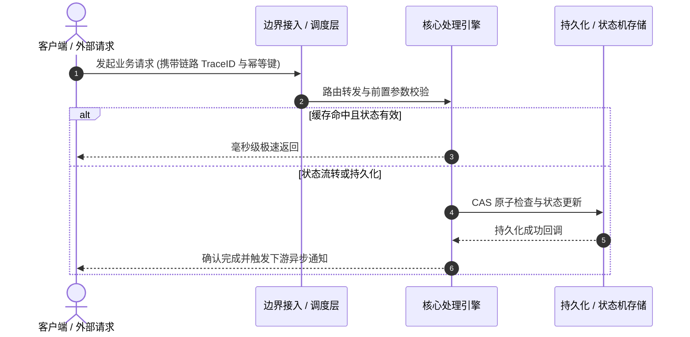

# 深度研读案：Why AlphaFold Didn't Solve Protein Folding — Pushmeet Kohli, Google DeepMind & Sal Candido, Biohub

> **权威来源**：[Latent.Space - Why AlphaFold Didn't Solve Protein Folding — Pushmeet Kohli, Google DeepMind & Sal Candido, Biohub](https://www.latent.space/p/biohub-deepmind)  
> **发布平台**：Latent Space (The AI Engineer Podcast) | **归档时间**：2026-10-12  
> **核心定位**：AI-Engineering演进与工程生产落地实践研读  
> **知识密度**：★★★★★ | **建议阅读时间**：8 分钟

---

## 目录
1. [全景逻辑脉络与时间轴](#1-全景逻辑脉络与时间轴)
2. [为什么需要该方案？（背景与本质动机）](#2-为什么需要该方案背景与本质动机)
3. [核心机理与架构全景拆解](#3-核心机理与架构全景拆解)
4. [工业级高危盲区与反模式（必避坑点）](#4-工业级高危盲区与反模式必避坑点)
5. [实战落地工程载荷（配置与协议）](#5-实战落地工程载荷配置与协议)
6. [准出自检清单 (Pre-flight Checklist)](#6-准出自检清单-pre-flight-checklist)

---

## 1. 全景逻辑脉络与时间轴


---

## 2. 为什么需要该方案？（背景与本质动机）

针对 **Why AlphaFold Didn't Solve Protein Folding — Pushmeet Kohli, Google DeepMind & Sal Candido, Biohub** 中所面临的业务场景，直击底层工程动机：
1. **工业世界约束**：面对并发流量激增、分布式网络不可靠与维护复杂度上升，传统简单单体或同步阻塞方案面临扩展极限。
2. **传统方案瓶颈**：强耦合导致可用性无法独立弹性伸缩，单点故障极易引发雪崩式级联崩溃。
3. **演进必然性**：通过异步解耦、状态机管控与分层防御，实现业务吞吐与工程健壮性的兼得。

---

## 3. 核心机理与架构全景拆解

### 3.1 系统拓扑与数据流转时序



### 3.2 核心要点研读提炼

- **核心洞察 1**：From the Bitter Lesson of AI scaling to the unsolved mysteries of protein folding , Google DeepMind’s Pushmeet Kohli and Biohub’s Sal Candido are rethinking what it takes to build AI that truly understands biology. In this special panel moderated by Brandon Anderson , they explore why AlphaFold’s breakthrough was only the beginning , why scaling compute and data alone won’t solve biology, and how the next generation of AI models could transform our understanding of proteins, cells, and human disease.
- **核心洞察 2**：We go deep on the future of AI-driven biology : finding scaling laws in biological data, the tradeoffs between scientific intuition and general-purpose architectures, why protein structure prediction is far from solved, and what it would take to build predictive models of living systems. Pushmeet reflects on the lessons behind AlphaFold , the limits of human interpretability, and whether future frontier models could understand other AI systems better than we can. Sal explains why protein language models may already contain scientific knowledge we haven’t unlocked, how biological modeling must move beyond individual proteins, and why achieving Biohub’s mission to cure all disease requires thinking in terms of 10x breakthroughs rather than incremental improvements.
- **核心洞察 3**：* The Bitter Lesson for biology : why scaling compute and data isn’t enough
- **核心洞察 4**：* Why finding the right scaling law matters more than blindly increasing model size

---

## 4. 工业级高危盲区与反模式（必避坑点）

> [!WARNING]
> 以下总结生产落地中极易忽略的隐性异常边界与高危踩坑点：

1. **盲区一：分布式幂等性缺失与幽灵重试**
   - *现象*：上游网络超时重试导致下游出现多次重复写入或资金状态异常。
   - *防御*：必须在网关层建立强校验机制，强制绑定全局唯一 Request ID + Redis SETNX 状态门禁。
2. **盲区二：监控断层与可观测性盲区**
   - *现象*：系统虽然返回 200，但内部异步任务积压滞后，排查时缺乏关联 Trace ID。
   - *防御*：全链路贯穿统一 TraceID，并在核心队列设置积压告警阈值。
3. **盲区三：级联超时与熔断降级兜底脱节**
   - *现象*：下游慢接口拖死上游连接池，缺乏快速失败隔离能力。
   - *防御*：配置严格的客户端超时、线程隔离与降级 Fallback 策略。

---

## 5. 实战落地工程载荷（配置与协议）

```yaml
# Why AlphaFold Didn't Solve Protein Folding — Pushmeet Kohli, Google DeepMind & Sal Candido, Biohub 生产级编排配置模板
pipeline_service:
  name: "pod-latent-space-service"
  version: "1.0.0"
  concurrency_limit: 50
  timeout_seconds: 15
  circuit_breaker:
    enabled: true
    failure_rate_threshold: 40
    sliding_window_size: 100
    minimum_number_of_calls: 20
  retry_policy:
    max_attempts: 3
    backoff_multiplier: 1.5
```

---

## 6. 准出自检清单 (Pre-flight Checklist)

- [ ] **技术对齐**：核心架构是否满足未来 6~12 个月业务峰值预期？
- [ ] **边界防护**：是否完成网络闪断、数据重放与并发并发竞争压力测试？
- [ ] **可观测性**：核心接口的 P99 延迟、错误率 Dashboard 与告警规则是否就绪？
- [ ] **兜底预案**：极端不可抗力事故下，是否具备一键旁路降级开关？
