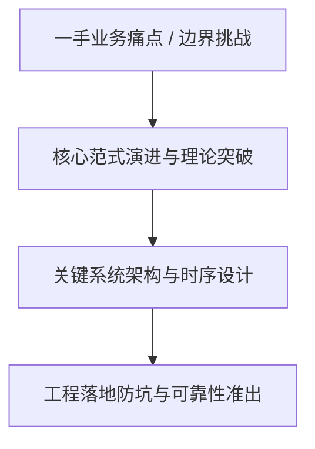
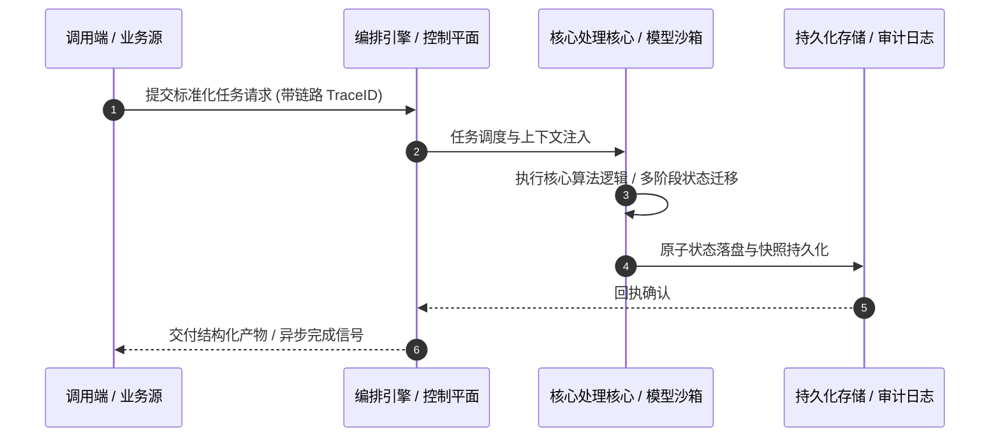

# 深度研读案：E254｜超级厄尔尼诺来了，我们的日常所需真会因它涨价吗？

> **权威来源**：[liuhj60@gmail.com (硅谷101) - E254｜超级厄尔尼诺来了，我们的日常所需真会因它涨价吗？](https://sv101.fireside.fm/268)  
> **发布平台**：硅谷101 (Silicon Valley 101) | **归档时间**：2026-10-13  
> **核心定位**：硬核科技访谈深度剖析与工程落地实战  
> **知识密度**：★★★★★ | **规范标准**：六段式深度学习资料规范 (Mode B)

---

## 目录
1. [一、元数据与技术背景声明](#一元数据与技术背景声明)
2. [二、全景逻辑脉络与时间轴](#二全景逻辑脉络与时间轴)
3. [三、核心机理与架构全景拆解](#三核心机理与架构全景拆解)
4. [四、工业级高危盲区与反模式警示](#四工业级高危盲区与反模式警示)
5. [五、实战落地工程载荷（配置与协议）](#五实战落地工程载荷配置与协议)
6. [六、准出自检清单 (Pre-flight Checklist)](#六准出自检清单-pre-flight-checklist)

---

## 一、元数据与技术背景声明

### 1.1 核心痛点与问题意识
- **背景出处**：来自 **硅谷101 (Silicon Valley 101)** 发布的专业技术沉淀。
- **直击工程矛盾**：本篇深度解析在实际软件工程或前沿 AI 系统中，如何打破传统设计局限，在性能、可靠性、维护成本与业务需求之间实现高阶平衡。

---

## 二、全景逻辑脉络与时间轴



---

## 三、核心机理与架构全景拆解

### 3.1 系统拓扑与核心交互时序



### 3.2 核心技术要点精要提炼

- **深度要点 1**：这个夏天，来自全球各地的多个气象机构都拉响了同一个警报，一场史无前例的超级厄尔尼诺正在上演。 来自摩根大通的经济学家预计，全球的食品通胀将在2027年的上半年上升到5%，明显高于今年同期的2.8% 。这其中有来自霍尔木兹海峡封锁和黑海冲突的因素，也部分归因于我们正身处的这场、50年来颇为罕见的超级厄尔尼诺。 它究竟会通过什么方式影响到全球供给？它所带来的危害是否真的像媒体报道的那么大？在一次次与极端气候变化的对抗中，人们又为应对厄尔尼诺做了怎样的准备？
- **深度要点 2**：【主播】 麻花，硅谷101特约研究员 【嘉宾】 张思齐，资深大宗商品期货交易员
- **深度要点 3**：【你将听到】 超级厄尔尼诺，如何影响农业生产 03:17 农业几多产，起决定因素的不只是气候 08:56 超级厄尔尼诺，以及它的影响边界 16:03 厄尔尼诺如何影响棕榈油、天然橡胶和咖啡豆 19:26 哪些终端商品，价格可能受到大波动 22:20 秘鲁禁捕鳀鱼，受波及的除了日料水产，还有宠物食品 25:10 都说厄尔尼诺导致减产，但也有产区因它收益
- **深度要点 4**：极端气候之外，生产资料的供应紧张和农民的应对之策 27:53 作物减产是否影响终端价格，还要看产区和出口集中度 29:52 推高全球粮食价格的，还有供应紧缺的氮肥 32:27 大宗商品期货交易员会有哪些工具关注气候变化 35:25 不确定性对于期货交易，究竟是好是坏 40:08 与不确定性对抗多年，农民如何应对极端气候变化 42:07 上有厄尔尼诺，下游农民活用期货 45:22 气候变化引起的出口限制，可能进一步加剧供给危机
- **深度要点 5**：巴拿马运河和全球铜矿的减产，厄尔尼诺要背多大的锅 47:02 极端气候带来的干旱，让巴拿马运河的运力更紧张了 50:23 全球铜矿产量下降的锅，厄尔尼诺背不了太多 56:25 做服装的人，也在厄尔尼诺面前为难了 57:41 被极端气候影响的电力、加工食品和保险行业 59:48 大宗商品交易门外汉，可以怎么观察这个行业
- **深度要点 6**：【延伸阅读】 • 《纽约时报：This Year’s Record-Breaking El Niño in 3 Charts》 • NOAA: 美国国家海洋和大气管理局，隶属美国商务部。它负责监测海洋、大气和气象变化，提供天气预报、气候预测和海洋资源管理服务。 • El Niño set to become very strong, raising risks of extreme weather into 2027 • 澳洲小麦升贴水（Basis）：澳洲本地小麦现货价格与国际小麦期货价格之间的差价，主要反映澳洲当地的供需、物流及汇率等因素。 • IFPRI: Will extreme weather lead to multiple breadbasket failures and threaten global food security? • Forbes: 巴拿马运河运力使用经济体Top20 • USDA:U.S. Department of Agriculture

---

## 四、工业级高危盲区与反模式警示

> [!WARNING]
> 生产环境落地中极易忽略的隐性异常边界与高危反模式：

1. **盲区一：状态漂移与不一致性风险**
   - *现象*：高并发或异常网络中断时，由于缺乏严格的原子事务保障，可能导致本地快照与中心状态发生偏离。
   - *防御*：必须引入严格的单调版本号或基于 CAS 的幂等更新控制机制。
2. **盲区二：资源枯竭与背压穿透**
   - *现象*：上游请求突增时，未受控的深层调用会击穿线程池或内存预算，引发级联雪崩。
   - *防御*：在接入层部署严格的自适应限流、主动背压 (Backpressure) 与熔断兜底。
3. **盲区三：上下文衰减与关键断点丢失**
   - *现象*：长周期异步任务执行中，由于中间日志截断导致关键审计凭证丢失。
   - *防御*：贯穿全链路 TraceID，建立不可篡改的事件审计流水线。

---

## 五、实战落地工程载荷（配置与协议）

```yaml
# E254｜超级厄尔尼诺来了，我们的日常所需真会因它涨价吗？ 生产环境可靠性编排规范
runtime_spec:
  name: "pod-sv101-pipeline"
  version: "v1.0.0"
  resilience:
    circuit_breaker:
      enabled: true
      failure_rate_threshold: 30
      sliding_window_size: 50
    retry_policy:
      max_attempts: 3
      exponential_backoff: true
  telemetry:
    trace_propagation: true
    metrics_interval_seconds: 10
```

---

## 六、准出自检清单 (Pre-flight Checklist)

- [ ] **架构完备性**：核心时序与数据流转是否具备端到端可观测性？
- [ ] **容灾降级**：当依赖的下游服务超时或崩溃时，是否具备明确的兜底策略？
- [ ] **幂等自愈**：重复推送相同任务时，是否能做到零副作用幂等过滤？
- [ ] **安全护栏**：凭证管理是否杜绝明文硬编码，并具备最小权限隔离？
