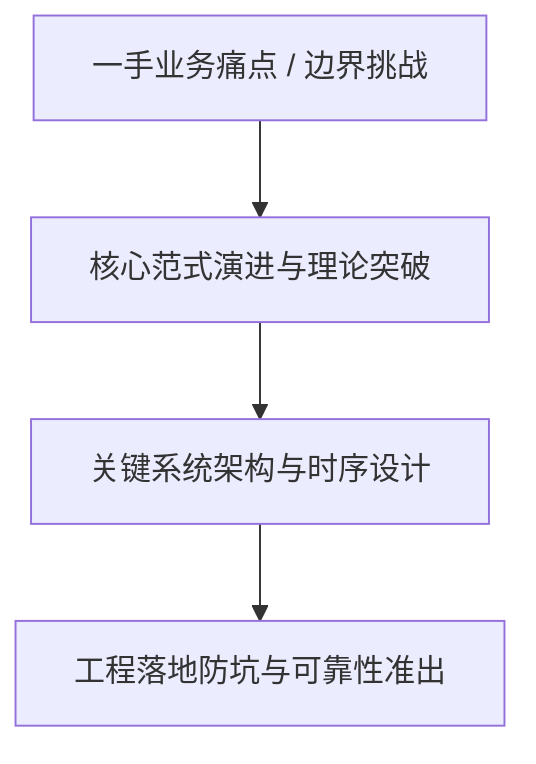
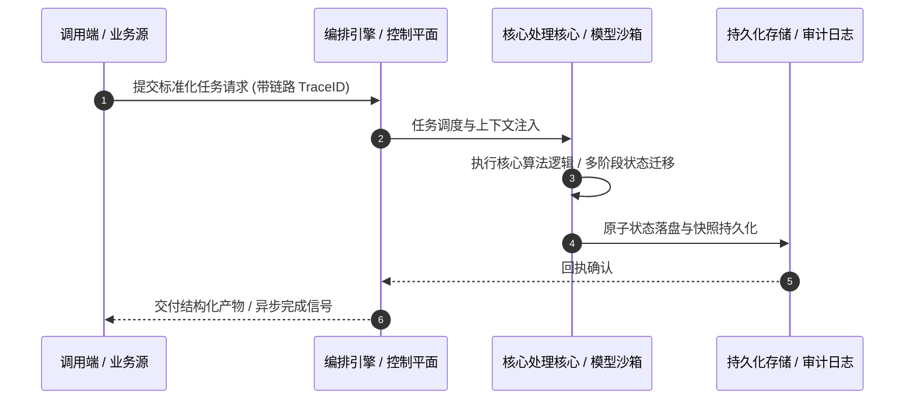

# 深度研读案：E256｜Agent、机器人与制药，谁先被GPT-6 Astra改写？

> **权威来源**：[liuhj60@gmail.com (硅谷101) - E256｜Agent、机器人与制药，谁先被GPT-6 Astra改写？](https://sv101.fireside.fm/270)  
> **发布平台**：硅谷101 (Silicon Valley 101) | **归档时间**：2026-10-20  
> **核心定位**：硬核科技访谈深度剖析与工程落地实战  
> **知识密度**：★★★★★ | **规范标准**：六段式深度学习资料规范 (Mode B)

---

## 目录
1. [一、元数据与技术背景声明](#一元数据与技术背景声明)
2. [二、全景逻辑脉络与时间轴](#二全景逻辑脉络与时间轴)
3. [三、核心机理与架构全景拆解](#三核心机理与架构全景拆解)
4. [四、工业级高危盲区与反模式警示](#四工业级高危盲区与反模式警示)
5. [五、实战落地工程载荷（配置与协议）](#五实战落地工程载荷配置与协议)
6. [六、准出自检清单 (Pre-flight Checklist)](#六准出自检清单-pre-flight-checklist)

---

## 一、元数据与技术背景声明

### 1.1 核心痛点与问题意识
- **背景出处**：来自 **硅谷101 (Silicon Valley 101)** 发布的专业技术沉淀。
- **直击工程矛盾**：本篇深度解析在实际软件工程或前沿 AI 系统中，如何打破传统设计局限，在性能、可靠性、维护成本与业务需求之间实现高阶平衡。

---

## 二、全景逻辑脉络与时间轴



---

## 三、核心机理与架构全景拆解

### 3.1 系统拓扑与核心交互时序



### 3.2 核心技术要点精要提炼

- **深度要点 1**：回顾9月，AI圈的重磅新闻一个接一个。 先是OpenAI发布GPT-6 Astra，总裁格雷格·布罗克曼在发布会上宣布：AGI已经到来。 这场发布对机器人行业的冲击，来得有些意外，一个发布会报告里只字未提机器人的通用模型，转身就空降了机器人评测榜首，甚至让很多机器人的Benchmark都失效了。有人开玩笑说：机器人领域等了这么多年的“GPT时刻”，居然是GPT自己。 同样在这个月里：Meta Muse冲上美国App Store榜首，它的竞争对手Instinct估值也涨到了100亿美元；xAI的Grok Bot开放了企业部署；不生成文本、只给选项打概率的决策模型Jev以“系统1”走红，发布24天就融了8.7亿美元。 在AI for Science方面，Claude发现类CRISPR的新酶系统；扎克伯格夫妇资助成立的Biohub宣布将虚拟细胞计划扩大到18亿美元……这些进展又会为科学发现带来哪些改变？ 本期《硅谷101》，我们请来三位分别站在Agent、机器人和AI制药一线的研究者，聊清楚三件事：个人Agent商业化卡在哪？机器人怎么被Astra这样的底层模型冲击？AI制药真正的瓶颈是什么？
- **深度要点 2**：【主播】 泓君，硅谷101创始人，播客主理人 【嘉宾】 许华哲，破壳机器人创始人、清华大学交叉信息研究院助理教授（X:@HarryXu12） 朱哲清，Pokee.ai创始人兼CEO，前MetaAI应用强化学习团队负责人，斯坦福强化学习博士（X:@ZheqingZhu） 王晟，华盛顿大学计算机学院助理教授（X:@profshengwang）
- **深度要点 3**：【你将听到】 00:05 新播客 《消费101》 上线啦！ 00:49 9月AI大事记 04:18 各领域实测Astra感受
- **深度要点 4**：Agent领域 09:11 生物医学“古董级软件”有了Computer Use 12:17 Computer Use是什么？与API调用的区别 15:47 Meta Muse会走Manus的老路吗？ 17:31 Meta Muse破局关键——软硬件结合 19:37 商家愿意开access，前提是确认身份 22:21 个人助手Agent新一轮烧钱获客大战 24:57 Grok Bot，“走在后面的人” 25:44 前沿Lab最烧token的是AI for Science 27:48 小模型追大模型，差距在缩小，但可能追错了benchmark
- **深度要点 5**：机器人领域 30:19 未来需要快决策模型 + Astra的推理能力 35:48 筷子夹小球效果：自研模型 V.S Astra 37:25 Astra冲击：利好Sim-to-Real和本体硬件 39:07 从TAMP到Agentic：机器人规划重回台前 40:19 数据标注新门槛：标注因果与直觉物理 43:06 惊艳之后，Astra也有明显短板 45:12 Jev“快系统”的潜在价值
- **深度要点 6**：生物医学领域 47:10 实验设计完成度只有30%，Astra缺什么？ 51:39 AI制药，离不开实验室的验证和数据积累 53:15 制药时间线：AI设计分子快，真实验证慢 55:01 从AlphaFold开源，看垂直科学公司的数据护城河 58:24 未来趋势：湿实验公司用MCP/API直连大模型 01:02:15 人类科学家的角色转向“定义问题” 01:03:47 好的benchmark，应该是无上限的 01:02:15 ART的启示：酶和蛋白质实验周期短，最先跑出来

---

## 四、工业级高危盲区与反模式警示

> [!WARNING]
> 生产环境落地中极易忽略的隐性异常边界与高危反模式：

1. **盲区一：状态漂移与不一致性风险**
   - *现象*：高并发或异常网络中断时，由于缺乏严格的原子事务保障，可能导致本地快照与中心状态发生偏离。
   - *防御*：必须引入严格的单调版本号或基于 CAS 的幂等更新控制机制。
2. **盲区二：资源枯竭与背压穿透**
   - *现象*：上游请求突增时，未受控的深层调用会击穿线程池或内存预算，引发级联雪崩。
   - *防御*：在接入层部署严格的自适应限流、主动背压 (Backpressure) 与熔断兜底。
3. **盲区三：上下文衰减与关键断点丢失**
   - *现象*：长周期异步任务执行中，由于中间日志截断导致关键审计凭证丢失。
   - *防御*：贯穿全链路 TraceID，建立不可篡改的事件审计流水线。

---

## 五、实战落地工程载荷（配置与协议）

```yaml
# E256｜Agent、机器人与制药，谁先被GPT-6 Astra改写？ 生产环境可靠性编排规范
runtime_spec:
  name: "pod-sv101-pipeline"
  version: "v1.0.0"
  resilience:
    circuit_breaker:
      enabled: true
      failure_rate_threshold: 30
      sliding_window_size: 50
    retry_policy:
      max_attempts: 3
      exponential_backoff: true
  telemetry:
    trace_propagation: true
    metrics_interval_seconds: 10
```

---

## 六、准出自检清单 (Pre-flight Checklist)

- [ ] **架构完备性**：核心时序与数据流转是否具备端到端可观测性？
- [ ] **容灾降级**：当依赖的下游服务超时或崩溃时，是否具备明确的兜底策略？
- [ ] **幂等自愈**：重复推送相同任务时，是否能做到零副作用幂等过滤？
- [ ] **安全护栏**：凭证管理是否杜绝明文硬编码，并具备最小权限隔离？
