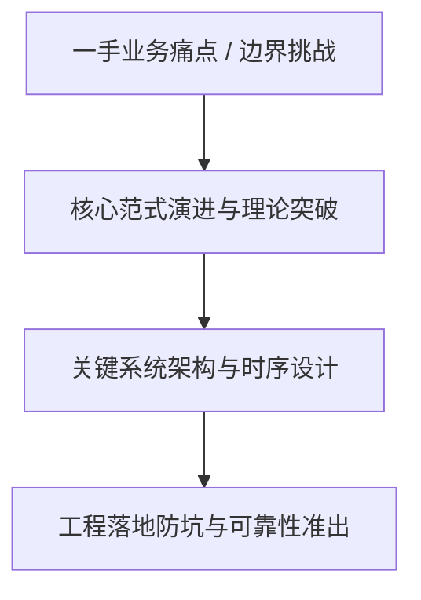
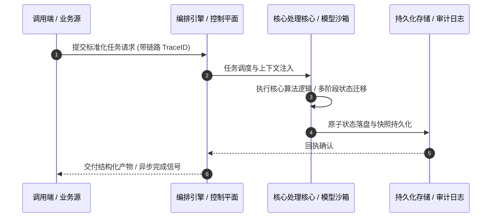

# 深度研读案：Seinfeld

> **权威来源**：[Ben Gilbert and David Rosenthal - Seinfeld](https://www.acquired.fm/episodes/seinfeld)  
> **发布平台**：Acquired | **归档时间**：2026-10-20  
> **核心定位**：硬核科技访谈深度剖析与工程落地实战  
> **知识密度**：★★★★★ | **规范标准**：六段式深度学习资料规范 (Mode B)

---

## 目录
1. [一、元数据与技术背景声明](#一元数据与技术背景声明)
2. [二、全景逻辑脉络与时间轴](#二全景逻辑脉络与时间轴)
3. [三、核心机理与架构全景拆解](#三核心机理与架构全景拆解)
4. [四、工业级高危盲区与反模式警示](#四工业级高危盲区与反模式警示)
5. [五、实战落地工程载荷（配置与协议）](#五实战落地工程载荷配置与协议)
6. [六、准出自检清单 (Pre-flight Checklist)](#六准出自检清单-pre-flight-checklist)

---

## 一、元数据与技术背景声明

### 1.1 核心痛点与问题意识
- **背景出处**：来自 **Acquired** 发布的专业技术沉淀。
- **直击工程矛盾**：本篇深度解析在实际软件工程或前沿 AI 系统中，如何打破传统设计局限，在性能、可靠性、维护成本与业务需求之间实现高阶平衡。

---

## 二、全景逻辑脉络与时间轴



---

## 三、核心机理与架构全景拆解

### 3.1 系统拓扑与核心交互时序



### 3.2 核心技术要点精要提炼

- **深度要点 1**：Seinfeld, which ended three decades ago, has been watched by 72 million Americans so far THIS YEAR. Behind that incredible stat is an equally incredible business story: obsessive creators, perfect market timing, an ownership structure that aligned incentives for the long term…all of which created a sitcom that became number one by breaking all the rules. Sponsors:
- **深度要点 2**：Many thanks to our fantastic Fall '26 Season partners: -  Sierra -  Anthropic -  Sentry -  WorkOS
- **深度要点 3**：Links: -  Sign up for email updates , get our takeaways and research photos from each episode, and vote on future topics! -  The Acquired Seinfeld Companion PDF -  Top of the Rock: Inside the Rise and Fall of Must See TV by Warren Littlefield -  Comedian -  The Seinfeld Chronicles: An Unnecessary Data Exploration by Andy Kirk -  Worldly Partners' Seinfeld Study by Arvind Navaratnam -  Jerry Seinfeld's 2017 Harvard Business Review Interview -  All episode sources
- **深度要点 4**：Carve Outs: -  Seinfeld - "The Marine Biologist" -  Seinfeld - "The Jacket" -  Seinfeld - "The Dinner Party" -  The Seinfeld Chronicles: An Unnecessary Data Exploration by Andy Kirk -  Buck's of Woodside -  Tin Can
- **深度要点 5**：More Acquired: -  Get email updates and vote on future episodes! -  Join the Slack -  Check out the latest swag in the ACQ Merch Store !
- **深度要点 6**：00:00:00 Start 00:00:55 Intro 00:04:52 Jerry Seinfeld's Stand-Up Origins (1954-1988) 00:16:16 NBC Pitches a Late-Night Special (1988) 00:21:35 Enter Larry David (1988) 00:35:04 Fin-Syn Rules & The Castle Rock Deal 00:52:45 Making the Pilot & Test Screening Disaster (1989) 01:04:24 Rick Ludwin Saves the Show (1989-1990) 01:10:17 Adding Elaine & "No Hugging, No Learning" 01:28:41 Season 2 & Defying Network Notes (1991) 01:35:56 The Structural Mechanics of Seinfeld 01:45:11 Season 4 & "The Contest" (1992) 01:57:09 Moving to Must See TV Thursdays (1993) 02:07:28 Anatomy of a Production Week & The Harvard Lampoon Writers 02:15:44 The Syndication Cash Cow (1995) 02:28:36 Larry Leaves, Cast Salaries & Season 9 (1996-1997) 02:42:13 Jack Welch's Brunch Offer & Jerry Walks (1997) 02:55:04 The Finale & Final TV Economics (1998) 03:11:21 The Modern Streaming Era & Netflix's Massive Deals 03:17:38 Analysis 03:30:00 7 Powers 03:34:00 Quintessence 03:41:49 Carve-Outs + Outro

---

## 四、工业级高危盲区与反模式警示

> [!WARNING]
> 生产环境落地中极易忽略的隐性异常边界与高危反模式：

1. **盲区一：状态漂移与不一致性风险**
   - *现象*：高并发或异常网络中断时，由于缺乏严格的原子事务保障，可能导致本地快照与中心状态发生偏离。
   - *防御*：必须引入严格的单调版本号或基于 CAS 的幂等更新控制机制。
2. **盲区二：资源枯竭与背压穿透**
   - *现象*：上游请求突增时，未受控的深层调用会击穿线程池或内存预算，引发级联雪崩。
   - *防御*：在接入层部署严格的自适应限流、主动背压 (Backpressure) 与熔断兜底。
3. **盲区三：上下文衰减与关键断点丢失**
   - *现象*：长周期异步任务执行中，由于中间日志截断导致关键审计凭证丢失。
   - *防御*：贯穿全链路 TraceID，建立不可篡改的事件审计流水线。

---

## 五、实战落地工程载荷（配置与协议）

```yaml
# Seinfeld 生产环境可靠性编排规范
runtime_spec:
  name: "pod-acquired-pipeline"
  version: "v1.0.0"
  resilience:
    circuit_breaker:
      enabled: true
      failure_rate_threshold: 30
      sliding_window_size: 50
    retry_policy:
      max_attempts: 3
      exponential_backoff: true
  telemetry:
    trace_propagation: true
    metrics_interval_seconds: 10
```

---

## 六、准出自检清单 (Pre-flight Checklist)

- [ ] **架构完备性**：核心时序与数据流转是否具备端到端可观测性？
- [ ] **容灾降级**：当依赖的下游服务超时或崩溃时，是否具备明确的兜底策略？
- [ ] **幂等自愈**：重复推送相同任务时，是否能做到零副作用幂等过滤？
- [ ] **安全护栏**：凭证管理是否杜绝明文硬编码，并具备最小权限隔离？
