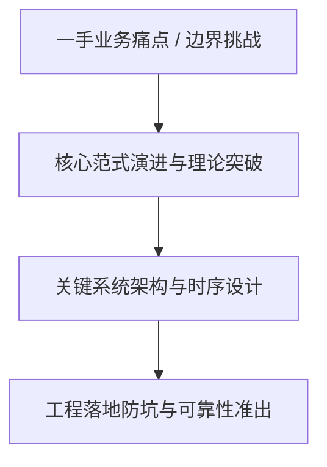
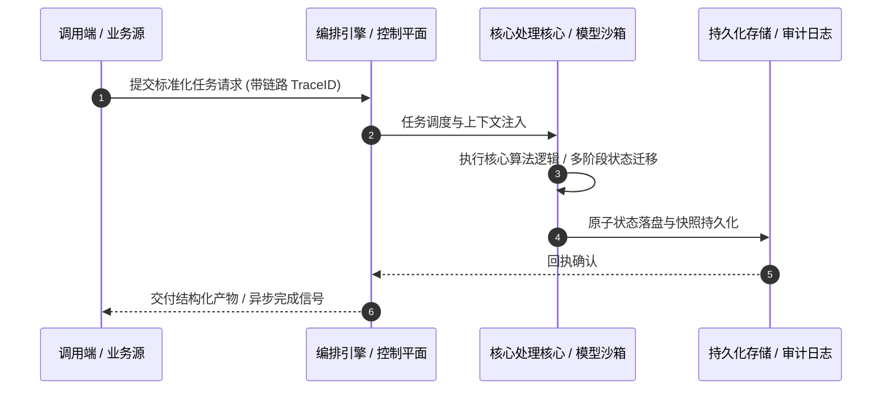

# 深度研读案：#503 – AI Crisis in Math: Navier-Stokes, Riemann Hypothesis & Complexity Theory

> **权威来源**：[Lex Fridman Podcast - #503 – AI Crisis in Math: Navier-Stokes, Riemann Hypothesis & Complexity Theory](https://lexfridman.com/math-ai-crisis/?utm_source=rss&utm_medium=rss&utm_campaign=math-ai-crisis)  
> **发布平台**：Lex Fridman Podcast | **归档时间**：2026-10-27  
> **核心定位**：硬核科技访谈深度剖析与工程落地实战  
> **知识密度**：★★★★★ | **规范标准**：六段式深度学习资料规范 (Mode B)

---

## 目录
1. [一、元数据与技术背景声明](#一元数据与技术背景声明)
2. [二、全景逻辑脉络与时间轴](#二全景逻辑脉络与时间轴)
3. [三、核心机理与架构全景拆解](#三核心机理与架构全景拆解)
4. [四、工业级高危盲区与反模式警示](#四工业级高危盲区与反模式警示)
5. [五、实战落地工程载荷（配置与协议）](#五实战落地工程载荷配置与协议)
6. [六、准出自检清单 (Pre-flight Checklist)](#六准出自检清单-pre-flight-checklist)

---

## 一、元数据与技术背景声明

### 1.1 核心痛点与问题意识
- **背景出处**：来自 **Lex Fridman Podcast** 发布的专业技术沉淀。
- **直击工程矛盾**：本篇深度解析在实际软件工程或前沿 AI 系统中，如何打破传统设计局限，在性能、可靠性、维护成本与业务需求之间实现高阶平衡。

---

## 二、全景逻辑脉络与时间轴



---

## 三、核心机理与架构全景拆解

### 3.1 系统拓扑与核心交互时序



### 3.2 核心技术要点精要提炼

- **深度要点 1**：Ankur Moitra, Steven Brunton and Alex Kontorovich are three mathematicians who can speak to this incredible moment in the history of mathematics, when AI solved some of its hardest problems: Navier-Stokes, the quasi-Riemann hypothesis, the unique games conjecture and hundreds of other problems. Ankur Moitra is a mathematician at MIT (visiting the Institute for Advanced Study in Princeton) working in theoretical computer science, who can speak to the unique games conjecture, complexity theory and the mathematics of how AI learns. Steven Brunton is a mathematician and fluid dynamics expert at UW, who can speak to Navier-Stokes, turbulence and machine learning for fluid dynamics. Alex Kontorovich is a mathematician at Rutgers specializing in number theory, who can speak to the Riemann hypothesis, Lean and machine-checked proofs. Thank you for listening ❤ Check out our sponsors: https://lexfridman.com/sponsors/ep503-sc See below for timestamps, transcript, and to give feedback, submit questions, contact Lex, etc.
- **深度要点 2**：Transcript: https://lexfridman.com/math-ai-crisis-transcript
- **深度要点 3**：CONTACT LEX: Feedback – give feedback to Lex: https://lexfridman.com/survey AMA – submit questions, videos or call-in: https://lexfridman.com/ama Hiring – join our team: https://lexfridman.com/hiring Other – other ways to get in touch: https://lexfridman.com/contact
- **深度要点 4**：EPISODE LINKS: Ankur’s Website: https://people.csail.mit.edu/moitra/ Alex’s X: https://x.com/AlexKontorovich Alex’s Website: https://sites.math.rutgers.edu/~alexk/ Steven’s X: https://x.com/eigensteve Steven’s YouTube: https://youtube.com/@Eigensteve Steven’s Website: https://eigensteve.com Lean: https://lean-lang.org/
- **深度要点 5**：SPONSORS: To support this podcast, check out our sponsors & get discounts: Wispr Flow: AI-powered voice dictation app. Go to https://wisprflow.ai/lex Fin: AI agent for customer service. Go to https://fin.ai/lex LMNT: Zero-sugar electrolyte drink mix. Go to https://drinkLMNT.com/lex Blitzy: AI agent for large enterprise codebases. Go to https://blitzy.com/lex Shopify: Sell stuff online. Go to https://shopify.com/lex NetSuite: Business management software. Go to https://netsuite.ai/lex Perplexity: AI-powered answer engine. Go to https://perplexity.ai/
- **深度要点 6**：OUTLINE: (00:00) – Introduction (01:58) – Sponsors, Comments, and Reflections (09:53) – Crisis moment in mathematics (18:10) – Will AI “solve” mathematics? (34:21) – Can AI create new math? (1:13:53) – Riemann hypothesis (1:37:45) – Navier-Stokes (2:03:42) – How nature computes (2:12:35) – Unique Games Conjecture and complexity theory (2:27:28) – How mathematicians think (2:41:05) – Is math invented or discovered? (2:47:13) – Can AI solve P vs NP? (2:57:28) – Why LLMs work so well (3:11:54) – Problems AI can’t solve yet (3:16:23) – Grigori Perelman (3:25:41) – Advice for young people

---

## 四、工业级高危盲区与反模式警示

> [!WARNING]
> 生产环境落地中极易忽略的隐性异常边界与高危反模式：

1. **盲区一：状态漂移与不一致性风险**
   - *现象*：高并发或异常网络中断时，由于缺乏严格的原子事务保障，可能导致本地快照与中心状态发生偏离。
   - *防御*：必须引入严格的单调版本号或基于 CAS 的幂等更新控制机制。
2. **盲区二：资源枯竭与背压穿透**
   - *现象*：上游请求突增时，未受控的深层调用会击穿线程池或内存预算，引发级联雪崩。
   - *防御*：在接入层部署严格的自适应限流、主动背压 (Backpressure) 与熔断兜底。
3. **盲区三：上下文衰减与关键断点丢失**
   - *现象*：长周期异步任务执行中，由于中间日志截断导致关键审计凭证丢失。
   - *防御*：贯穿全链路 TraceID，建立不可篡改的事件审计流水线。

---

## 五、实战落地工程载荷（配置与协议）

```yaml
# #503 – AI Crisis in Math: Navier-Stokes, 生产环境可靠性编排规范
runtime_spec:
  name: "pod-lex-fridman-pipeline"
  version: "v1.0.0"
  resilience:
    circuit_breaker:
      enabled: true
      failure_rate_threshold: 30
      sliding_window_size: 50
    retry_policy:
      max_attempts: 3
      exponential_backoff: true
  telemetry:
    trace_propagation: true
    metrics_interval_seconds: 10
```

---

## 六、准出自检清单 (Pre-flight Checklist)

- [ ] **架构完备性**：核心时序与数据流转是否具备端到端可观测性？
- [ ] **容灾降级**：当依赖的下游服务超时或崩溃时，是否具备明确的兜底策略？
- [ ] **幂等自愈**：重复推送相同任务时，是否能做到零副作用幂等过滤？
- [ ] **安全护栏**：凭证管理是否杜绝明文硬编码，并具备最小权限隔离？
