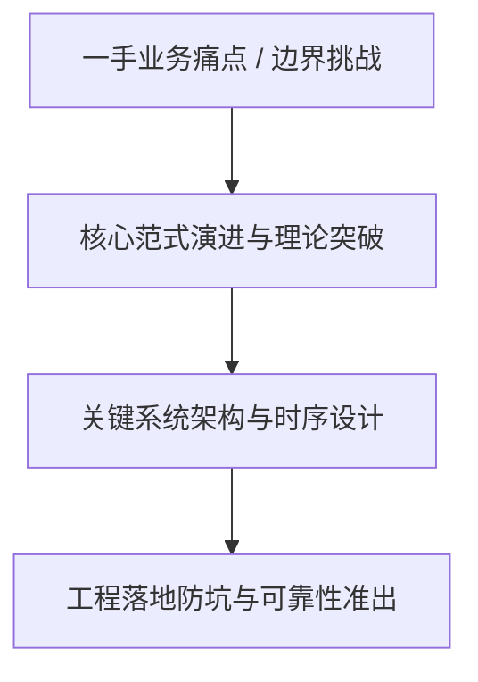
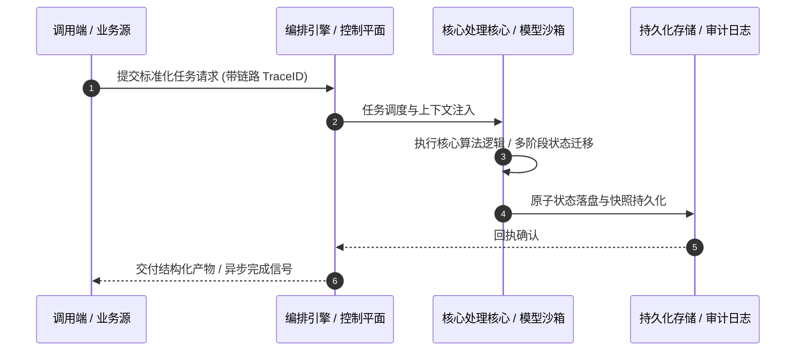

# 深度研读案：E257｜对话Vitalik：AI安全背后的哲学思想，有效利他主义如何影响硅谷？

> **权威来源**：[liuhj60@gmail.com (硅谷101) - E257｜对话Vitalik：AI安全背后的哲学思想，有效利他主义如何影响硅谷？](https://sv101.fireside.fm/271)  
> **发布平台**：硅谷101 (Silicon Valley 101) | **归档时间**：2026-10-30  
> **核心定位**：硬核科技访谈深度剖析与工程落地实战  
> **知识密度**：★★★★★ | **规范标准**：六段式深度学习资料规范 (Mode B)

---

## 目录
1. [一、元数据与技术背景声明](#一元数据与技术背景声明)
2. [二、全景逻辑脉络与时间轴](#二全景逻辑脉络与时间轴)
3. [三、核心机理与架构全景拆解](#三核心机理与架构全景拆解)
4. [四、工业级高危盲区与反模式警示](#四工业级高危盲区与反模式警示)
5. [五、实战落地工程载荷（配置与协议）](#五实战落地工程载荷配置与协议)
6. [六、准出自检清单 (Pre-flight Checklist)](#六准出自检清单-pre-flight-checklist)

---

## 一、元数据与技术背景声明

### 1.1 核心痛点与问题意识
- **背景出处**：来自 **硅谷101 (Silicon Valley 101)** 发布的专业技术沉淀。
- **直击工程矛盾**：本篇深度解析在实际软件工程或前沿 AI 系统中，如何打破传统设计局限，在性能、可靠性、维护成本与业务需求之间实现高阶平衡。

---

## 二、全景逻辑脉络与时间轴



---

## 三、核心机理与架构全景拆解

### 3.1 系统拓扑与核心交互时序



### 3.2 核心技术要点精要提炼

- **深度要点 1**：怎样用有限的钱帮助更多人？有效利他主义（Effective Altruism，简称“EA”），就是从这个朴素的问题出发，推动人们比较不同慈善项目的效果，从捐赠蚊帐、预防疟疾，到后来投入数亿美元研究AI安全。 SBF与FTX的崩塌，曾让这场运动陷入信誉危机。最近，AI研究员辞职、安全评估机构和捐赠网络引发的争议，又让EA受到关注。当一些人把防止AI毁灭人类视为最值得投入的事业，他们的判断如何影响研究方向和资金分配？其中又有怎样的利益与权力问题？ 本期节目，我们邀请以太坊联合创始人Vitalik Buterin与科技记者Afra，聊聊EA和理性主义究竟主张什么，以及这些思想如何影响了今天的AI发展。 Vitalik曾向这个圈子的机构捐赠大量资金。他在节目中回忆，一笔加密货币捐赠如何意外地变成数亿美元，以及受赠机构后来的方向，为什么让他开始重新考虑当初的选择。
- **深度要点 2**：节目全程以中文录制，前半段由Afra介绍背景，后半段是我们与Vitalik的对话。本期涉及英文人名和机构名较多，为方便大家理解，我们在shownotes文末整理了名词解释，也在Bilibili、YouTube、视频号等平台也上线了带字幕版本，方便大家对照收听。
- **深度要点 3**：【主播】 Yiwen，硅谷101主持人 泓君，硅谷101创始人，播客主理人
- **深度要点 4**：【嘉宾】 Vitalik Buterin，以太坊联合创始人 Afra，科技记者
- **深度要点 5**：【你将听到】 有效利他主义是什么，它如何走到AI安全中心？ 02:25 两个关键人物：William MacAskill与Eliezer Yudkowsky 07:54 八万个小时：怎样使用一生，才能帮助更多人？ 09:27 EA的四次转向：全球健康、长期主义、信任危机与AI安全 12:58 EA与理性主义的异同：怎样做好事，怎样想清楚？ 15:59 AI安全如何影响前沿AI实验室的公司选择 18:02 METR与捐赠网络：安全评估如何引发了争议？ 22:28 走进伯克利：Lighthaven、The Curve与硅谷思想聚会 28:09 去华尔街赚钱，再把钱捐出去：这条路出了什么问题？ 35:18 EA与e/acc：关于AI加速与减速的争论
- **深度要点 6**：Vitalik的捐赠：一笔意外的加密货币如何变成数亿美元 39:15 如何成为一名负责任的数字游民？Vitalik最初的EA经历 44:19 哲学僵尸与意识：理性主义者都在讨论什么？ 50:38 当思想社群有了富豪捐赠者和专业机构 53:35 AI安全思想和P(doom)逐渐成为争论焦点 59:09 狗狗币的故事：意外收到大量代币之后 01:05:10 印度疫情救助与FLI：两笔捐赠如何落地 01:08:13 当FLI转向AI政策，Vitalik和它的矛盾何在？

---

## 四、工业级高危盲区与反模式警示

> [!WARNING]
> 生产环境落地中极易忽略的隐性异常边界与高危反模式：

1. **盲区一：状态漂移与不一致性风险**
   - *现象*：高并发或异常网络中断时，由于缺乏严格的原子事务保障，可能导致本地快照与中心状态发生偏离。
   - *防御*：必须引入严格的单调版本号或基于 CAS 的幂等更新控制机制。
2. **盲区二：资源枯竭与背压穿透**
   - *现象*：上游请求突增时，未受控的深层调用会击穿线程池或内存预算，引发级联雪崩。
   - *防御*：在接入层部署严格的自适应限流、主动背压 (Backpressure) 与熔断兜底。
3. **盲区三：上下文衰减与关键断点丢失**
   - *现象*：长周期异步任务执行中，由于中间日志截断导致关键审计凭证丢失。
   - *防御*：贯穿全链路 TraceID，建立不可篡改的事件审计流水线。

---

## 五、实战落地工程载荷（配置与协议）

```yaml
# E257｜对话Vitalik：AI安全背后的哲学思想，有效利他主义如何影响硅谷？ 生产环境可靠性编排规范
runtime_spec:
  name: "pod-sv101-pipeline"
  version: "v1.0.0"
  resilience:
    circuit_breaker:
      enabled: true
      failure_rate_threshold: 30
      sliding_window_size: 50
    retry_policy:
      max_attempts: 3
      exponential_backoff: true
  telemetry:
    trace_propagation: true
    metrics_interval_seconds: 10
```

---

## 六、准出自检清单 (Pre-flight Checklist)

- [ ] **架构完备性**：核心时序与数据流转是否具备端到端可观测性？
- [ ] **容灾降级**：当依赖的下游服务超时或崩溃时，是否具备明确的兜底策略？
- [ ] **幂等自愈**：重复推送相同任务时，是否能做到零副作用幂等过滤？
- [ ] **安全护栏**：凭证管理是否杜绝明文硬编码，并具备最小权限隔离？
