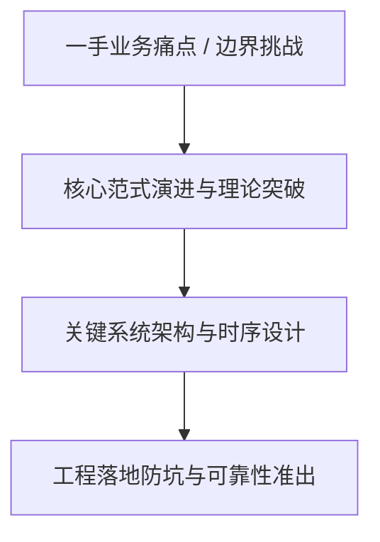
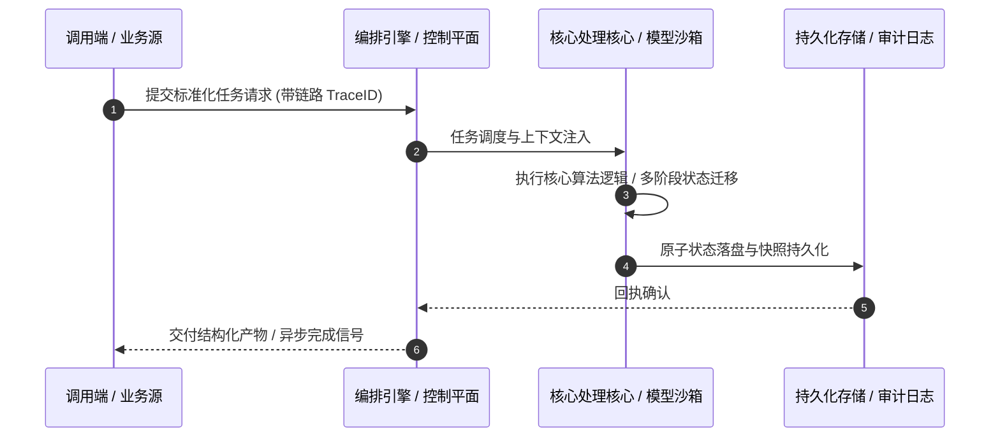

# 深度研读案：E258｜聊聊硅谷创业“修道院”HF0与OpenRouter早期故事

> **权威来源**：[liuhj60@gmail.com (硅谷101) - E258｜聊聊硅谷创业“修道院”HF0与OpenRouter早期故事](https://sv101.fireside.fm/272)  
> **发布平台**：硅谷101 (Silicon Valley 101) | **归档时间**：2026-11-10  
> **核心定位**：硬核科技访谈深度剖析与工程落地实战  
> **知识密度**：★★★★★ | **规范标准**：六段式深度学习资料规范 (Mode B)

---

## 目录
1. [一、元数据与技术背景声明](#一元数据与技术背景声明)
2. [二、全景逻辑脉络与时间轴](#二全景逻辑脉络与时间轴)
3. [三、核心机理与架构全景拆解](#三核心机理与架构全景拆解)
4. [四、工业级高危盲区与反模式警示](#四工业级高危盲区与反模式警示)
5. [五、实战落地工程载荷（配置与协议）](#五实战落地工程载荷配置与协议)
6. [六、准出自检清单 (Pre-flight Checklist)](#六准出自检清单-pre-flight-checklist)

---

## 一、元数据与技术背景声明

### 1.1 核心痛点与问题意识
- **背景出处**：来自 **硅谷101 (Silicon Valley 101)** 发布的专业技术沉淀。
- **直击工程矛盾**：本篇深度解析在实际软件工程或前沿 AI 系统中，如何打破传统设计局限，在性能、可靠性、维护成本与业务需求之间实现高阶平衡。

---

## 二、全景逻辑脉络与时间轴



---

## 三、核心机理与架构全景拆解

### 3.1 系统拓扑与核心交互时序



### 3.2 核心技术要点精要提炼

- **深度要点 1**：HF0正在成为硅谷最难进入的“孵化器”，在旧金山的核心地带，有一栋建于1904年的大主教府邸，如今它是驻地创业加速项目HF0（Hacker Fellowship Zero）的驻扎地。HF0由Dave Fontenot创立，每年只开3期，每期只招收10个团队。入选的创业者会在这里共同度过12周封闭生活。大宅提供全包式生活服务，力图消除一切外在琐事和干扰，让创业者心无旁骛地专注于产品。 2024年秋季，Joe和他的音乐生成团队走进了这座大宅，在专注项目加速的三个月里，他们几乎没见过外面的阳光。三个月后，他的产品月收入从8万美元冲到了80万美元。Joe在HF0的期间，遇见了今年大热的OpenRouter的联合创始人Louis，他放着舒适的卧室不住，每天睡在地下室的小屋里，没人能搞懂他的作息，他走到哪里都抱着电脑，近乎狂野地YOLO代码上线。 Joe说，他在HF0最大的收获，其实不是那些增长技巧，而是一种修道院式的状态，不断做减法，聚焦最重要的那个目标，构造信念感的氛围。 本期硅谷101，我们邀请Joe来聊聊他在HF0的这段特殊经历，揭秘HF0“增长奇迹”背后的细节，以及他眼中硅谷最优秀的这批创业者，是如何工作和思考的。
- **深度要点 2**：【嘉宾】 郭靖Joe，ACE Studio创始人兼CEO，HF0 2024秋季批次成员
- **深度要点 3**：【你将听到】 02:05 硅谷最火孵化器HF0，入选率远低于YC 06:57 在旧金山豪宅里的“修道院”，学习做减法 09:43 每周仪式Demo Dinner，分享“唯一目标” 13:26 像做算法一样做增长，12周营收变10倍 17:56 增长术与道：纯靠奇技淫巧是会遇到瓶颈的 22:57 把HF0模式搬回公司，效果如何？ 33:37 当过和尚，会说中文：HF0创立者Dave其人 36:20 在地下室和OpenRouter Louis当“室友”的日子 44:44 音乐模型之战：后来者如何追赶Suno 50:28 AI音乐现状：精美有余，粗粝不足
- **深度要点 4**：【新播客：消费101】 《消费101》 是《硅谷101》团队新开设的消费垂类节目，由资深消费记者&研究员麻花担任主播，是一档提供有趣、有料、有用的消费行业观察与品牌解读的播客。每周更新，欢迎关注！
- **深度要点 5**：【硅谷101听友群】 在这里，和同好一起深聊科技、商业与未来，期待你的声音，也期待更多有趣的讨论。 扫码加入，即刻相遇！
- **深度要点 6**：【监制】 泓君 【后期】 Amei 【运营】 朱婕 【BGM】 Shark Disco by Elliot Holmes The Farmer by Fabien Tell Beco das Garrafas by El Equipo Del Norte

---

## 四、工业级高危盲区与反模式警示

> [!WARNING]
> 生产环境落地中极易忽略的隐性异常边界与高危反模式：

1. **盲区一：状态漂移与不一致性风险**
   - *现象*：高并发或异常网络中断时，由于缺乏严格的原子事务保障，可能导致本地快照与中心状态发生偏离。
   - *防御*：必须引入严格的单调版本号或基于 CAS 的幂等更新控制机制。
2. **盲区二：资源枯竭与背压穿透**
   - *现象*：上游请求突增时，未受控的深层调用会击穿线程池或内存预算，引发级联雪崩。
   - *防御*：在接入层部署严格的自适应限流、主动背压 (Backpressure) 与熔断兜底。
3. **盲区三：上下文衰减与关键断点丢失**
   - *现象*：长周期异步任务执行中，由于中间日志截断导致关键审计凭证丢失。
   - *防御*：贯穿全链路 TraceID，建立不可篡改的事件审计流水线。

---

## 五、实战落地工程载荷（配置与协议）

```yaml
# E258｜聊聊硅谷创业“修道院”HF0与OpenRouter早期故事 生产环境可靠性编排规范
runtime_spec:
  name: "pod-sv101-pipeline"
  version: "v1.0.0"
  resilience:
    circuit_breaker:
      enabled: true
      failure_rate_threshold: 30
      sliding_window_size: 50
    retry_policy:
      max_attempts: 3
      exponential_backoff: true
  telemetry:
    trace_propagation: true
    metrics_interval_seconds: 10
```

---

## 六、准出自检清单 (Pre-flight Checklist)

- [ ] **架构完备性**：核心时序与数据流转是否具备端到端可观测性？
- [ ] **容灾降级**：当依赖的下游服务超时或崩溃时，是否具备明确的兜底策略？
- [ ] **幂等自愈**：重复推送相同任务时，是否能做到零副作用幂等过滤？
- [ ] **安全护栏**：凭证管理是否杜绝明文硬编码，并具备最小权限隔离？
