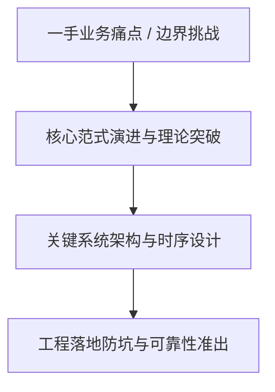
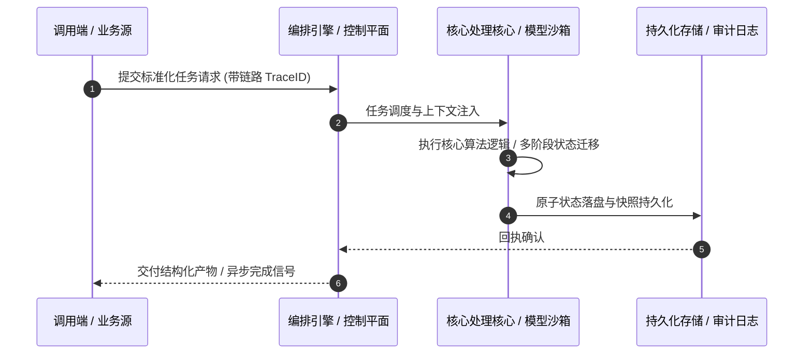

# 深度研读案：E259｜机械神教与反人性策略：华尔街量化巨头的AI之路

> **权威来源**：[liuhj60@gmail.com (硅谷101) - E259｜机械神教与反人性策略：华尔街量化巨头的AI之路](https://sv101.fireside.fm/273)  
> **发布平台**：硅谷101 (Silicon Valley 101) | **归档时间**：2026-11-23  
> **核心定位**：硬核科技访谈深度剖析与工程落地实战  
> **知识密度**：★★★★★ | **规范标准**：六段式深度学习资料规范 (Mode B)

---

## 目录
1. [一、元数据与技术背景声明](#一元数据与技术背景声明)
2. [二、全景逻辑脉络与时间轴](#二全景逻辑脉络与时间轴)
3. [三、核心机理与架构全景拆解](#三核心机理与架构全景拆解)
4. [四、工业级高危盲区与反模式警示](#四工业级高危盲区与反模式警示)
5. [五、实战落地工程载荷（配置与协议）](#五实战落地工程载荷配置与协议)
6. [六、准出自检清单 (Pre-flight Checklist)](#六准出自检清单-pre-flight-checklist)

---

## 一、元数据与技术背景声明

### 1.1 核心痛点与问题意识
- **背景出处**：来自 **硅谷101 (Silicon Valley 101)** 发布的专业技术沉淀。
- **直击工程矛盾**：本篇深度解析在实际软件工程或前沿 AI 系统中，如何打破传统设计局限，在性能、可靠性、维护成本与业务需求之间实现高阶平衡。

---

## 二、全景逻辑脉络与时间轴



---

## 三、核心机理与架构全景拆解

### 3.1 系统拓扑与核心交互时序



### 3.2 核心技术要点精要提炼

- **深度要点 1**：华尔街最低调、最赚钱的那一批量化交易巨头，也是这一轮AI浪潮里囤算力、抢人才、投资AI实验室最凶猛的那一批。 他们不靠市场趋势赚钱，而是靠波动和速度在毫秒间争夺价差。和大家印象中西装革履的金融人士并不一样，这些公司里的人可能是一群数学家、物理学家，他们把市场当成一个纯粹的客观的自然现象来研究，寻找其中的规律。他们信奉“肉身苦弱，机械飞升”，不愿让个人主观判断干预模型。也正因如此，算力成了他们最重要的运营开支之一。 本期硅谷101播客，我们邀请到两位来自量化巨头XTX Markets、DRW内部的研究者，揭秘AI量化的底层逻辑，探究这个行业能不能被AI改变、会怎么样被AI改变。 我们聊到了很多有意思的观点，比如说，通用大模型的突飞猛进，并没有从根本上改变量化模型。因为市场是一个高维、连续、难以完全定义的不可观察系统，比自然语言要复杂得多。嘉宾们认为，量化模型可能更接近是FSD或机器人模型。量化模型和AI前沿实验室的进化策略也完全不同，AI Lab会把所有的算力和人才集中押注在一起，让模型一代比一代更聪明；但量化模型的策略是分散化的，需要永远尝试新的东西，做出完全不一样的模型，相互补充，形成组合。 而最大的不同，可能是金融行业对风险和纪律的敬畏。保证活下去，活得足够长，这是一个比赚钱更重要的问题。最终我们发现，表面上，量化交易公司几乎都变成了大大小小的AI实验室，华尔街和硅谷在抢同一批人才、同一批芯片，界限似乎正在消失。但不同的底层逻辑，仍然塑造了两个行业截然不同的风格与气质。
- **深度要点 2**：【嘉宾】 Atlas Wang，XTX Markets研究总监，德州大学奥斯汀分校终身副教授 Wei Wu，初创公司联合创始人，曾任职于DRW、亚马逊及学术机构
- **深度要点 3**：嘉宾以个人身份参与本期分享，所表达观点仅代表个人，不代表 XTX Markets，DRW 或其他任职机构的立场。分享内容仅供交流讨论，不构成投资建议。
- **深度要点 4**：【你将听到】 量化生意 07:25 量化交易进化史：从“速度派”到“模型派” 13:29 不存在FOMO，量化投资和主观投资都在拥抱AI 17:24 科普：系统化交易，量化交易，α稀缺，过拟合 23:07 “中频看趋势，高频看波动” 25:37 做市商简史和XTX Markets的算力信仰 31:21 算力军备竞赛：科技公司讲叙事，量化公司算ROI 34:37 隔行如隔山：通用大模型为什么看不懂市场行情 38:00 量化公司护城河：infra＞数据＞模型 41:33 模型足够聪明就能赚到钱吗，中间还有这些gap 45:45 数据飞轮为何在金融领域失效了？ 48:59 量化模型更接近FDS而不是大语言模型 53:19 回测：赚钱的策略，就是好策略吗？ 01:00:54 金融领域的reward，必须放在统计学层面 01:04:48 创业公司的机会&edge
- **深度要点 5**：量化模型 01:09:48 一个吃市场数据的world model 01:17:12 策略趋同与人机分歧：模型、策略还是交易直觉？ 01:18:47 量化研究员≠擅长炒股，多为理工科背景 01:20:49 如何验证AI量化策略真的有效？ 01:23:19 为什么量化需要硬核科学研究者？ 01:26:25 量化公司的创新动机与Ensemble逻辑 01:31:55 量化策略亏损时，研究员什么时候该动手？ 01:35:48 生成式AI没有改写量化，市场高维连续信号需要Encoding 01:44:34 金融RSI的困境：模型在追赶一个不断变化的市场
- **深度要点 6**：硅谷与华尔街 01:48:18 心态差异背后：是否被RSI卷进自动化闭环 01:50:32 嘉宾从AI reseach到金融量化的亲身经历 01:52:11 量化研究员的“品味”是什么？ 01:56:35 AI工具人人可用后，新人门槛反而更高 02:00:12 黑盒量化模型，如何让人放心 02:03:58 好的量化公司先要活得长，理想的策略反人性 02:06:51 为什么回测需要很长时间？黑天鹅与风险管理 02:11:46 市场动荡会影响量化吗？好的策略更追求市场中性 02:15:35 量化与主观之间：AI Native投资的中间地带 02:20:46 AI交易工具：信号一旦卖给很多人就不存在了 02:24:04 散户会更活跃，但散户没有edge 02:25:48 就业选择：AI lab VS 量化公司，哪个更赚钱？

---

## 四、工业级高危盲区与反模式警示

> [!WARNING]
> 生产环境落地中极易忽略的隐性异常边界与高危反模式：

1. **盲区一：状态漂移与不一致性风险**
   - *现象*：高并发或异常网络中断时，由于缺乏严格的原子事务保障，可能导致本地快照与中心状态发生偏离。
   - *防御*：必须引入严格的单调版本号或基于 CAS 的幂等更新控制机制。
2. **盲区二：资源枯竭与背压穿透**
   - *现象*：上游请求突增时，未受控的深层调用会击穿线程池或内存预算，引发级联雪崩。
   - *防御*：在接入层部署严格的自适应限流、主动背压 (Backpressure) 与熔断兜底。
3. **盲区三：上下文衰减与关键断点丢失**
   - *现象*：长周期异步任务执行中，由于中间日志截断导致关键审计凭证丢失。
   - *防御*：贯穿全链路 TraceID，建立不可篡改的事件审计流水线。

---

## 五、实战落地工程载荷（配置与协议）

```yaml
# E259｜机械神教与反人性策略：华尔街量化巨头的AI之路 生产环境可靠性编排规范
runtime_spec:
  name: "pod-sv101-pipeline"
  version: "v1.0.0"
  resilience:
    circuit_breaker:
      enabled: true
      failure_rate_threshold: 30
      sliding_window_size: 50
    retry_policy:
      max_attempts: 3
      exponential_backoff: true
  telemetry:
    trace_propagation: true
    metrics_interval_seconds: 10
```

---

## 六、准出自检清单 (Pre-flight Checklist)

- [ ] **架构完备性**：核心时序与数据流转是否具备端到端可观测性？
- [ ] **容灾降级**：当依赖的下游服务超时或崩溃时，是否具备明确的兜底策略？
- [ ] **幂等自愈**：重复推送相同任务时，是否能做到零副作用幂等过滤？
- [ ] **安全护栏**：凭证管理是否杜绝明文硬编码，并具备最小权限隔离？
