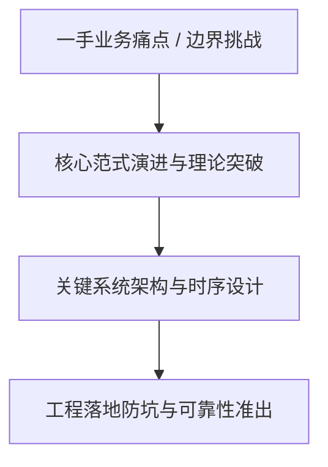
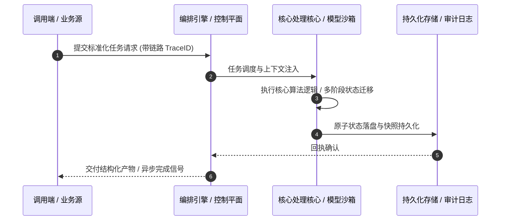

# 深度研读案：E260｜黄仁勋归来之际，深聊英伟达、CoreWeave和算力信用市场

> **权威来源**：[liuhj60@gmail.com (硅谷101) - E260｜黄仁勋归来之际，深聊英伟达、CoreWeave和算力信用市场](https://sv101.fireside.fm/274)  
> **发布平台**：硅谷101 (Silicon Valley 101) | **归档时间**：2026-11-25  
> **核心定位**：硬核科技访谈深度剖析与工程落地实战  
> **知识密度**：★★★★★ | **规范标准**：六段式深度学习资料规范 (Mode B)

---

## 目录
1. [一、元数据与技术背景声明](#一元数据与技术背景声明)
2. [二、全景逻辑脉络与时间轴](#二全景逻辑脉络与时间轴)
3. [三、核心机理与架构全景拆解](#三核心机理与架构全景拆解)
4. [四、工业级高危盲区与反模式警示](#四工业级高危盲区与反模式警示)
5. [五、实战落地工程载荷（配置与协议）](#五实战落地工程载荷配置与协议)
6. [六、准出自检清单 (Pre-flight Checklist)](#六准出自检清单-pre-flight-checklist)

---

## 一、元数据与技术背景声明

### 1.1 核心痛点与问题意识
- **背景出处**：来自 **硅谷101 (Silicon Valley 101)** 发布的专业技术沉淀。
- **直击工程矛盾**：本篇深度解析在实际软件工程或前沿 AI 系统中，如何打破传统设计局限，在性能、可靠性、维护成本与业务需求之间实现高阶平衡。

---

## 二、全景逻辑脉络与时间轴



---

## 三、核心机理与架构全景拆解

### 3.1 系统拓扑与核心交互时序



### 3.2 核心技术要点精要提炼

- **深度要点 1**：算力市场的“定心丸”，他回来了。 11月23日，黄仁勋回归英伟达重新出任CEO，英伟达股价开盘上涨30%，并带动美国AI市场短暂复苏；与英伟达关系密切的NeoCloud公司CoreWeave、Nebius、IREN股价也一度飙升超过20%。 为什么英伟达和黄仁勋能够牵动万亿AI基建信用链？在他不在的日子里，资本市场在怕什么？CoreWeave的股价为什么在今年坐上了过山车？如果数据中心项目延期，金融风险由谁来承担？ 本期《硅谷101》录制于11月17日英伟达发布第三季度财报的当晚，我们邀请Anoris Capital创始人兼CEO、长期研究信用市场的Maggie Wang，以及在科技公司从事数据中心规划和能源策略的Yixing Xu（徐熠兴），从金融与能源两个角度拆解这场AI建设热潮：钱从哪里来，钱够不够，卡点在哪里，风险在哪里？ 节目中，Maggie Wang将今年定义为“AI债券元年”，AI数据中心和算力融资对信用市场仍是新课题，定价机制还不完善。也正因如此，黄仁勋和英伟达的支持与增信，成为了一个重要的信号。 黄仁勋回归了，但万亿AI基建的真正考验，才刚刚开始。
- **深度要点 2**：【主播】 Yiwen，硅谷101主持人 泓君，硅谷101创始人，播客主理人
- **深度要点 3**：【嘉宾】 Dr. Yixing Xu（徐熠兴），前微软数据中心规划与能源战略专家 Maggie Wang，Anoris Capital（安先资本）创始人及CEO，前花旗全球结构性信贷与私募信贷研究主管
- **深度要点 4**：嘉宾以个人身份参与本期分享，所表达观点仅代表个人，分享内容仅供交流讨论，不构成投资建议。
- **深度要点 5**：【你将听到】 英伟达：从芯片供应商到融资支持者 03:56 黄仁勋离职，为什么牵动AI基建市场？ 08:24 土地、机房与GPU：英伟达支持的不同资产 11:28 股权投资、算力承购与担保 17:43 英伟达如何撬动信贷市场 20:26 数据中心的通电难关
- **深度要点 6**：CoreWeave股价过山车，债权人在担心什么？ 24:09 单季支出与经营现金流的75亿美元之差 29:09 债券抛售，市场在担心什么？ 32:58 CoreWeave：Neocloud融资的风向标

---

## 四、工业级高危盲区与反模式警示

> [!WARNING]
> 生产环境落地中极易忽略的隐性异常边界与高危反模式：

1. **盲区一：状态漂移与不一致性风险**
   - *现象*：高并发或异常网络中断时，由于缺乏严格的原子事务保障，可能导致本地快照与中心状态发生偏离。
   - *防御*：必须引入严格的单调版本号或基于 CAS 的幂等更新控制机制。
2. **盲区二：资源枯竭与背压穿透**
   - *现象*：上游请求突增时，未受控的深层调用会击穿线程池或内存预算，引发级联雪崩。
   - *防御*：在接入层部署严格的自适应限流、主动背压 (Backpressure) 与熔断兜底。
3. **盲区三：上下文衰减与关键断点丢失**
   - *现象*：长周期异步任务执行中，由于中间日志截断导致关键审计凭证丢失。
   - *防御*：贯穿全链路 TraceID，建立不可篡改的事件审计流水线。

---

## 五、实战落地工程载荷（配置与协议）

```yaml
# E260｜黄仁勋归来之际，深聊英伟达、CoreWeave和算力信用市场 生产环境可靠性编排规范
runtime_spec:
  name: "pod-sv101-pipeline"
  version: "v1.0.0"
  resilience:
    circuit_breaker:
      enabled: true
      failure_rate_threshold: 30
      sliding_window_size: 50
    retry_policy:
      max_attempts: 3
      exponential_backoff: true
  telemetry:
    trace_propagation: true
    metrics_interval_seconds: 10
```

---

## 六、准出自检清单 (Pre-flight Checklist)

- [ ] **架构完备性**：核心时序与数据流转是否具备端到端可观测性？
- [ ] **容灾降级**：当依赖的下游服务超时或崩溃时，是否具备明确的兜底策略？
- [ ] **幂等自愈**：重复推送相同任务时，是否能做到零副作用幂等过滤？
- [ ] **安全护栏**：凭证管理是否杜绝明文硬编码，并具备最小权限隔离？
