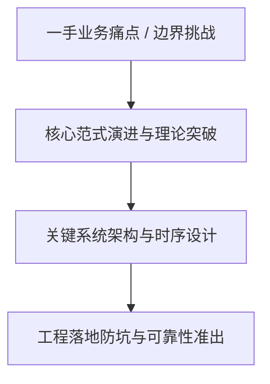
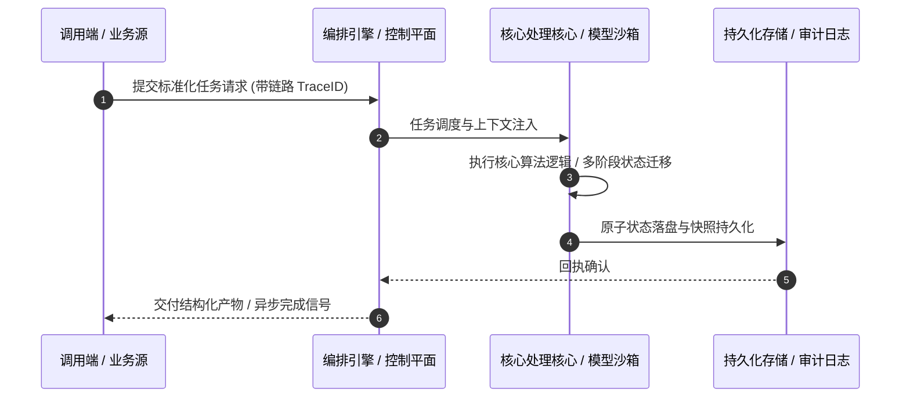

# 深度研读案：E261｜表演有效、组团出海，韩国美妆如何抢占美国市场？

> **权威来源**：[liuhj60@gmail.com (硅谷101) - E261｜表演有效、组团出海，韩国美妆如何抢占美国市场？](https://sv101.fireside.fm/275)  
> **发布平台**：硅谷101 (Silicon Valley 101) | **归档时间**：2026-11-27  
> **核心定位**：硬核科技访谈深度剖析与工程落地实战  
> **知识密度**：★★★★★ | **规范标准**：六段式深度学习资料规范 (Mode B)

---

## 目录
1. [一、元数据与技术背景声明](#一元数据与技术背景声明)
2. [二、全景逻辑脉络与时间轴](#二全景逻辑脉络与时间轴)
3. [三、核心机理与架构全景拆解](#三核心机理与架构全景拆解)
4. [四、工业级高危盲区与反模式警示](#四工业级高危盲区与反模式警示)
5. [五、实战落地工程载荷（配置与协议）](#五实战落地工程载荷配置与协议)
6. [六、准出自检清单 (Pre-flight Checklist)](#六准出自检清单-pre-flight-checklist)

---

## 一、元数据与技术背景声明

### 1.1 核心痛点与问题意识
- **背景出处**：来自 **硅谷101 (Silicon Valley 101)** 发布的专业技术沉淀。
- **直击工程矛盾**：本篇深度解析在实际软件工程或前沿 AI 系统中，如何打破传统设计局限，在性能、可靠性、维护成本与业务需求之间实现高阶平衡。

---

## 二、全景逻辑脉络与时间轴



---

## 三、核心机理与架构全景拆解

### 3.1 系统拓扑与核心交互时序



### 3.2 核心技术要点精要提炼

- **深度要点 1**：在现在这个节骨点，如果问韩国出口全球、销量暴涨的东西，除了三星和海力士的储存芯片外还有什么，那韩妆一定会有姓名。 早在2025年，韩国的美妆出口额就超过了美国，成为仅次于法国的全球第二大美妆出口国，到了2026年，这个势头变得愈发不可收拾。过去两年，它在全球的销售额增长了一倍多，美国有近25%的家庭都用过韩妆产品，今年前三季度出口英国的韩妆还同比增长了1.8倍。 平价的定位是韩妆席卷全球的原因之一，消费者会惊叹于只花一两百人民币，或者10-50美元，就能买来看上去很有科技含量的PDRN、蜗牛粘液。但韩妆风靡的背后，其实是韩国一整套配合出海的机制，比如品牌对营销概念的手拿把掐，韩国想要用文化出海辅助产品出海的国策，以及，他们上下游全产业链的组团式出海。
- **深度要点 2**：【嘉宾】 寒笑 Ray， “ 美妆内行人 Beauty Insiders”创始主编 Kelly，商业科技博主，“ 凯莉彭 ”账号主理人
- **深度要点 3**：【你将听到】 韩妆格局大盘点：谁在火，谁在卖 03:35 韩妆涌进美国线下店，甚至Costco都出了韩妆大套装 07:05 1/4的美国家庭买过韩妆产品 11:30 1.0韩妆 vs 2.0韩妆，渠道、特色大不同 16:04 现在的韩妆甚至不需要消费者记住品牌名 20:38 新三富 vs 旧三富，韩妆背后的新造富神话 25:17 当年的特殊事件，反而成了新三富崛起的天时地利人和
- **深度要点 4**：研发制造、零售营销和出海贸易，韩妆链条大拆解 27:10 中国、韩国和欧美的美妆，研发流程大不同 35:06 全球美妆ODM双巨头科丝美诗和科玛，能力早不止研发制造了 44:39 消费者都想美妆产品有功效，而韩妆最擅长“表演有功效” 51:37 韩式审美为什么强，根源可能是岛国倒逼的审美内卷 58:16 从Gentle Monster和K-pop，看韩国人表达美玩得有多花 01:01:07 K-pop辅助韩妆出海，已经纳入“国策”了 01:07:46 韩国最大的美妆全球贸易商，居然是做半导体起家的 01:13:15 “韩版屈臣氏”Olive Young，成了外国人接触韩妆的重要渠道
- **深度要点 5**：唱唱反调：韩妆出海那么强，隐患又在哪儿？ 01:20:53 擅长放烟花的韩妆，已经有太多品牌死在了沙滩上 01:26:40 中国美妆，可以对未来更有信心一点
- **深度要点 6**：K-Beauty Goes Global: Sales Surge 53% as Korean Innovation Reshapes Beauty Growth -

---

## 四、工业级高危盲区与反模式警示

> [!WARNING]
> 生产环境落地中极易忽略的隐性异常边界与高危反模式：

1. **盲区一：状态漂移与不一致性风险**
   - *现象*：高并发或异常网络中断时，由于缺乏严格的原子事务保障，可能导致本地快照与中心状态发生偏离。
   - *防御*：必须引入严格的单调版本号或基于 CAS 的幂等更新控制机制。
2. **盲区二：资源枯竭与背压穿透**
   - *现象*：上游请求突增时，未受控的深层调用会击穿线程池或内存预算，引发级联雪崩。
   - *防御*：在接入层部署严格的自适应限流、主动背压 (Backpressure) 与熔断兜底。
3. **盲区三：上下文衰减与关键断点丢失**
   - *现象*：长周期异步任务执行中，由于中间日志截断导致关键审计凭证丢失。
   - *防御*：贯穿全链路 TraceID，建立不可篡改的事件审计流水线。

---

## 五、实战落地工程载荷（配置与协议）

```yaml
# E261｜表演有效、组团出海，韩国美妆如何抢占美国市场？ 生产环境可靠性编排规范
runtime_spec:
  name: "pod-sv101-pipeline"
  version: "v1.0.0"
  resilience:
    circuit_breaker:
      enabled: true
      failure_rate_threshold: 30
      sliding_window_size: 50
    retry_policy:
      max_attempts: 3
      exponential_backoff: true
  telemetry:
    trace_propagation: true
    metrics_interval_seconds: 10
```

---

## 六、准出自检清单 (Pre-flight Checklist)

- [ ] **架构完备性**：核心时序与数据流转是否具备端到端可观测性？
- [ ] **容灾降级**：当依赖的下游服务超时或崩溃时，是否具备明确的兜底策略？
- [ ] **幂等自愈**：重复推送相同任务时，是否能做到零副作用幂等过滤？
- [ ] **安全护栏**：凭证管理是否杜绝明文硬编码，并具备最小权限隔离？
