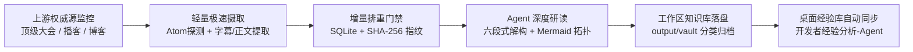

# 开发者经验分析与Agent自动化执行规范 (Agent Workflow Analysis SOP)

> **版本**：v1.0.0  
> **适用工作区**：`D:\Agent视频学习录`  
> **归档目标库**：`C:\Users\jiang\Desktop\开发经验\开发者经验分析-Agent`  
> **核心使命**：由 Agent 严格依照技术雷达工作流，对全球顶级技术峰会、硬核播客访谈与大厂工程博客进行自动化监控、去重、深度研读与知识沉淀，构建工业级开发者经验库。

---

## 目录

- [一、体系定位与核心价值](#一体系定位与核心价值)
- [二、三大内容源矩阵与采集协议](#二三大内容源矩阵与采集协议)
- [三、Agent 工作流标准化执行流程 (SOP)](#三agent-工作流标准化执行流程-sop)
- [四、产物交付结构规约 (六段式结构)](#四产物交付结构规约-六段式结构)
- [五、命名规约与双层存储架构](#五命名规约与双层存储架构)
- [六、桌面经验库同步铁律 (Desktop Sync)](#六桌面经验库同步铁律-desktop-sync)
- [七、自检清单与准出要求 (Pre-flight Checklist)](#七自检清单与准出要求-pre-flight-checklist)

---

## 一、体系定位与核心价值

本工作区是专为 **Agent 自动化执行技术雷达研读流水线** 设立的工业级作业环境。与传统人工交互式零散记录不同，本规范推行**“无感监控 -> 增量去重 -> 深度提炼 -> 双层落盘 -> 桌面同步”**的全自动闭环：



1. **破除冷启动困境**：内置结构化权威源矩阵，无需人工寻找输入源即可自动启动学习流。
2. **零带宽浪费**：大会视频长达 1 小时以上，严禁下载大视频文件，优先提取带时间戳字幕 (VTT) 或清洗后的纯净正文。
3. **结构化深度沉淀**：产物杜绝口水话，必须沉淀出架构拓扑、底层逻辑、工业高危盲区与工程落地载荷。

---

## 二、三大内容源矩阵与采集协议

| 领域编号 | 内容分类 | 覆盖范围 | 采集与提炼协议 |
| :---: | :--- | :--- | :--- |
| **01** | **顶级峰会与讲座 (Conferences)** | Strange Loop, USENIX (OSDI/NSDI), QCon/InfoQ, GOTO, YC Startup School | 监听 YouTube 官方 Channel Atom Feed，提取 CC 字幕与分段时间戳，生成架构拓扑与 DSL 模式总结 |
| **02** | **硬核播客与访谈 (Podcasts)** | Latent Space, Dwarkesh Patel, Lex Fridman, Acquired, 硅谷101 | 监听标准 RSS 2.0 Feed，提取音频直链与 Episode Notes，剖析技术演进痛点与第一手经验 |
| **03** | **大厂工程与架构博客 (Blogs)** | OpenAI, Anthropic, Netflix TechBlog, Cloudflare, Stripe Engineering, Uber | 监听 RSS/Atom 正文，解析生产级高可用、降本提效、计费系统与安全鉴权实践方案 |

---

## 三、Agent 工作流标准化执行流程 (SOP)

Agent 在本工作区中执行任务时，严格按照以下 5 步流水线自动运转：

### Step 1: 权威源矩阵扫描与探测
- 解析 `config/sources.yaml` 中启用的源，发起 HTTP 请求探测最新发布项。
- 遵循单次最大条目限制（`max_items_per_source`），防止海量数据刷爆。

### Step 2: SHA-256 增量去重校验
- 对每一个条目的 URL 计算 SHA-256 哈希值。
- 查询 `data/state_store.db`，若已存在且已完成则立即跳过，确保强幂等。

### Step 3: 内容深度清洗与提取
- 视频/播客源：解析官方字幕或音频文稿，保留时间切片。
- 工程博客源：剥离 HTML 导航、脚本与侧边栏噪点，保留高质量技术 Markdown。

### Step 4: Agent 知识深度研读与重构 (Six-Stage Synthesis)
- 结构化剖析工程痛点、架构选型、系统拓扑时序（Mermaid Sequence）、工业级踩坑点与落地代码。

### Step 5: 知识库落盘与桌面强一致同步
- 输出至工作区 `output/vault`，并调用 `sync_to_desktop.py` 自动同步至 `C:\Users\jiang\Desktop\开发经验\开发者经验分析-Agent`。

---

## 四、产物交付结构规约 (六段式结构)

所有输出文档必须严格遵从六段式组织：

1. **元数据声明 (Frontmatter)**：包含 `title`, `source_url`, `platform`, `author`, `date`, `type`, `tags`, `status`。
2. **全景逻辑脉络 (Executive Summary & Mermaid)**：使用流程图直观呈现从传统痛点到架构演进的脉络。
3. **底层机理与系统拓扑 (Mechanism & SequenceDiagram)**：使用 Mermaid 时序图解构系统交互时序与关键算法。
4. **工业级高危盲区与反模式 (Gotchas & Antipatterns)**：指出至少 3 个生产落地中的隐性暗坑（如幂等缺失、级联雪崩、监控脱节）。
5. **实战落地工程载荷 (Actionable Payloads)**：提供生产可用的配置（YAML）、Docker 或核心代码伪代码。
6. **准出自检清单 (Pre-flight Checklist)**：提供 5~8 项勾选式自检清单。

---

## 五、命名规约与双层存储架构

### 1. 桌面根目录独立直读报告
为了方便人类在桌面或 Obsidian 根目录即开即读，根目录下生成扁平化的直读文件：
`[两位数字序号]-[领域前缀]-[主题名称]-[形态标识].md`

示例：
- `01-顶级峰会-StrangeLoop-代码化鸟鸣DSL与编译器模式深度研读.md`
- `02-大厂架构-Cloudflare-托管计算工作负载认证与零信任身份置换实战.md`
- `03-大厂落地-OpenAI-Daybreak安全大模型降本96%与自动化调查实战.md`
- `04-大厂架构-Stripe-代币化计费演进困境与计量系统韧性设计解析.md`
- `05-硬核访谈-DwarkeshPatel-从AlphaFold到前沿生物AI大模型边界深度研读.md`

### 2. 专题分类目录结构
```text
topics/
├── 01-conferences-lectures/       # 顶级技术峰会与学术讲座
├── 02-podcasts-interviews/        # 硬核科技播客与前沿访谈
└── 03-engineering-blogs/          # 世界顶尖科技公司工程博客
```

---

## 六、桌面经验库同步铁律 (Desktop Sync)

> 🚨 **强制纪律**：
> `D:\Agent视频学习录` 是 Agent 自动执行流水线的加工车间；  
> `C:\Users\jiang\Desktop\开发经验\开发者经验分析-Agent` 是 Agent 为开发者输出成果的专属沉淀库。

1. 每次工作流执行结束前，必须执行同步脚本：`& "D:\PythonProject\.venv\Scripts\python.exe" sync_to_desktop.py`。
2. 保持桌面库根目录直读报告、专题分类库、总索引 `README.md` 与 Dataview 看板四位一体强一致性。

---

## 七、自检清单与准出要求 (Pre-flight Checklist)

- [ ] 是否已完整抓取并提取一手核心技术内容？
- [ ] 是否具备合法合规的 Frontmatter 元数据？
- [ ] 是否包含合法渲染的 Mermaid 图表？
- [ ] 是否剖析了真实生产环境下的高危盲区与反模式？
- [ ] 是否包含生产可复制的工程载荷与自检清单？
- [ ] 桌面沉淀库 `开发者经验分析-Agent` 是否已完成同步并更新总看板？
